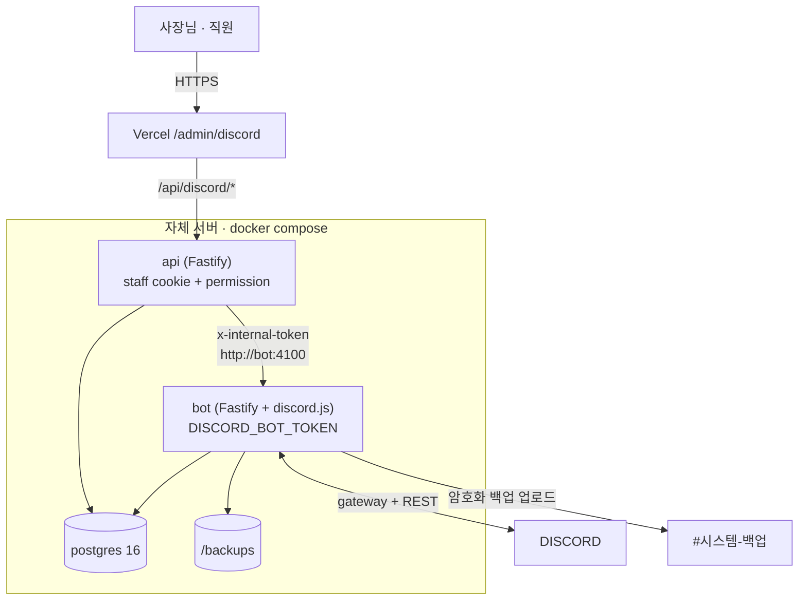

# HONJAYA — Roadmap & Task Status

Primary context source for the current work. Keep this file short (target 200–300 lines).
Write in English. UI strings stay Korean.

---

## 0. Confirmed decisions

| Area | Decision |
| --- | --- |
| Tables | 30 total. No. 1–10 = bar (`BAR`), No. 11–30 = large table (`LARGE`) |
| Points earn | 1% of paid amount, floored to integer |
| Points expiry | 3 calendar months from earn date, end of day KST |
| Points redeem | min 1,000 points, in 1,000-point increments, only when payment ≥ ₩30,000 |
| Points basis | earn = 1% of cash actually collected (after discount and point use); the ₩30,000 redeem minimum uses the amount after discount, before point deduction |
| Staff | 3 people, 3 roles: `OWNER` / `MANAGER` / `STAFF`; the role supplies defaults and the owner can override permissions per employee (`employees.permissions`) |
| Frontend origin | `https://honjaya.vercel.app` (operational) |
| API origin (target) | `https://api.honjaya-server.xyz` via Cloudflare Tunnel — **LIVE** (`/health` → db up) |
| API origin (backup) | Tailscale Funnel `https://<device>.<tailnet>.ts.net` |
| Auth transport | HttpOnly + SameSite=Lax first-party cookie via `vercel.json` rewrites for `/rest/v1/*`, `/api/staff/*`, `/api/admin/*`, `/api/guest/*` |
| Payment scope | Split / partial payment included in phase 1 |
| Tablet console | Keep and extend (not replaced) |
| Customer identity | **Phone number only** — no Kakao login, no member signup. `customers` is created at the tablet payment screen |
| Marketing channel | 문자(SMS/LMS) + 카카오 알림톡 through a provider. Default `MESSAGING_PROVIDER=dryrun` (records logs, sends nothing) |
| Marketing consent | Collected at the tablet payment screen + admin CRM page; customers can opt out via a tokenized link in every message |
| Coupons | Phone-keyed, single-use, 사장만 발급/취소, redeemed at the tablet payment screen; percent or amount with an optional 최소 결제금액 |
| Guest entry | No `?table=` needed — the root URL shows a 자리 선택 screen |
| Removed from original spec | Supabase hosted, chat, hearts, market, character, push, gift — already gone |

### Out of scope / explicitly dropped

- Supabase as the backend (self-hosted Fastify + Postgres instead).
- Real-time WebSocket (Supabase Realtime) → replaced by SSE `/api/events`.
- **Kakao login** (P4 scaffold) — dropped. Members are identified by phone number; Kakao is only a message channel.

---

## 1. Architecture

```
Guest phone / staff tablet
      │ HTTPS
      ├──────────────▶ Vercel  https://honjaya.vercel.app
      │                  │
      │                  │  vercel.json rewrite:
      │                  │    /rest/v1/*, /api/guest/*, /api/staff/*, /api/admin/*
      │                  │  → same-origin → first-party cookie (hj_guest, hj_staff)
      │                  ▼
      └──────────────▶ Cloudflare Tunnel  https://api.honjaya-server.xyz
                         │   (backup: Tailscale Funnel)
                         ▼
                 Laptop (Ubuntu 24.04)
                   api  Node/Fastify :3000
                   db   Postgres 16
```

- `/rest/v1/*` is now **same-origin** (rewritten) so the `hj_guest` cookie is sent; `src/lib/supabase.js`
  resolves the URL to `window.location.origin` in the browser.
- SSE `/api/events` stays **absolute** (`VUE_APP_SUPABASE_URL` / `VUE_APP_EVENTS_BASE_URL`) — streaming
  through a Vercel rewrite risks buffering and timeouts.
- `VUE_APP_SUPABASE_URL` may stay absolute; the browser ignores it for REST.
- `trustProxy: true` is already enabled, so `X-Forwarded-Proto` drives the `Secure` cookie flag.

---

## 2. Phase roadmap

| Phase | Scope | Status |
| --- | --- | --- |
| **P0** | Staff auth (login/logout/me/password), role permissions, admin employee API, audit log, cookie infra, deploy config, frontend login + route guard | **DONE (verified)** |
| **P1** | Table master (`bar_tables`, 30 tables: 1–10 bar / 11–30 large), admin table settings page, tablet layout driven by the master | **DONE (verified)** |
| **P2** | Guest table session cookie + per-guest attribution + order ownership (guest sees only own table sheet; staff any) | **DONE (verified)** |
| **P3** | Payment ledger (`payments`, `payment_allocations`, `refunds`), split/partial payment, refunds | **DONE (verified)** |
| **P4** | Kakao login readiness (`/api/kakao/status` + console checklist) | **DROPPED** — members are identified by phone number; the scaffold was removed in P7 |
| **P5** | Points ledger (earn / redeem / expire / adjust), FEFO deduction | **DONE (verified: smoke 169/169, lint, build)** |
| **P6** | CRM & consent (customer profile, marketing consent, visit history) | **DONE (verified: smoke 201/201, lint, build, deployed live)** |
| **P7** | Marketing & messaging (segments, campaigns, 문자/알림톡 send, opt-out link, CSV export) | **DONE (verified: smoke 242/242, lint, build, deployed live)** |
| **P8** | Revisit coupons (`coupons` table, issue/void, redemption at the tablet payment screen, admin coupon panel) | **DONE (verified: smoke 269/269, lint, build)** |
| **P9** | 직원 계정·권한 관리 (사장 전용 메뉴, 역할 + 직원별 세부 권한 override) | **DONE (verified: smoke 292/292, lint, build)** |
| **P10** | 선불권 (member-bound balance, 다음 영업일부터 사용, 모든 조건을 관리자가 설정) | **DONE (lint/build 통과, 커밋·배포 완료 — 서버 마이그레이션 대기)** |
| **P11** | 혼자야 기프티콘 (code-based single-use gift, 링크/문자 전달, 태블릿 사용) | **DONE (lint/build 통과, 커밋 완료 — 서버 마이그레이션 대기)** |
| **Ops** | Cloudflare cutover (`api.honjaya-server.xyz` live, Tailscale → backup, `vercel.json` rewrite swapped) | **DONE** |
| **P12** | Discord 통합 관리 시스템: 봇(서버 전체 관리) + 암호화 자동 백업 → Discord 업로드 + 웹 관리자 `/admin/discord` | **IN PROGRESS** — P12A~P12E 커밋 완료(`333dafa`), see §3-13 |
| **P14K** | ARC 운영 안정화 + 교육자료: 스키마 자기치유(해시 지문), 월 1회 실사 재등록 허용, 인쇄용 교육자료(오랄테스트 대비) | **DONE (code + 9/9 schema harness, 7/7 boot smoke)** |

---

## 3. P0 — Staff auth & security (DONE)

### Schema — `server/sql/staff.sql`

- `employees` — `login_id` (unique, case-insensitive), `name`, `role`, `password_hash`, `is_active`, timestamps.
- `staff_sessions` — token stored as **sha256 hash only**, `expires_at`, `revoked_at`, `ip`, `user_agent`.
- `admin_audit_logs` — `employee_id`, `action`, `target_type`, `target_id`, `detail` jsonb, `ip`.
- **Not** registered in `server/src/tables.js`, so `/rest/v1` cannot reach these tables.

### Backend

| File | Purpose |
| --- | --- |
| `server/src/auth/password.js` | scrypt hash/verify, `validatePasswordStrength` |
| `server/src/auth/cookies.js` | cookie parse/serialize (no `@fastify/cookie` dependency) |
| `server/src/auth/permissions.js` | role → permission map |
| `server/src/auth/sessions.js` | session lifecycle, cookie helpers, `createStaffGuard(perm)` |
| `server/src/auth/rateLimit.js` | login attempt limiter (5 / 10 min per `loginId|ip`) |
| `server/src/auth/audit.js` | audit writer (never throws) |
| `server/src/routes/api/staffAuth.js` | `/api/staff/login`, `/logout`, `/me`, `/password` |
| `server/src/routes/api/admin.js` | employee CRUD + audit log list |

Guards implemented:

- Constant-time dummy hash for unknown `loginId` (no user enumeration).
- Last `OWNER` cannot be demoted or deactivated.
- `MANAGER` cannot create or assign `OWNER`.
- Nobody can deactivate themselves.
- Role change / deactivation revokes that employee's live sessions.
- Password change revokes other sessions but keeps the current one.

### Roles & permissions

| Role | Label | Highlights |
| --- | --- | --- |
| `OWNER` | 사장 | everything + `menu.price`, `employee.manage`, `point.adjust`, `settings.manage` |
| `MANAGER` | 매니저 | orders, payment/refund, sales/crm/audit view |
| `STAFF` | 알바 | order accept/status, table manage, payment, `menu.toggle` |

Role defaults are defined in `server/src/auth/permissions.js`. Since P9 the owner can override them per employee
(`employees.permissions`); `OWNER` accounts always keep the full role defaults.

### Frontend

| File | Purpose |
| --- | --- |
| `src/lib/api.js` | `apiGet/apiPost/apiPatch`, `credentials: "include"`, sends `apikey` |
| `src/lib/staffAuth.js` | reactive auth state, `staffLogin/staffLogout`, `hasPermission` |
| `src/views/Staff/StaffLoginView.vue` | Korean dark-gold login page |
| `src/router/index.js` | `/staff/login`, `meta.requiresStaff` on `/admin` + `/tablet` |
| `src/layouts/AdminLayout.vue` | staff name + role chip, logout button |
| `src/views/Tablet/TabletAdminView.vue` | header logout button |
| `vercel.json` | rewrite `/api/staff/(.*)`, `/api/admin/(.*)` → `https://bar.taild838e4.ts.net` (swap to `honjaya-server.xyz` at P7) |
| `vue.config.js` | `devServer.proxy` for the same two paths |

### Ops

- `server/scripts/seed-staff.mjs` + `npm run staff:seed` — idempotent OWNER bootstrap,
  `--reset-password` flag, random password printed once.
- `server/deploy/README.md` — Cloudflare Tunnel plan, `10-1` cookie section, `7-1` staff account section.
- `server/README.md` — folder map, env table, API table updated.

### Verification

Temporary script `server/scripts/tmp-verify-p0.mjs` (already deleted) ran against embedded Postgres
on port 55441: **44/44 checks passed**, including `/rest/v1` read/write regression.

Not yet run (project Rule 15 — only on request): `pnpm lint`, `pnpm build`, `npm run smoke`.

---

## 3-1. P1 — Table master (DONE)

### Schema — `server/sql/tables.sql`

- `bar_tables` — `table_number` int PK (1..999), `zone` (`BAR` | `LARGE`), `seat_capacity`, `display_name`,
  `is_active`, `sort_order`, `note`, timestamps.
- Seed: `generate_series(1,30)` with `on conflict (table_number) do nothing`
  → 1–10 `BAR` / 4 seats, 11–30 `LARGE` / 8 seats, `sort_order = table_number`, `display_name` empty.
- Reachable **read-only** through `/rest/v1` (public tablet/guest reads); writes are blocked server-side.

### Backend

| File | Purpose |
| --- | --- |
| `server/sql/tables.sql` | new table + constraints + 30-row seed |
| `server/scripts/apply-schema.mjs` | applies `tables.sql` **before** `events.sql` (trigger needs the table) |
| `server/sql/events.sql` | `bar_tables` added to the trigger target list; `row_id` falls back to `table_number` |
| `server/src/tables.js` | `bar_tables: { pk: "table_number", readOnly: true }` + `assertWritable()` |
| `server/src/routes/rest.js` | insert/update/delete call `assertWritable()` → **403** |
| `server/src/routes/api/admin.js` | `GET /api/admin/tables` (table.view), `PATCH /api/admin/tables/:tableNumber` (**settings.manage = OWNER**), `TABLE_UPDATE` audit log |

### Frontend

| File | Purpose |
| --- | --- |
| `src/lib/supabase.js` | `barTables` / `bar_tables` in `TABLE_MAPS`, `FIELD_MAPS` for snake_case |
| `src/lib/tableMaster.js` | `fetchTableMaster`, `subscribeTableMaster`, `updateTableMaster`, `tableLabelOf`, `zoneLabel` |
| `src/views/Tablet/TabletAdminView.vue` | `tableLayoutList` merges the master + latest order sheets → empty tables render as non-interactive `손님 없음` cards |
| `src/views/Admin/AdminTableView.vue` | new page: 30-row table list, zone/seat/name/sort/active/note editor |
| `src/router/index.js` / `src/layouts/AdminLayout.vue` | `/admin/tables` route + `테이블 관리` menu |

### Verification

- `server/scripts/tmp-verify-tables.mjs` (temporary, deleted): embedded Postgres 55434 → **32/32 passed**
  (seed 30 rows, `/rest/v1` read OK + POST/PATCH/DELETE 403, admin GET 401→200, PATCH validation 400s,
  404, audit log, STAFF 403 on PATCH, SSE `bar_tables` change frame).
- `npm run smoke` → **55/55 passed** (no regression).
- `pnpm lint` / `pnpm build`: not run yet (project Rule 15 — only on request).

---

## 3-2. P2 — Guest table session & order ownership (DONE)

Decision: **table-level shared visibility** (every guest at the table sees the table's orders, unchanged UX)
**plus per-guest attribution** ("누가 어떤 주문했는지") and server-side ownership enforcement.
`order_sheet_members` from the original draft is **not** needed — one session row per device covers it.

### Schema — `server/sql/guest.sql`

- `guest_sessions` — `id` uuid PK, `table_number`, `order_sheet_id`, `nickname`, `token_hash` (unique, sha256),
  `user_agent`, `ip`, `created_at`, `last_seen_at`, `expires_at`, `revoked_at` + 3 indexes.
- `orders.guest_session_id uuid` (nullable) + `orders.guest_nickname text` + index.
- Applied **after** `schema.sql`/`staff.sql` in `server/scripts/apply-schema.mjs`.

### Backend

| File | Purpose |
| --- | --- |
| `server/src/auth/guestSessions.js` | create/resolve/update/revoke/purge session, `hj_guest` cookie (HttpOnly, Lax, 12h) |
| `server/src/guest.js` | `openTableOrderSheet` (transaction: validate `bar_tables`, reuse OPEN sheet or create), `readOrderSheetById`, `readTableEntryInfo`, `validateGuestNickname` (Hangul = 2 units, max 16) |
| `server/src/routes/api/guest.js` | `GET /api/guest/table`, `POST/GET/PATCH /api/guest/session`, `POST /api/guest/logout` |
| `server/src/auth/restIdentity.js` | `resolveRestIdentity` → staff / guest / anon, plus the scoping policy |
| `server/src/routes/rest.js` | all 4 handlers apply the scope; closing an `order_sheets` row revokes that sheet's guest sessions |
| `server/src/config.js` | `guestCookieName: "hj_guest"`, `guestSessionHours: 12` |

Scope policy on `/rest/v1`:

| Table | guest | anon |
| --- | --- | --- |
| `orders` | SELECT forced `order_sheet_id = eq.<own>`; INSERT forces `order_sheet_id`/`table_number`/`display_name`/`guest_session_id`/`guest_nickname`/`status='REQUESTED'`; PATCH/DELETE 403 | 403 |
| `order_sheets` | SELECT forced `id = eq.<own>`; INSERT 403; PATCH whitelist (`table_nickname`, `total_amount`, `order_count`, `latest_*`, `updated_at`); DELETE 403 | 403 |
| `active_order_sheets` | SELECT forced `order_sheet_id = eq.<own>`; writes 403 | 403 |
| `products`, `categories`, `bar_tables`, `app_settings`, `counters` | unchanged (public) | unchanged |

### Frontend

| File | Purpose |
| --- | --- |
| `src/lib/guestAuth.js` | reactive guest state, `startGuestSession`, `loadGuestSession`, `updateGuestNickname`, `endGuestSession`, `saveEntryInfo` (sessionStorage `userEntryInfo` incl. `guestSessionId`) |
| `src/lib/supabase.js` | REST is same-origin now; `EVENTS_URL` kept absolute; `orders` FIELD_MAPS gained `guestSessionId` / `guestNickname` |
| `src/views/HomeView.vue` | entry screen calls `POST /api/guest/session` (no more client-side sheet creation); label **주문자 닉네임** |
| `src/views/User/UserMainView.vue` | **내 닉네임** editor → `PATCH /api/guest/session`; restores the cookie session on mount |
| `src/views/User/UserOrderHistoryView.vue` | per-order nickname chip + **내 주문** badge (`order.guestSessionId === mine`) |
| `src/views/Tablet/TabletAdminView.vue` | order cards show `guestNickname` next to the sheet id |
| `vercel.json` / `vue.config.js` | rewrites + dev proxy for `/rest/v1` and `/api/guest` |

### Deploy checklist (server first, then Vercel)

1. `docker compose --profile tools build migrate && docker compose run --rm migrate` (applies `guest.sql`)
2. `docker compose up -d --force-recreate api`
3. Vercel redeploy (new `vercel.json` rewrites must exist before the frontend is used)

### Verification (local)

- `npm run smoke` → **75/75** (P2 added 20 checks: staff login, guest join, forced columns, guest 403s, sheet scoping).
  - The `reserve-sequence` check now reads the live counter first, because `POST /api/guest/session` consumes
    one sequence number before that test runs.
- `pnpm lint` → clean (auto-formatted `src/lib/guestAuth.js`, `UserOrderHistoryView.vue`).
- `pnpm build` → OK (only the pre-existing 722 KiB entrypoint size warning).

---

## 3-3. P3 — Payment ledger, split/partial payment, refunds (DONE)

Decision: a **real ledger** replaces the single `order_sheets.payment_status` flag. One `payments` row per
(payment method × payer), so split-by-method and split-by-person are the same mechanism.
All three modes are supported: **partial payment**, **split by method**, **split by person**.

Money rules (server-authoritative):

- `order_sheets.original_amount` = gross, `discount_total` / `discounts` = server-recomputed discounts,
  `total_amount` = payable (`original − discount`). The client's `totalAmount` is **ignored**.
- `order_sheets.paid_amount` = **net settled** (paid − refunded). `payment_status` is derived:
  `UNPAID` (0) / `PARTIAL` (<total) / `COMPLETED` (>=total).
- `remaining = total_amount − paid_amount`; overpay is rejected with 400, paying a closed sheet with 409.
- Refunds reverse allocations newest-first and re-derive the sheet state (a fully refunded sheet returns to
  `UNPAID`). The sheet `status` (OPEN/CLOSED) is **not** reopened by a refund.

### Schema — `server/sql/payments.sql`

- `payments` — `id` text PK, `order_sheet_id`, `table_number`, `business_date date` (KST 15:00 rollback),
  `amount > 0`, `method`, `payer_label`, `guest_session_id`, `employee_id` → `employees(id) on delete set null`,
  `employee_name`, `memo`, `occurred_at`, `created_at` + 3 indexes.
- `payment_allocations` — `payment_id` → `payments on delete cascade`, `order_id` (nullable), `amount` + 2 indexes.
- `refunds` — `payment_id` → `payments on delete restrict`, `order_sheet_id`, `business_date`, `amount > 0`,
  `method`, `reason`, `employee_id`/`employee_name`, `occurred_at` + 3 indexes.
- `order_sheets.paid_amount integer not null default 0`.
- Idempotent legacy backfill: existing `payment_splits` jsonb → `payments` rows (`legacy_<sheet>_<nn>`), a
  `legacy_<sheet>` fallback from `payment_method`, then `paid_amount = total_amount` for `COMPLETED` sheets.

### Backend

| File | Purpose |
| --- | --- |
| `server/src/payments.js` | `toBusinessDate`, `computeDiscountTotal`, `normalizeEntries`, `allocatePaymentAmount` (FIFO by order creation, leftover → `order_id null`), `syncSheetPaymentState` (keeps `payment_splits`/`payment_method`/`paid_at` compatible), `getSheetLedger`, `recordPayment`, `refundPayment`, `listPayments` |
| `server/src/routes/api/payments.js` | `GET /api/payments`, `GET /api/payments/sheet/:orderSheetId`, `POST /api/payments`, `POST /api/payments/:paymentId/refund` (+ audit `payment.record` / `payment.refund`) |
| `server/src/app.js` | registers the payment routes |
| `server/scripts/apply-schema.mjs` | applies `sql/payments.sql` after `guest.sql` |

Permissions: `payment.view` (STAFF+), `payment.manage` (STAFF+), `payment.refund` (MANAGER+).
The ledger tables are **not** in `server/src/tables.js`, so `/rest/v1/payments` returns 404 — writes only via `/api/payments`.

### Frontend

| File | Purpose |
| --- | --- |
| `src/lib/payments.js` | method labels (7 methods + `MIXED`), `fetchSheetLedger`, `fetchPaymentLedger`, `recordSheetPayment`, `refundSheetPayment` |
| `src/lib/orderSheet.js` | `completeOrderSheetPayment` now delegates to `POST /api/payments` (splits → entries with `method`/`payerLabel`/`amount`) |
| `src/views/Tablet/TabletAdminView.vue` | 결제 모달: 결제된 금액 / 이번 결제 필요 금액, per-row method select + 결제자 label + 남은 금액, "일부 결제 처리" confirm; 결제 완료 모달 shows 이번 결제 / 남은 금액; table detail shows 결제된 금액 + 남은 금액 |
| `src/views/Admin/AdminPaymentHistoryView.vue` | 결제 원장 section (총 결제 / 총 환불 / 순 매출, method chips, ledger table, 환불 기록) + 환불 modal (`payment.refund` only) |
| `src/lib/supabase.js` | `order_sheets` FIELD_MAP gained `paidAmount` |
| `vercel.json` / `vue.config.js` | `/api/payments` rewrite + dev proxy |

### Deploy checklist (server first, then Vercel)

1. `docker compose --profile tools build migrate && docker compose run --rm migrate` (applies `payments.sql` + backfill)
2. `docker compose up -d --force-recreate api`
3. Vercel redeploy (new `/api/payments` rewrites)

### Verification (local)

- `npm run smoke` → **109/109** (P3 added 34 checks: partial payment, ledger read, overpay 400, split payers, close,
  409 on closed sheet, partial refund, over-refund 400, ledger totals, staff-only 401s).
- `pnpm lint` → clean (auto-formatted `src/lib/payments.js`, `AdminPaymentHistoryView.vue`, `TabletAdminView.vue`).
- `pnpm build` → OK (only the pre-existing bundle-size warning).

### Known nuances

- Second-round billing: the tablet sends the sheet's current `total_amount` as `originalAmount`, so an earlier
  discount is baked into `original_amount` and `discount_total` resets unless new discounts are added. `due` is
  always `total_amount − paid_amount`, so amounts stay consistent.
- `payment_splits` keeps **gross** per-method totals (refunds are tracked in `refunds`, mirrored in `paid_amount`).
  Legacy views filter `paymentStatus === 'COMPLETED'`, so a refunded sheet drops out of their revenue.

---

## 3-4. P4 — Kakao login readiness (DROPPED)

Originally a P4 scaffold (`/api/kakao/status`, `KAKAO_*` env, console checklist). **Removed in P7.**

- Why: Kakao login bought nothing here — guests are bar customers, not app users. A phone number is the
  natural identity and it is already collected at the tablet payment screen (P5/P6).
- Kakao is still used as a **message channel** (알림톡), which needs only a 카카오 채널 + 발신 프로필,
  not a login app.
- Deleted: `server/src/kakao.js`, `server/src/routes/api/kakao.js`, `KAKAO_*` env keys, the
  `/api/kakao/(.*)` rewrite/proxy, and the P4 smoke checks (replaced by a "404" regression check).
- `customers.kakao_id` column is kept but **unused** (no migration risk); nothing reads or writes it.

---

## 3-5. P5 — Points ledger (DONE)

Points are **staff-driven**: there is no customer login yet, so the tablet payment screen asks for the guest's phone
number, looks up (or creates) the customer, then applies earn/redeem inside the same `POST /api/payments`
transaction. Identity is the phone number — there is no customer login (Kakao was dropped in P7), so the ledger
does not change.

### Schema — `server/sql/points.sql`

- `customers` — minimal profile keyed by the normalized mobile number (`phone` unique) plus `name`, `memo`.
  P6 adds `kakao_id`, marketing consent and visit history to this same row.
- `point_ledger` — one row per movement. `points` is signed (`+` EARN, `−` REDEEM / EXPIRE / ADJUST), `balance_after`
  is stored for audit, `expires_at` exists only on EARN lots. Balance = `sum(points)`.
- `point_allocations` — which earn lot a debit consumed (FEFO: soonest expiry first), so expiry runs per lot.
- `order_sheets.points_used` — points consumed by that sheet, kept separate from `discount_total`.

Applied by `npm run db:apply` (and the `migrate` container) after `payments.sql`.

### Rules

`POINT_RULES` in `server/src/points.js` is the single source of truth and is mirrored to the UI through
`GET /api/points/rules`.

| Rule | Value |
| --- | --- |
| Earn | 1% of the cash actually collected (`floor`), after discount and point deduction |
| Expiry | same day 3 calendar months later, 23:59:59 KST |
| Redeem minimum | 1,000P |
| Redeem step | 1,000P |
| Redeem payment floor | ₩30,000, measured **after discount, before point deduction** |
| Refund clawback | `floor(refund × 1%)`, capped by the current balance |

### Backend

- `server/src/points.js` — `getCustomerPoints`, `earnPointsForPayment`, `redeemPointsForPayment`, `adjustPoints`,
  `clawbackForRefund`, `listPointLedger`, the FEFO allocator and lazy expiry (`materializeExpiry` writes the missing
  `EXPIRE` rows on read — no cron).
- `server/src/businessDay.js` — `toBusinessDate` extracted from `payments.js` so point rows inherit the payment's
  business date (15:00 KST rollover).
- `server/src/payments.js` — `recordPayment` accepts `customerPhone` / `customerName` / `pointsUsed` and runs
  discount → redeem → insert payments → earn (basis = `entryTotal`). `refundPayment` claws back earned points inside a
  `points_clawback` savepoint, so a points problem can never block the refund.
- `server/src/routes/api/points.js` — `GET /api/points/rules`, `GET|POST /api/points/customer` (`point.use`),
  `GET /api/points/ledger` (`customer.view`), `POST /api/points/adjust` (`point.adjust`, OWNER only). Every other
  movement happens inside `POST /api/payments`, so no extra endpoint can move points.
- Audit: `customer.upsert`, `point.adjust`, and `payment.record` (now carrying `pointsUsed` / `pointsEarned` /
  `customerPhone`, plus `pointsReclaimed` on refunds).

### Frontend

- `src/lib/points.js` — API wrappers, `maxUsablePoints`, phone formatting/normalizing, entry labels.
- `src/views/Tablet/TabletAdminView.vue` — the payment modal gains a 포인트 section (phone lookup → balance →
  사용 포인트 with a 최대 button → earn preview); the 결제 금액 math subtracts used points, and the completion modal
  shows 사용 / 적립 / 남은 포인트.
- `src/views/Admin/AdminPointHistoryView.vue` (`/admin/points`, "포인트 관리") — phone/date filters, summary cards
  (적립 / 사용 / 소멸 / 조정 / 미사용 잔액), customer card with memo, OWNER-only 조정 form, and the ledger table.

### Deploy checklist

1. `docker compose --profile tools build migrate && docker compose run --rm migrate` (applies `points.sql`)
2. `docker compose up -d --force-recreate api`
3. Vercel redeploy (new `/api/points` rewrites)

### Verification (local)

- `npm run smoke` (server, embedded Postgres) — **169/169 통과**, including the new `points ledger (P5)` block:
  rules, permission matrix (STAFF can read/adjust → 403), earn on a 50,000원 card payment, redemption guards
  (미만 / 단위 / 3만원 미만 / 잔액 초과 / 전화번호 없음), 성공 사용 (3,000P + 37,000원 카드), ledger totals,
  refund clawback, and lazy expiry writing an `EXPIRE` row.
- `pnpm lint` — 통과 (3 files auto-fixed).
- `pnpm build` — 성공 (기존 bundle-size warning 3건만 존재).

### Known nuances

- Expiry only materializes when the customer is read or a balance changes; the liability card filters
  `expires_at > now()`, so totals stay correct without a cron.
- A refund claws back earned points but **does not restore points that were spent** on that payment
  (open question #5).
- The phone number is the only customer key right now — a typo creates a second customer row instead of merging.

---

## 3-6. P6 — CRM foundation: profile, marketing consent, visit history (DONE)

Scope decision: build the CRM base **without Kakao login** (user choice). Member identity is the phone number;
`kakao_id` exists in the table but is never read or written.

### Schema — `server/sql/crm.sql`

- `customers` += `marketing_consent boolean not null default false`, `marketing_consent_at timestamptz`,
  `nickname text not null default ''`, `kakao_id text` (+ partial unique index `customers_kakao_id_key`).
- `payments` += `customer_id text references customers(id) on delete set null` (+ `payments_customer_idx`).
- Backfill: `payments.customer_id` filled once from `point_ledger` for P5-era rows.
- **No denormalized counters**: 방문 횟수 = `count(distinct payments.business_date)`, 누적 결제 =
  `sum(payments.amount) - sum(refunds.amount)`, 최근 방문 = `max(payments.occurred_at)`.

### Backend

- `server/src/crm.js` — `listCustomers` (검색/동의 필터/정렬 + 전체 요약), `getCustomerProfile`
  (고객 + 방문 이력), `updateCustomer` (이름·닉네임·메모·동의), `grantMarketingConsent` (결제 트랜잭션용).
  보유 포인트는 로트 기준(미만료 적립 − 사용) 합계.
- `server/src/routes/api/crm.js` — `GET /api/crm/customers`, `GET /api/crm/customers/:id`,
  `PATCH /api/crm/customers/:id`, guard `crm.view` (MANAGER+), audit `customer.update` / `customer.consent`.
- `server/src/payments.js` — `recordPayment` now stores `payments.customer_id` and accepts
  `marketingConsent` (켜기만; 철회는 관리자 화면). Response `customer.marketingConsent`.
- `vercel.json` + `vue.config.js` — `/api/crm` rewrite/proxy.

### Frontend

- `src/lib/crm.js` — API wrappers + formatters (reuses `formatPointValue`, `getPaymentMethodLabel`).
- `src/views/Admin/AdminCustomerView.vue` at `/admin/customers` ("고객 관리"): 검색·동의 필터·정렬,
  요약 카드(전체/동의/미사용 포인트), 고객 목록, 상세(요약·동의 토글·이름/닉네임/메모 저장·방문 이력),
  "포인트 관리에서 보기" 이동. AdminLayout 메뉴에 `고객 관리` 추가.
- `AdminPointHistoryView` accepts `?phone=` so the CRM detail page can deep-link.
- Tablet payment modal: 마케팅 수신 동의 checkbox (전화번호 입력 시) → `marketingConsent` 전송.

### Deploy checklist

1. `docker compose --profile tools build migrate && docker compose run --rm migrate` (applies `crm.sql`)
2. `docker compose up -d --build api` — **`--build` 필수** (`--force-recreate` 만으로는 코드가 반영되지 않음)
3. Vercel redeploy (new `/api/crm` rewrites)

### Verification (local & live)

- `npm run smoke` — **201/201 통과** (P6 블록 36개 추가: 목록/권한(STAFF 403, 비로그인 401)/상세 방문 이력/
  정보 수정/동의 설정·필터·요약/결제 시 동의 저장/`payments.customer_id` 연결/`customer.consent` 감사 로그).
- `pnpm lint` — 통과 (3 files auto-fixed). `pnpm build` — 성공.
- 라이브: `crm.sql` 6개 적용 → `GET /api/crm/customers` 200(사장 쿠키) / 401(미로그인),
  `https://honjaya.vercel.app/api/crm/customers` rewrite 동작 확인.

---

## 3-7. P7 — Marketing & messaging: segments, campaigns, 문자/알림톡 (DONE)

Goal: message customers whose phone number we already have, **without Kakao login**. A phone number is the member
identity; Kakao is only a delivery channel for 알림톡.

### Schema — `server/sql/marketing.sql`

- `customers` += `marketing_opt_out_token text` (+ partial unique index), `marketing_consent_source text`
  (`TABLET` / `ADMIN` / `CUSTOMER`). Tokens backfilled with `md5(...)` (no pgcrypto dependency).
- `message_campaigns` — `title`, `body`, `channel` (`SMS`/`LMS`/`ALIMTALK`), `segment`, `target_count`,
  `sent_count`, `failed_count`, `status` (`DRAFT`/`SENT`/`CANCELED`), `provider`, `provider_note`,
  `created_by` → `employees`, timestamps.
- `message_logs` — per-recipient row (`PENDING`/`SENT`/`FAILED`/`SKIPPED`), `attempts`, `error`,
  `provider_message_id`; unique partial index `(campaign_id, customer_id)` so re-sends are idempotent.

### Backend

- `server/src/messaging.js` — provider adapter. `MESSAGING_PROVIDER=dryrun` (default, returns a `dry-…` id and
  sends nothing), `none` (feature off), `solapi` (real `POST /messages/v4/send`, HMAC-SHA256 auth header, auto
  SMS/LMS by body length, `ALIMTALK` → 503 until a 카카오 채널 + 발신 프로필 exists).
- `server/src/marketing.js` — `SEGMENTS` (`CONSENTED` / `DORMANT` 60d / `NEW` 30d / `POINTS` ≥1,000P),
  `AUDIENCE_CTE` (consent + valid phone 9–11 digits + points balance + visit stats), `previewAudience`,
  `createCampaign`, `materializeLogs`, `deliverPending`, `refreshCampaignStats`, `sendCampaign`, `retryCampaign`,
  `unsubscribeByToken`, `exportAudienceCsv` (UTF-8 BOM, Korean headers). Placeholders `#{이름}` / `#{포인트}`
  are resolved at send time.
- `server/src/routes/api/marketing.js` — 12 endpoints. Staff: settings/segments/audience/campaigns/CSV guarded by
  `marketing.view` (MANAGER+); create/send/retry by `marketing.manage` (OWNER). Public:
  `GET/POST /api/marketing/unsubscribe` (token in the query/body, masked phone in the response).
- `server/src/crm.js` — consent writes now also stamp `marketing_consent_source` and mint the opt-out token.
- Kakao login removed end-to-end (see §3-4).

### Frontend

- `src/views/Admin/AdminMarketingView.vue` at `/admin/marketing` ("마케팅"): dry-run banner, segment summary cards,
  composer (segment/channel/title/body with placeholder hints), audience preview, campaign table (상세/발송/재발송),
  recipient log list, CSV download.
- `src/views/User/UnsubscribeView.vue` at `/unsubscribe?token=…` — public opt-out page (Korean, masked phone).
- `src/lib/marketing.js` + `apiText()` in `src/lib/api.js` (non-JSON responses for the CSV).
- `vercel.json` / `vue.config.js` — `/api/kakao` rewrite/proxy replaced by `/api/marketing`.

### Rules

- Only `marketing_consent = true` **and** a 9–11 digit phone number is a valid recipient.
- A campaign becomes `SENT` after any send attempt; failed rows stay `FAILED` and `retry` resets them to `PENDING`.
  Resending a `SENT` campaign returns **409**.
- Every message body gets the opt-out link `https://honjaya.vercel.app/unsubscribe?token=…` appended.

### Deploy checklist

1. Backup: `BACKUP_DIR=/home/bar/backups-honjaya ./deploy/backup-db.sh`
2. `docker compose --profile tools build migrate && docker compose run --rm migrate` (applies `marketing.sql`)
3. `docker compose up -d --build api` — **`--build` 필수**
4. Vercel redeploy (new `/api/marketing` rewrites + the `/unsubscribe` page)

### Verification (local)

- `npm run smoke` — **242/242 통과** (P7 block ~40 checks: dry-run defaults, 권한 403/401, segment counts,
  audience preview, 201 create, send 2/0, resend 409, retry, log detail, `marketing.send` audit row, opt-out
  token → 미동의 전환, CSV BOM + Korean header; plus a "카카오 로그인 제거 → 404" regression check).
- Live (2026-11-21): `marketing.sql` 8개 적용 → `/api/marketing/settings` 200(사장 쿠키) / 401(미로그인),
  `/api/marketing/segments` 200, `/api/kakao/status` 404, 잘못된 수신거부 토큰 404,
  `https://honjaya.vercel.app/api/marketing/*` rewrite 동작 + `/unsubscribe` 페이지 200.

### 실사용 모드 전환 (dry-run → real send)

- **Root cause of "still 검수용 모드"**: `server/docker-compose.yml` listed each api env var explicitly and
  never forwarded `MESSAGING_*` / `SOLAPI_*`; `server/.env` is `.dockerignore`d so it never lands in the
  image. Keys added to `.env` were therefore invisible and the container kept falling back to `dryrun`.
- Fix: `api.environment` now passes `MESSAGING_PROVIDER` / `MESSAGING_SENDER` / `SOLAPI_API_KEY` /
  `SOLAPI_API_SECRET` (plus `LOG_LEVEL`, which was documented but never forwarded either).
- `messagingReadiness()` in `server/src/messaging.js` → `{provider, dryRun, credentialsReady, missing[]}`
  with **env names only** (never values). `GET /api/marketing/settings` exposes `provider`, `sender`,
  `senderText`, `credentialsReady`, `missing`; `server/src/index.js` logs the same verdict at boot
  (`[messaging] 실사용 모드` / `검수용 모드` / `발송 설정 누락: …`).
- Admin banner now has 4 states: dry-run + keys present (⇒ flip `MESSAGING_PROVIDER`), dry-run + missing
  names listed, real mode but missing names (error), real mode ready (shows the sender number).
- **Vercel needs no change** — sending is server-side. Verified against the live bundle
  `app.*.js`: `VUE_APP_SUPABASE_URL=https://api.honjaya-server.xyz`, discord invite present, `supabase.co`
  and `*.ts.net` absent.

---

## 3-8. P8 — Revisit coupons (DONE)

Goal: the bar can hand a specific customer a coupon ("다음에 오시면 5,000원 할인") and the tablet redeems it at payment.
Coupons belong to a **phone number** (same identity as points/CRM), so no login is required.

### Schema — `server/sql/coupons.sql`

- `public.coupons` — `code` (unique), `customer_id` → `customers`, `phone`, `title`, `discount_type`
  (`AMOUNT` / `PERCENT`), `discount_value`, `min_amount` (default 0), `status`
  (`ACTIVE` / `USED` / `EXPIRED` / `VOID`), `expires_at`, `used_at`, `used_payment_id`, `used_order_sheet_id`,
  `issued_by` → `employees`, `memo`, timestamps. Indexes: `(phone, status)`, `(status, expires_at)`, `code`.
- Registered in `apply-schema.mjs` (applied last). **Not** added to `server/src/tables.js` (that registry governs
  `/rest/v1` only).

### Backend

- `server/src/coupons.js` — `mapCoupon` (derives `ACTIVE` → `EXPIRED` on read, exposes `usable`),
  `discountAmountOf` (`PERCENT` → `min(base, floor(base*min(value,100)/100))`, `AMOUNT` → `min(base, value)`),
  `issueCoupon`, `voidCoupon`, `listCustomerCoupons`, `listUsableCouponsByPhone`, `redeemCouponsForPayment`.
- `server/src/routes/api/crm.js` — `GET /api/crm/customers/:phone/coupons` (`crm.view`),
  `POST … /coupons` (`marketing.manage`, audit `coupon.issue`), `POST … /coupons/:id/void` (`marketing.manage`,
  audit `coupon.void`).
- `server/src/routes/api/payments.js` — `GET /api/payments/coupons?phone=&baseAmount=` (`payment.view`);
  `POST /api/payments` passes `couponIds` through.
- `server/src/payments.js` — `recordPayment({ couponIds })`: resolves the coupons server-side, adds them to
  `discounts` as `{type:'COUPON'}`, marks them `USED` with the payment/order-sheet ids, returns `coupons: [...]`.
  Rejects coupons without `originalAmount` (400) or without a resolvable `customerId` (400); an already used
  coupon → **409**.

### Frontend

- Tablet payment modal (`TabletAdminView.vue`): 휴대폰 번호로 재방문 쿠폰 조회 → checkbox list → summary/receipt rows
  → `completePayment` sends `couponIds` (discount math mirrored client-side **for display only**).
- `AdminCustomerView.vue`: coupon issue form (제목/할인 유형/값/최소 금액/유효기간) + coupon list with 취소.
- `src/lib/payments.js` (`couponIds`, `fetchUsableCoupons`), `src/lib/orderSheet.js` (`couponIds` passthrough),
  `src/lib/crm.js` (coupon constants + CRUD + `formatCouponDiscount`).

### Rules

- A coupon is single-use: `ACTIVE → USED` in the same transaction as the payment. `USED` / `VOID` / `EXPIRED`
  coupons never show up in `GET /api/payments/coupons`.
- Coupon discount is capped by the remaining base amount and is added **after** manual discounts.
- Refunds do not restore coupons (sheet totals/discounts are not reverted on refund either).
- Issuing/voiding is 사장 전용 (`marketing.manage`).

### Deploy checklist

1. Backup: `BACKUP_DIR=/home/bar/backups-honjaya ./deploy/backup-db.sh`
2. `npm run db:apply` (or the `migrate` profile) — applies `coupons.sql`
3. `docker compose up -d --build api` — **`--build` 필수** (새 `/api/crm/customers/:phone/coupons`, `/api/payments/coupons`)
4. Vercel redeploy (tablet 쿠폰 UI + 관리자 고객 화면)

### Verification (local)

- `npm run smoke` — **269/269 통과** (P8 block ~27 checks: issue → 201, 권한 403/401, 목록, 결제 조회 할인 금액,
  쿠폰 결제 → `discount_total`/`total_amount`/`discounts` 기록, 쿠폰 → 결제·주문서 연결, 재사용 409, 취소 후 상태,
  취소/사용 쿠폰 조회 제외, 전화번호 없는 쿠폰 결제 400).
- `pnpm lint` / `pnpm build` 통과.

---

## 3-9. UI polish & tablet fixes (DONE)

- **Admin dark theme** — `AdminPointHistoryView.vue`, `AdminCustomerView.vue`, `AdminMarketingView.vue` were still on the
  light palette; they now share the dark admin tokens. `.admin-layout` sets `color-scheme: dark`, and
  `AdminTableView.vue` `select option` is dark so dropdowns stop rendering white-on-white.
- **Root table picker** — `HomeView.vue` shows a 자리 선택 screen (zone groups 바 / 큰 테이블, 52px tiles,
  loading / error / empty states) when the URL has no `?table=`. Choosing a table calls `/api/guest/session` and
  `router.replace` strips `?table=`, so 손님 can just open the root URL. A "다른 자리 선택" button returns to the picker.
- **테이블별 매출** — `AdminSalesView.vue` aggregates payments per table (매출 / 건수 / 객단가) for the selected range.
- **Tablet payment bug fixes** — `completePayment` recalculates the sheet totals before billing (the modal used to send
  a stale amount that the server then wrote into `order_sheets.total_amount`), and "테이블 정리 완료" now deletes the
  `active_order_sheets` row (`finalizeOrderSheetCleanup({ orderSheetId, tableNumber })`).
- **Open follow-ups** from the tablet flow audit (not fixed yet): duplicate order on `UserCartView` retry (no
  idempotency), unguarded `guardOrderSheetUsable()` calls outside `try` (silent no-op / endless loading), guest
  session recovery only on `UserMainView`, order history total includes `CANCELLED`, fetch failures rendering as an
  empty menu, tablet order list filtered by business-day start breaking midnight-spanning sheets, 주문 관리
  showing only `REQUESTED` with no undo, `buildLatestSheetMap` possibly picking a `CLOSED` sheet.

---

## 3-10. P9 — 직원 계정·권한 관리 (DONE)

Goal: the owner needs one screen to create staff accounts, reset passwords, switch roles, and fine-tune what each
person can see — without touching SQL.

### Model

- Two layers: `employees.role` (`OWNER` / `MANAGER` / `STAFF`) supplies a default permission set, and the optional
  `employees.permissions text[]` overrides it per employee.
- `permissions = null` → role defaults; `permissions = '{}'` → **no** permissions; `permissions = '{...}'` → exactly
  those.
- **OWNER is always forced to role defaults** — the API stores `null` and ignores overrides. This is the
  lockout-prevention mechanism (nobody can strip `employee.manage` from the last owner), so the owner account can
  never lock itself out.
- Unknown permission strings are silently dropped and the array is normalised to `ALL_PERMISSIONS` order, so the UI
  can never persist a permission the server does not check.
- Any change to `permissions` revokes all sessions of that employee (the caller keeps their own), so the tablet must
  log in again — the UI warns "다시 로그인해야 합니다".
- A `MANAGER` can be *granted* `employee.manage`, but still cannot create or modify an `OWNER` account (403).

### Schema — `server/sql/staff.sql`

- `alter table public.employees add column if not exists permissions text[];` (idempotent, safe to re-apply).

### Backend

- `server/src/auth/permissions.js` — `PERMISSION_LABELS` (Korean), `PERMISSION_GROUPS` (주문 / 테이블 / 결제·포인트 /
  고객·마케팅 / 메뉴·매장 / 직원·보안), `ALL_PERMISSIONS`, `normalizePermissions()`, `permissionsForEmployee()`
  (the single source of truth for the effective set), `permissionCatalog()`.
- `server/src/auth/sessions.js` — `resolveStaffSession` selects `e.permissions` and resolves the effective set through
  `permissionsForEmployee()`; `toPublicEmployee` exposes both `permissions` (effective) and `permissionOverrides`
  (raw, `null` when defaulted).
- `server/src/routes/api/admin.js` — `GET /api/admin/permissions` (catalogue for the checkbox UI);
  `POST/PATCH /api/admin/employees` accept `permissions` (`undefined` = untouched, `null` = reset, array = set);
  OWNER targets are rejected for non-OWNER callers; every permission change is audited.
- `server/src/routes/api/staffAuth.js` — login `select` includes `permissions`.

### Frontend

- `src/lib/adminEmployees.js` — API helper (`fetchPermissionCatalog`, `fetchEmployees`, `createEmployee`,
  `updateEmployee`, `resetEmployeePassword`).
- `src/views/Admin/AdminEmployeeView.vue` — 사장 전용 page: 직원 추가 form, 직원 목록 (아이디 / 이름 / 역할 / 권한 /
  상태 / 마지막 로그인 / 관리), 인라인 수정 card (이름·역할·계정 상태·권한 체크박스 그룹), 비밀번호 변경 card.
- `src/router/index.js` — `/admin/employees` with `meta: { permission: "employee.manage" }`; `beforeEach` reads
  `to.matched` meta and redirects to `/admin/dashboard` when the permission is missing.
- `src/layouts/AdminLayout.vue` — every menu item now carries a `permission`, and only `visibleMenuList` is rendered,
  so 매출 / 결제 / 포인트 / CRM / 마케팅 / 메뉴 / 테이블 / 직원 관리 / 태블릿 entries appear per employee.

### Deploy checklist

1. `npm run db:apply` on the server — adds `employees.permissions` **and** re-applies `coupons.sql`.
   **Mandatory before the API rebuild**: the API selects `employees.permissions`, so without the column every staff
   login and session resolution fails.
2. `docker compose up -d --build api`.
3. Vercel redeploy (the frontend is served from `dist/`).

### Verification (local)

- `npm run smoke` — **292/292 통과** (P9 block ~23 checks: catalogue 200/401, create with a bogus permission dropped,
  effective vs override, 부여된 권한만 200 / 나머지 403, 권한 변경 시 기존 세션 401, `null` reset 복원, OWNER 강제
  기본값, 위임받은 매니저의 사장 계정 403 / 직원 생성 200).
- `pnpm lint` / `pnpm build` 통과.

---

## 3-11. P10 — 선불권 (DONE — code complete, pending deploy)

Goal: a member (phone-keyed `customers`) pre-pays at the bar and spends the balance on later visits. Every condition
an operator may tune — price, credited amount, validity, minimum spend, per-use limits, usable days/time — is a row
in an admin-managed plan table, so no code change is needed to add a new 선불권.

### Rules (proposed defaults)

- **Member-bound**: a pass belongs to `customers.id` (phone). Not transferable, no code/link (that is P11).
- **Next visit only**: usable from the **business day after the purchase business day**
  (`usable_from_business_date = purchase_business_date + 1`). A purchase at 00:30 still belongs to the previous
  business day (15:00 KST cut-over), so the same night stays blocked.
- **Balance type (confirmed by owner)**: amount-based **only**. Count-based packages (e.g. "하이볼 5잔") are not
  implemented here — they are covered by P11 `ITEM` gift certificates.
  `price` (paid) may differ from `face_value` (credited) — bonus allowed,
  e.g. pay ₩100,000 → ₩120,000 balance.
- Expiry is lazy (same as points): an `EXPIRE` ledger row is written when a pass is read after `expires_at`.
- Redemption = payment method `PREPAID` on the tablet payment screen (cash was collected at purchase, so it is
  **not** a discount). Refunding that payment restores the balance.
- **Points (decided)**: earn 1% of `price` **at sale time** only. `PREPAID` amounts are excluded from the point base
  when a bill is paid with the pass, so the same money never earns twice. There is no `payments` row at sale time
  (`payments.order_sheet_id` is `not null`), so the earn is written with `payment_id = null`.
- Sale is recorded as `prepaid_transactions(PURCHASE)` with the payment method; the sales screen shows
  판매(입금) / 사용(매출 인식) / 미사용 잔액(부채) separately so revenue is not double counted.

### Schema — `server/sql/prepaid.sql`

- `prepaid_plans` (admin templates): `id`, `name`, `price`, `face_value`, `validity_months` (0 = 무제한),
  `min_payment_amount`, `min_use_amount`, `max_use_percent`, `usable_days smallint[]`,
  `usable_from_time` / `usable_to_time`, `usable_from_next_visit boolean default true`,
  `allow_multiple boolean`, `is_active`, `sort_order`, `memo`, timestamps.
- `prepaid_passes`: `id`, `code`, `customer_id` → `customers`, plan snapshot (`plan_id`, `plan_name`, `face_value`),
  `balance`, `price_paid`, `purchased_at`, `purchase_business_date`, `usable_from`, `expires_at`,
  `status` (`ACTIVE` / `EXHAUSTED` / `EXPIRED` / `VOID`), `payment_method`, `memo`,
  `issued_by_employee_id/name`.
- `prepaid_transactions`: `id`, `pass_id`, `customer_id`, `entry_type`
  (`PURCHASE` / `USE` / `ADJUST` / `EXPIRE` / `RESTORE`), `amount` (signed), `balance_after`, `payment_id`,
  `refund_id`, `order_sheet_id`, `business_date`, `employee_id/name`, `reason`, `occurred_at`.
- Registered in `apply-schema.mjs` right after `coupons.sql`. **Not** in `server/src/tables.js`.

### Backend

- `server/src/prepaid.js` — `mapPlan`, `mapPass` (lazy expire), `passBlockedReason`, `maxUsableAmount`, `listPlans`,
  `createPlan`, `updatePlan`, `expireDuePasses`, `issuePass`, `listCustomerPasses`, `listPasses`, `getPassLedger`,
  `readPassForPayment`, `applyPassUse`, `restorePassForRefund`, `adjustPass`, `voidPass`, `prepaidSummary`.
- `server/src/routes/api/prepaid.js` — `GET/POST /api/prepaid/plans`, `PATCH /api/prepaid/plans/:planId`,
  `POST /api/prepaid/passes`, `GET /api/prepaid/customer?phone=`, `GET /api/prepaid/passes`,
  `GET /api/prepaid/passes/:id/ledger`, `POST /api/prepaid/passes/:id/adjust`, `POST /api/prepaid/passes/:id/void`,
  `GET /api/prepaid/summary`.
- `server/src/payments.js` — `PREPAID` in `PAYMENT_METHODS`, `prepaidPassId` per split (same-pass rows merged),
  validation before insert, `applyPassUse` inside the payment transaction, earn base excludes `PREPAID`, and
  `restorePassForRefund` on refund.
- Audit actions: `prepaid.plan.create` / `prepaid.plan.update` / `prepaid.issue` / `prepaid.adjust` / `prepaid.void`.

### Permissions (`server/src/auth/permissions.js`, new group 선불권·기프티콘)

- `prepaid.view` — MANAGER default (admin screens).
- `prepaid.issue` — STAFF default (staff must sell and redeem at the bar; unlike coupons, which stay owner-only).
- `prepaid.manage` — OWNER only (plan CRUD, manual adjust, void).

### Frontend

- `src/lib/prepaid.js` — API helper + labels/formatters + `computePassMaxUsable` (mirrors the server rule).
- `TabletAdminView.vue` — 결제 수단에 `선불권` 추가(결제 분할별 선불권 선택 + 사용 가능 금액 안내) + 헤더 `선불권 판매` 버튼.
- `src/components/tablet/PrepaidSellModal.vue` — 판매(발급) 모달. `TabletAdminView.vue`가 이미 5.4k 줄이라 분리했습니다.
- `src/views/Admin/AdminPrepaidView.vue` — 탭 1 상품 설정(CRUD), 탭 2 발급·잔액 현황(검색/조정/취소/원장).
- `AdminCustomerView.vue` — 고객 상세에 보유 선불권 카드.
- `AdminSalesView.vue` — 선불권 판매/사용/미사용 잔액 카드.
- `AdminLayout.vue` + `router/index.js` — `/admin/prepaid` with `meta.permission = "prepaid.view"`.

### Verification

- `pnpm lint` — PASS (fixed one unused import in `TabletAdminView.vue`).
- `pnpm build` — PASS (32 s; only the pre-existing bundle-size warnings).
- `node --check` on all new/changed server files — PASS.
- Smoke test — **not run** (needs a live DB). Run on the server after migrate: plan CRUD 403/200, issue,
  사용 가능일 이전 400, 잔액 차감 + `payment_splits` `PREPAID`, 잔액 부족 400, `min_payment_amount` 400,
  `max_use_percent` 400, 사용 요일 위반 400, 만료 `EXPIRE`, 환불 시 잔액 복원, adjust/void 권한 403, summary 합계.

### Deploy checklist

1. `deploy/backup-db.sh`
2. `docker compose run --rm --build migrate` — applies `prepaid.sql`
3. `docker compose up -d --build api`
4. Vercel redeploy

Status: frontend committed + pushed (`7a2edf4`) → Vercel auto-deploy. Server steps 1–3 still pending (run on the host).

---

## 3-12. P11 — 혼자야 기프티콘 (DONE — code complete, lint/build PASS, pending migrate)

Goal: a customer buys a HONJAYA-branded gift certificate at the bar and sends it to someone (카톡 링크 / 문자).
The recipient shows the code; staff redeems it at the tablet payment screen.

### Rules (proposed defaults)

- **Code-based, not member-bound**: whoever holds the code redeems it. Buyer/recipient are metadata only.
- **Single use, one shot**: the whole face value is consumed at once, no partial balance (that is what 선불권 is for).
  When the face value exceeds the bill, the remainder is forfeited — the UI must warn before redeeming.
- Two kinds, one table: `ITEM` (menu exchange; face value = menu price snapshot at issue) and `AMOUNT` (금액권).
- Usable immediately (no next-visit rule) until `expires_at`; expiry lazy like points.
- Redemption uses payment method `GIFT_CERT` (distinct from the legacy external `GIFT_CARD`).
- Delivery: (1) copy link for 카톡, (2) 문자 via `messaging.js#sendOne` (Solapi / dryrun), (3) staff reads the code.
- Public card page `/gift/:code` — no login; codes are random 10-char tokens; response is minimal
  (name, face value, theme, message, recipient name, expiry, status) and rate limited against enumeration.
- Sale recorded at issue time (`price_paid`), revenue recognised at redemption.

### Schema — `server/sql/gifts.sql`

- `gift_products` (templates): `id`, `name`, `kind` (`ITEM` / `AMOUNT`), `product_id`, `product_name`,
  `face_value`, `price`, `validity_days` (0 = 무제한, default 90), `min_payment_amount`,
  `theme` (`SOLO_NIGHT` / `CHEERS` / `BIRTHDAY` / `THANKS`), `message_max_length` (default 100),
  `is_active`, `sort_order`, `memo`.
- `gift_certificates`: `id`, `code` (unique), `gift_product_id`, snapshots (`product_name`, `kind`, `face_value`,
  `theme`), `status` (`ACTIVE` / `USED` / `EXPIRED` / `VOID`), `price_paid`, `payment_method`, `buyer_customer_id`,
  `buyer_name`, `buyer_phone`, `recipient_name`, `recipient_phone`, `message`, `purchased_at`, `business_date`,
  `expires_at`, `used_at`, `used_order_sheet_id`, `used_payment_id`, `forfeited_amount`,
  `redeemed_by_employee_id/name`, `sent_at`, `sent_channel`, `voided_at`, `voided_reason`,
  `sold_by_employee_id/name`.
- Registered in `apply-schema.mjs` after `prepaid.sql`.

### Backend

- `server/src/gifts.js` — `listGiftProducts` / product CRUD (`createGiftProduct`, `updateGiftProduct`), `issueGift`
  (code generation `G-XXXXXXXX` with collision retry), `lookupGiftCode`, `lookupPublicGift`, `listGifts`,
  `listCustomerGifts`, `giftSummary`, `sendGiftMessage`, `resendGift`, `voidGift`, `expireDueGifts` (lazy),
  `readGiftForPayment` / `applyGiftUse` / `restoreGiftForRefund` (payment layer).
- `server/src/routes/api/gifts.js` — staff: `GET|POST /api/gifts/products`, `POST /api/gifts/products/:productId`,
  `POST /api/gifts`, `GET /api/gifts/lookup`, `GET /api/gifts`, `GET /api/gifts/customer/:customerId`,
  `GET /api/gifts/summary`, `POST /api/gifts/:giftId/resend`, `POST /api/gifts/:giftId/void`;
  public: `GET /api/public/gifts/:code` (staff cookie 없이, 전역 API key만).
- `server/src/payments.js` — `giftCode`를 entry에 받아 트랜잭션 안에서 검증 후 `USED` 처리, 중복 코드 거부,
  부분 환불 시 복원하지 않고 전액 환불 + 미만료일 때만 `ACTIVE` 복원.
- Audit actions: `gift.issue` / `gift.resend` / `gift.void`.

### Permissions

- `gift.view` — MANAGER default; `gift.issue` — STAFF default (sell + redeem); `gift.manage` — OWNER (templates, void).

### Frontend

- `src/lib/gifts.js` — API helper + theme/label constants + `normalizeGiftCodeInput`, `computeGiftUsable`.
- `src/components/tablet/GiftSellModal.vue` — 발급 모달 (상품 선택 / 받는 분 / 메시지 / 결제수단 / 문자 발송 / 발급 완료 + 링크 복사·재발송).
  (`GiftPanel.vue` was replaced by this modal + the payment-split GIFT_CERT row.)
- `TabletAdminView.vue` — 헤더 `기프티콘 판매` 버튼, 결제 분할 `+ 기프티콘 추가` 행(코드 입력 → 확인 → 액면/차액 경고),
  결제 수단 `혼자야 기프티콘`, `GIFT_CERT`는 적립 대상에서 제외.
- `src/views/Admin/AdminGiftView.vue` — 상품 설정 CRUD + 발급 내역(조회/링크 복사/재발송/취소) + 요약 카드.
- `src/views/User/GiftCardView.vue` — `/gift/:code` 공개 카드 페이지 (테마 배경, 큰 코드, 상태/유효기간, 코드 복사).
- `AdminCustomerView.vue` — 구매한 기프티콘 목록 (`gift.view` 필요).
- `AdminLayout.vue` + `router/index.js` — `/admin/gifts` (permission `gift.view`), `/gift/:code` public route.
- `src/lib/orderSheet.js` — `completeOrderSheetPayment` entries에 `prepaidPassId` / `giftCode` 전달
  (P10 선불권 결제가 서버에서 거부되던 버그도 함께 수정).

### Verification

- `pnpm lint` PASS (auto-fix 후 재실행 → No lint errors found)
- `pnpm build` PASS (36 s, 기존 bundle-size 경고 3건만)
- `node --check` PASS (`gifts.js`, `routes/api/gifts.js`, `payments.js`, `config.js`, `permissions.js`, `app.js`)
- smoke P11 블록은 아직 없음 (`p11-gift-smoke` todo). 실 DB 검증은 배포 후 `migrate` 실행 뒤에 가능합니다.

### Deploy status

- 코드 커밋 완료(`3fb2981`). **서버 마이그레이션은 아직 실행하지 않았습니다.**
  호스트에서 `bash deploy/backup-db.sh` → `docker compose run --rm --build migrate` → `docker compose up -d --build api` 순서로 적용해야
  `gift_products` / `gift_certificates` / `payment_method` 컬럼이 생깁니다. 그 뒤 Vercel redeploy.

### Deploy checklist

1. `deploy/backup-db.sh`
2. `docker compose run --rm --build migrate` — applies `gifts.sql`
3. `docker compose up -d --build api`
4. Vercel redeploy

---

## 3-13. P12 — Discord 통합 관리 시스템 (IN PROGRESS)

Source: ChatGPT-authored spec ("혼자야 Discord 통합 관리 시스템", 16 sections) + owner direction
(2026-11-23): *"이 봇은 서버에 관한 전체적인 관리를 대신 해주기 위해 만들려는 거야. 그냥 그 디스코드 내에
모든 항목에 대해서 관리가 가능하게 해야 해."*

**The first-draft MVP cut is reverted.** Structure editor, permission matrix, moderation and the apply
engine are all back in scope. What remains rejected is only what is technically wrong for this codebase
(Nuxt, Redis, microservices, second DB). Status: **plan only, no code written.**

### A. Clarification — bot app vs Discord OAuth2

| Item | Needed? | Note |
| --- | --- | --- |
| Developer Portal **Application** (client id + secret) | **Yes** | Every bot is an application; this is the container. |
| **Bot** tab → reset/copy **Bot Token** | **Yes** | The *only* runtime credential the bot needs. |
| **OAuth2 login flow** (`/oauth2/authorize` → `code` → token exchange) | **No** | Not required to create or run a bot. The spec's OAuth2 section is a *separate* feature: "log in to the web admin with a Discord account". Moved to **P12F (optional)**. |
| Privileged intent **GUILD_MEMBERS** | **Yes** | Required by `GET /guilds/{id}/members` (member list + moderation). Must be toggled ON in the portal — sending it unapproved closes the gateway with **`4014`**. A 1-guild app needs no verification/approval. |
| Privileged intent **MESSAGE_CONTENT** | **No** | We post/edit/delete our own messages; we never read other people's message text. Skipping it avoids the gated-intent approval path. |
| `GUILD_PRESENCES` | **No** | Not used. |

So: **creating the bot app in the portal is required; the OAuth2 authorize/login flow is not.** If we later
want "Discord로 관리자 로그인", it uses the same application's OAuth2 credentials — nothing has to be
created twice. Design for that option: add `employees.discord_user_id`, verify guild membership +
`ManageGuild` via `GET /users/@me/guilds`, then still issue **our own** session cookie. Permission checks
stay in `server/src/auth/permissions.js` — Discord OAuth2 is only an authentication method, never an
authorization source. A password login must always remain as a fallback (Discord outage ≠ locked out).

### B. Capability matrix — what "manage everything" covers

| # | Resource | Operations | Discord endpoint | Bot permission | Phase |
| --- | --- | --- | --- | --- | --- |
| 1 | Server settings | name, icon/banner, description, verification level, content filter, system/AFK channel, notifications default, locale | `PATCH /guilds/{id}` | MANAGE_GUILD | P12E |
| 2 | Category / channel | create, edit (name, topic, nsfw, slowmode, bitrate, user limit, archive duration, type), delete, reorder, re-parent | `POST/PATCH/DELETE /guilds/{id}/channels`, `PATCH /guilds/{id}/channels` (bulk position) | MANAGE_CHANNELS | P12E |
| 3 | Channel permission overwrites | add/edit/remove per role & per member; 3-state (inherit / allow / deny) | `PUT/DELETE /channels/{id}/permissions/{overwrite_id}` | MANAGE_ROLES | P12E |
| 4 | Roles | create, edit (name, color, hoist, mentionable, icon), **permission bitfield**, position, delete | `POST/PATCH/DELETE /guilds/{id}/roles`, `PATCH /guilds/{id}/roles` (bulk position) | MANAGE_ROLES | P12E |
| 5 | Members | nickname, role add/remove, timeout (`communication_disabled_until`), kick, ban, unban, ban list, voice move/mute/deafen/disconnect | `PATCH /guilds/{id}/members/{user}`, `.../roles/{role}`, `PUT/DELETE /guilds/{id}/bans/{user}`, `PATCH /guilds/{id}/members/{user}` (channel_id) | MANAGE_NICKNAMES, MANAGE_ROLES, MODERATE_MEMBERS, KICK_MEMBERS, BAN_MEMBERS, MOVE/MUTE/DEAFEN_MEMBERS | P12D |
| 6 | Messages | send (embed builder), edit, delete, bulk delete 2–100, pin/unpin | `POST/PATCH/DELETE /channels/{id}/messages/*`, `PUT /channels/{id}/pins/{msg}` | MANAGE_MESSAGES | P12D |
| 7 | Threads | create, archive, lock, add/remove member | `POST /channels/{id}/threads`, `PATCH /channels/{id}` | MANAGE_THREADS | P12D |
| 8 | Invites | create (max_age/max_uses/temporary), list, revoke | `POST/GET/DELETE /channels/{id}/invites`, `/invites/{code}` | CREATE_INSTANT_INVITE, MANAGE_GUILD | P12D |
| 9 | Audit log | read + filter by action/user, paginated | `GET /guilds/{id}/audit-logs` | VIEW_AUDIT_LOG | P12C |
| 10 | Emoji / sticker / soundboard | list, upload, rename, delete | `/guilds/{id}/emojis`, `/stickers`, `/soundboard-sounds` | MANAGE_GUILD_EXPRESSIONS | P12F |
| 11 | Webhooks | create, edit, delete, execute (our API → Discord alerts) | `/channels/{id}/webhooks`, `/webhooks/{id}` | MANAGE_WEBHOOKS | P12F |
| 12 | AutoMod | rule create/edit/delete (keyword, mention spam, profanity), actions block/alert/timeout | `/guilds/{id}/auto-moderation/rules` | MANAGE_GUILD | P12F |
| 13 | Scheduled events | create/edit/delete, member list | `/guilds/{id}/scheduled-events` | MANAGE_EVENTS | P12F |
| 14 | Guild template | export current structure as a template (structure backup) | `POST /guilds/{id}/templates` | MANAGE_GUILD | P12C |

Priority is value-first: everything in #1–#9 ships in P12C–P12E; #10–#13 are routine additions in P12F.

### C. Architecture — bot owns the token, nothing else does



- **bot** = new compose service (`server/bot/`), `node:22-alpine` + `postgresql-client`. Holds the only copy of
  `DISCORD_BOT_TOKEN`. Listens on `bot:4100` **inside the compose network only — no published port, no
  Vercel rewrite, no Cloudflare route**. Dies independently of ordering.
- **api** = keeps staff auth and becomes the authenticated proxy: `/api/discord/*` → verify session +
  permission → forward to `http://bot:4100` with `x-internal-token: BOT_INTERNAL_TOKEN`. The api container
  never receives the bot token.
- **DB** = one Postgres. All Discord writes go through `discord_jobs` with **concurrency 1 per guild**, so
  rate limits are respected by construction and every operation is resumable.
- **No Redis, no Nuxt, no second DB.**

### D. Apply engine — the core of "manage everything"

Editing Discord *is* the risky part; the design exists to make it boring.

1. **Draft, not live.** The web editor mutates a `discord_struct_docs` row (desired state JSONB), never Discord.
2. **Preview.** `POST /api/discord/apply/preview` fetches live state, computes a 3-way diff
   (desired / actual / last-synced) and returns an ordered operation list with human labels, e.g.
   `역할 생성 · "단골"`, `채널 이동 · #공지 → 카테고리 정보`, `권한 변경 · @직원 #주문 (+ViewChannel)`.
   Destructive ops are flagged `DESTRUCTIVE`.
3. **Approve.** `POST /api/discord/apply` requires `discord.manage` + explicit confirmation; destructive ops
   require typing the target name.
4. **Pre-snapshot.** A full structure snapshot is captured automatically before the first op.
5. **Execution order** (fixed — order matters):
   `roles:create → roles:patch → roles:position(bottom-up) → categories:create → channels:create(children
   after parents) → channels:position/parent(batch) → overwrites → renames(batched, last) → deletes`.
6. **Isolation.** One `discord_jobs` row per op, `discord_apply_runs` as the parent. Each op stores
   `before`/`after`, HTTP status, Discord error code. A failure **stops the run** (`403` = permission
   problem — never keep hammering), while `429` waits `retry_after` and retries.
7. **Rollback.** Inverse ops generated from the pre-snapshot; only for the most recent run; requires
   `discord.manage`; warns that manual edits made in between will be lost.
8. **Guardrails — hard-coded rejects:**
   - delete guild / transfer ownership / leave guild
   - delete or edit the `@everyone` role's identity (permissions editable only via the matrix, with a warning)
   - create/edit/move a role **at or above** the bot's highest role (Discord will `403`; we refuse locally)
   - kick/ban the guild owner, or the bot itself
   - grant `Administrator` without an explicit extra confirmation
   - more than `MAX_OPS_PER_RUN` (default 60) in one run
9. **Permission pre-check.** Before each call we compute the bot's effective permission for the target and
   skip+report if it will fail. This matters: Discord blocks an IP for **10,000 invalid requests per 10
   minutes** (`401`/`403`/`429`), so "try and see" is not an option
   (https://docs.discord.com/developers/topics/rate-limits.md).

### E. Data model (`server/sql/discord.sql`, applied last in `scripts/apply-schema.mjs`)

| Table | Key columns | Purpose |
| --- | --- | --- |
| `discord_guilds` | `id text pk` (snowflake), `name`, `owner_user_id`, `bot_role_id`, `joined_at` | the single managed guild |
| `discord_settings` | `id int pk check (id = 1)`, `backup_channel_id`, `announce_channel_id`, `owner_discord_id`, `backup_cron`, `keep_daily/weekly/monthly`, `max_upload_mb`, `max_ops_per_run`, `next_backup_at` | bot config, editable in the admin page |
| `discord_snapshots` | `id uuid pk`, `guild_id`, `captured_at`, `structure jsonb`, `structure_hash text`, `channel_count`, `role_count`, `member_count`, `reason` (`MANUAL`/`PRE_APPLY`/`SCHEDULED`) | full guild state; diffing two blobs in JS, no child tables |
| `discord_struct_docs` | `id uuid pk`, `guild_id`, `version int`, `desired jsonb`, `note`, `updated_by`, `updated_at` | draft desired state |
| `discord_apply_runs` | `id uuid pk`, `guild_id`, `doc_version`, `status`, `op_total`, `op_ok`, `op_failed`, `pre_snapshot_id`, `started_at`, `finished_at`, `rollback_of`, `error` | one apply attempt |
| `discord_apply_ops` | `id uuid pk`, `run_id fk`, `seq`, `op`, `target_type`, `target_id`, `before jsonb`, `after jsonb`, `status`, `http_status`, `discord_code`, `error` | per-operation audit trail |
| `discord_jobs` | `id uuid pk`, `kind`, `payload jsonb`, `status` (QUEUED/RUNNING/SUCCEEDED/FAILED), `attempts`, `max_attempts`, `run_after`, `last_error`, `result jsonb` | queue: apply_op, upload, announce, dm, snapshot |
| `discord_messages` | `id uuid pk`, `channel_id`, `message_id text`, `kind`, `embed jsonb`, `created_by`, `deleted_at` | posted announcements |
| `discord_mod_actions` | `id uuid pk`, `target_user_id text`, `action` (TIMEOUT/KICK/BAN/UNBAN/NICK/ROLE), `reason`, `expires_at`, `actor_employee_id`, `created_at` | moderation history (Discord's audit log also kept as source of truth) |
| `backup_runs` | `id uuid pk`, `kind`, `status`, `started_at`, `finished_at`, `size_bytes`, `sha256`, `key_id`, `encrypted`, `part_count`, `local_path`, `app_version`, `app_commit`, `row_counts jsonb`, `error` | one row per dump |
| `backup_files` | `id uuid pk`, `run_id fk`, `part_no`, `part_count`, `filename`, `size_bytes`, `sha256`, `discord_channel_id`, `discord_message_id`, `upload_status`, `uploaded_at`, `error` | split parts + upload state |
| `backup_restores` | `id uuid pk`, `run_id fk`, `mode` (VERIFY/PROD), `target_db`, `status`, `verification jsonb`, `started_at`, `finished_at`, `error` | verification / restore history |

- Indexes: `discord_jobs(status, run_after)`, `discord_snapshots(guild_id, captured_at desc)`,
  `discord_apply_ops(run_id, seq)`, `backup_runs(finished_at desc)`, `backup_files(run_id)`.
- Snowflakes stay **`text`** — never `bigint`/number (JS precision).
- **None of these tables go into `server/src/tables.js`** (the `/rest/v1` allowlist).
- Admin actions reuse `admin_audit_logs` (`action = 'discord.apply'`, `discord.backup.run`, …). Bot-initiated
  rows use `employee_id = null`, `employee_name = 'discord:bot'`. No duplicate audit table.

### F. API surface (`/api/discord/*` — covered by the existing `/api/(.*)` Vercel rewrite)

| Endpoint | Permission | Purpose |
| --- | --- | --- |
| `GET /api/discord/status` | `discord.view` | bot online, gateway latency, queue depth, rate-limit headroom |
| `GET /api/discord/guild` | `discord.view` | server settings (edit fields prefilled) |
| `PATCH /api/discord/guild` | `discord.manage` | update server settings |
| `GET /api/discord/channels` | `discord.view` | categories + channels tree with overwrites |
| `POST/PATCH/DELETE /api/discord/channels[/:id]` | `discord.manage` | channel CRUD (draft-based) |
| `GET/PUT/DELETE /api/discord/channels/:id/permissions/:overwriteId` | `discord.manage` | overwrites |
| `GET /api/discord/roles` | `discord.view` | roles + permission bitfields decoded to names |
| `POST/PATCH/DELETE /api/discord/roles[/:id]` | `discord.manage` | role CRUD |
| `GET /api/discord/members?query=&role=` | `discord.view` | member list (paginated) |
| `PATCH /api/discord/members/:userId` | `discord.member` / `discord.manage` | nickname, roles, timeout |
| `POST /api/discord/members/:userId/{kick,ban}` / `DELETE .../ban` | `discord.manage` | kick / ban / unban |
| `GET /api/discord/audit-logs` | `discord.view` | Discord audit log (paginated, filtered) |
| `POST /api/discord/messages` / `DELETE /api/discord/messages/:id` | `discord.manage` | 공지/메시지 |
| `GET/POST/DELETE /api/discord/invites` | `discord.manage` | invites |
| `GET /api/discord/structure` | `discord.view` | full live structure + hash + bot position + permission catalog + saved draft |
| `GET /api/discord/draft` | `discord.view` | latest saved draft (`{draft}` or `{draft:null}`) |
| `PUT`/`POST` `/api/discord/draft` | `discord.manage` | save draft (`{desired, note}`) — versions capped at 5 |
| `DELETE /api/discord/draft` | `discord.manage` | drop every draft version for the guild |
| `POST /api/discord/apply/preview` | `discord.view` | diff / execute plan (`{desired?}` → ops, blocked, warnings, conflicts, counts) |
| `POST /api/discord/apply` | `discord.manage` | run plan (`{desired?, confirmName, allowAdministrator, allowDangerous, allowDeletes}`) |
| `POST /api/discord/apply/:runId/rollback` | `discord.manage` | build inverse ops of a finished run and execute them |
| `GET /api/discord/apply/runs` | `discord.view` | apply history (`{total, limit, offset, runs}`) |
| `GET /api/discord/apply/runs/:runId` | `discord.view` | run + per-op rows |
| `GET /api/discord/snapshots` + `/diff` | `discord.view` | structure history + diff |
| `GET/POST /api/discord/backups`, `POST .../verify`, `GET .../download` | `discord.backup` | backups |
| `PATCH /api/discord/settings` | `discord.settings` | channels, cron, retention |

New permission codes in `server/src/auth/permissions.js`:

| Code | Default roles | Covers |
| --- | --- | --- |
| `discord.view` | OWNER, MANAGER, STAFF | read-only status, structure, members, audit log, backup list |
| `discord.member` | OWNER, MANAGER | nickname / role assign / timeout |
| `discord.manage` | OWNER | structure edit + apply, kick/ban, messages, invites, settings |
| `discord.backup` | OWNER | run backup, verify, download |

### G. Web admin UX (`/admin/discord`)

Tabs: **개요 · 채널 · 역할 · 멤버 · 공지 · 초대 · 감사로그 · 백업 · 설정**

> P12C ships the read-only subset: **개요 · 채널 · 역할 · 멤버 · 감사로그 · 백업 · 스냅샷**.
> P12D adds **공지 · 초대** plus inline member moderation. 설정 lands in P12F.

- 개요 — 봇 온라인/게이트웨이 지연, 큐 길이, 마지막 백업·마지막 스냅샷, 미해결 실패 작업.
- 채널 — 트리 + 드래그 재정렬 → **초안(draft)** 상태로 보관. 상단에 `미리보기` / `초안 버리기` / `적용`.
- 역할 — 목록 + 드래그 순서 + 권한 매트릭스(역할 × 권한). 위험 권한(`Administrator`, `Manage Guild`,
  `Manage Roles`, `Ban Members`, `Manage Webhooks`)은 붉게 강조하고 확인을 한 번 더 받습니다.
- 채널 권한 — 역할/멤버별 3-state(상속 / 허용 / 거부) 매트릭스, 카테고리 상속 표시.
- 멤버 — 검색 + 역할 필터, 역할 칩 토글, 닉네임 변경, 타임아웃(사유 필수), 강퇴/차단(이름 입력 확인).
- 감사로그 — Discord audit log를 그대로 읽어 표시(누가 무엇을 언제), 우리 `discord_apply_ops`와 나란히.
- 백업 — 이력/부품 상태/다운로드/검증. `지금 백업` 버튼.
- 파괴적 작업은 전부 **이름 입력 확인 + 사전 스냅샷 자동 생성**.

**Slash commands** (모바일에서 사장님이 쓰는 빠른 경로 — 전체 편집은 웹이 담당):

`/상태` · `/백업` · `/백업목록` · `/검증` · `/구조` · `/구조비교` · `/공지` · `/초대` · `/타임아웃` ·
`/역할` · `/감사로그` · `/봇설정`

Owner gate = `DISCORD_OWNER_USER_ID` **and** Discord's own `ManageGuild` check. Sensitive output is
ephemeral (`flags: 64`) or DM.

### H. Backup pipeline

1. **Dump** — `pg_dump -Fc -h db -U postgres -d honjaya` (same command the existing script uses) plus
   `row_counts` for `customers/orders/payments/points_*` so verification means something.
2. **Compress** — gzip stream.
3. **Encrypt** — Node `crypto` AES-256-GCM. Layout `HJBK1 | iv(12) | tag(16) | ciphertext`. Key =
   `BACKUP_ENCRYPTION_KEY` (32 bytes base64) **host `.env` only** — never in the DB, never in Discord, never
   in the browser bundle. A `key_id` column allows future rotation.
4. **Checksum** — SHA-256 of the encrypted file → `backup_runs.sha256`.
5. **Split** — if a part exceeds `max_upload_mb` (default **20**, the verified default limit; read
   `attachment_size_limit` when available instead of hardcoding) → `part-001-of-NNN` + per-part SHA-256.
6. **Upload** — fixed `backup_channel_id` (stored ID, never a name search). Message body: backup ID, 생성 시각,
   DB, 파일명, 크기, 압축/암호화 여부, SHA-256, 업로드 상태, 검증 결과. **Never** a password, key,
   connection string or env value.
7. **Failure** — an upload failure never fails the backup: local file stays, `upload_status='PENDING'`, retry
   job queued. A `413` re-splits with a smaller part size before retrying.
8. **Retention** — default daily 14 / weekly 8 / monthly 12 (local + Discord message pruning), configurable.
9. **Schedule** — `discord_settings.backup_cron` evaluated by the bot every minute against `next_backup_at`
   (restart-safe). `deploy/backup-db.sh` stays as the pre-deploy safety net; it is not replaced.

**Key custody:** if `BACKUP_ENCRYPTION_KEY` is lost, every uploaded backup is unrecoverable. One offline copy
(password manager / printed, stored off-site) is mandatory. The key is never uploaded next to the backup.

### I. Restore policy

- **Automated (P12B):** verify-restore into a scratch database `honjaya_verify` — download/decrypt →
  SHA-256 check → `pg_restore --list` sanity → restore into scratch → compare `row_counts` → report →
  drop scratch.
- **Production restore — never automated.** Runbook in `server/deploy/README.md`: maintenance mode → fresh
  encrypted backup → `docker compose stop api bot` → restore → `migrate` → health check → start. Owner
  confirmation required; prod overwrite is never a default action.

### J. Rate limits & safety budget

| Rule | Value | Source |
| --- | --- | --- |
| Global bot limit | **50 req/s** | https://docs.discord.com/developers/topics/rate-limits.md |
| Our pacing | ≤ 10 req/s, **1 write chain** per guild | design choice |
| Invalid-request ban threshold | **10,000 per 10 min** (`401`/`403`/`429` count) | same doc |
| Per-route buckets | keyed by `X-RateLimit-Bucket`, never hardcode | same doc |
| Upload size | 20 MiB default, higher with boost; read `attachment_size_limit` | https://docs.discord.com/developers/reference |
| Privileged intent | ON in portal or gateway closes with `4014` | https://docs.discord.com/developers/events/gateway |
| Unverified — measure in P12A | channel name/topic edits use a much stricter bucket; measure and batch behind a delay, report progress, keep the run resumable | — |

Bot role: a dedicated **혼자야 관리봇** role placed directly below the owner's top role, with an explicit
permission list (Manage Channels, Manage Roles, Manage Nicknames, Manage Messages, Manage Threads, Manage
Guild, Manage Webhooks, Manage Events, Manage Expressions, View Audit Log, Kick/Ban/Moderate Members,
Move/Mute/Deafen Members, Send Messages, Attach Files, Embed Links, Read History, Create Invite) —
**`Administrator` deliberately NOT granted**, so the token cannot delete the guild or transfer ownership.

### K. Risks

| Risk | Mitigation |
| --- | --- |
| Bot token = full guild control | Token only in the non-exposed `bot` container; api proxies with `x-internal-token`; rotate in the portal on suspicion. |
| Bad apply breaks the server | Draft → preview → approve, pre-snapshot, per-op logging, rollback from snapshot, `MAX_OPS_PER_RUN`. |
| 403 storms → temporary API ban | Local permission pre-check before every mutating call; stop the run on first `403`. |
| Channel rename bucket causes long waits | Renames batched last with visible progress; run is resumable. |
| Backup contains customer phone numbers | Mandatory AES-256-GCM + owner-only channel; plaintext upload is impossible by construction. |
| Key loss | Offline key copy + documented "backups unrecoverable" limit. |
| Discord outage | Ordering/POS unaffected (separate container, separate code path); admin page shows `봇 오프라인`. |
| Owner locks themselves out via role edit | Guardrail blocks edits to roles at/above the bot; `@everyone` identity immutable; password login stays available. |

### L. Phases

| Phase | Scope | Size | Depends on | Status |
| --- | --- | --- | --- | --- |
| **P12A** | Bot foundation: `bot` compose service, token isolation, internal API + api proxy + `BOT_INTERNAL_TOKEN`, `discord.sql`, gateway with GUILD_MEMBERS, `/상태`, job queue, snapshot capture, structured logging, graceful shutdown | M | Discord app + portal intents | **DONE (code) — 호스트 env + 배포 대기** |
| **P12B** | Encrypted backup pipeline + Discord upload + retention + retry queue + verify-restore to scratch DB | M | P12A | **DONE — 커밋 `aa3d831`** |
| **P12B-1** | 메인 서버 백업: 저장소 코드·설정을 tar.gz 로 묶어 같은 AES-256-GCM 파이프라인으로 암호화·분할·업로드. `kind='SERVER'` run 을 DB 백업과 분리(보존 정책·검증 대상도 종류별) | S | P12B | **DONE (code)** — 마이그레이션·배포 대기 |
| **P12C** | Read-only dashboard: `/admin/discord` 개요·채널 트리·역할·멤버·감사로그·스냅샷 diff·백업 이력 | M | P12B | **DONE — 커밋 `540bb39`** |
| **P12D** | Live editing (non-structure): members (nickname/roles/timeout/kick/ban), messages & 공지, threads, invites, voice move | M | P12C | **DONE — 커밋 `8988084`** |
| **P12E** | Structure editing + apply engine: 채널·카테고리·역할 CRUD, 순서 변경, 권한 편집, diff → 적용 → 롤백, 서버 설정 | L | P12D | **DONE — lint/build 통과, 커밋 `333dafa`** |
| **P12E-1** | 혼자야 기본 구조 프리셋: 서버 구조를 한 번에 채우는 원클릭 초안 생성(역할 4 · 카테고리 4 · 채널 14, 운영진 카테고리에 `#백업` 포함). 이름 매칭으로 멱등 · 추가 전용(기존 항목 수정/삭제 없음) | S | P12E | **DONE (code)** — lint/build 대기 |
| **P12F** | 자동화 & extras: 백업 설정 편집(`PUT /api/discord/settings`) + 확장 탭(이모지·스티커·AutoMod·예약 이벤트). webhook alerts / Discord OAuth2 web login 은 미착수 | M | P12E | **PARTIAL — 백업 설정 편집·확장 탭 완료(커밋 대기), 웹훅·OAuth2 미착수** |

S/M/L are relative effort, not calendar estimates. P12A+P12B is the part with immediate operational value;
P12E is the part with the highest risk and must not start before P12C/P12D are stable.

### M. Env additions (host `server/.env` only, never committed)

`DISCORD_BOT_TOKEN`, `DISCORD_APPLICATION_ID`, `DISCORD_GUILD_ID`, `DISCORD_OWNER_USER_ID`,
`DISCORD_BACKUP_CHANNEL_ID`, `DISCORD_ANNOUNCE_CHANNEL_ID`, `BACKUP_ENCRYPTION_KEY`,
`BACKUP_DIR=/backups`, `DISCORD_MAX_UPLOAD_MB=20`, `BOT_INTERNAL_TOKEN`, `BOT_API_URL=http://bot:4100`.

### N. Out of scope

Multi-guild / managing other servers, Discord billing & boost management, bot marketplace distribution,
reading other members' message content (`MESSAGE_CONTENT`), and any operation that would delete the guild or
transfer ownership.

### O. P12A implementation notes (DONE)

Files created:

| Path | Role |
| --- | --- |
| `server/sql/discord.sql` | 12 tables (`discord_guilds`, `discord_settings` single row, `discord_snapshots`, `discord_struct_docs`, `discord_apply_runs`, `discord_apply_ops`, `discord_jobs`, `discord_messages`, `discord_mod_actions`, `backup_runs`, `backup_files`, `backup_restores`) |
| `server/bot/package.json` + `package-lock.json` | separate package; `discord.js ^14.28.1`, `pg ^8.23.1` |
| `server/bot/Dockerfile` | `node:22-alpine` + `postgresql-client` (pg_dump for P12B), `npm ci --omit=dev` |
| `server/bot/src/config.js` | manual `.env` loader (same pattern as `server/src/config.js`) + `configProblems()` |
| `server/bot/src/logger.js` | JSON-lines logger (`ts/level/service/msg`) |
| `server/bot/src/db.js` | pg pool factory |
| `server/bot/src/jobs.js` | `discord_jobs` queue (`FOR UPDATE SKIP LOCKED`), backoff `min(2^n*5, 300)`s, stale requeue, worker loop |
| `server/bot/src/structure.js` | `readStructure()` (roles/channels/emojis/stickers/AutoMod/events), `stableStringify`, `hashStructure`, `summarizeStructure` |
| `server/bot/src/snapshot.js` | `captureSnapshot()` + `SNAPSHOT` job handler |
| `server/bot/src/discordService.js` | gateway client (Guilds + GuildMembers only), ready hooks, `requireGuild()`, `describe()` |
| `server/bot/src/commands.js` | guild-scoped `/상태`, `/구조`, `/스냅샷`; owner gate = `DISCORD_OWNER_USER_ID` + `ManageGuild` |
| `server/bot/src/internalApi.js` | `node:http` internal API on `bot:4100`; `x-internal-token` (timing-safe) |
| `server/bot/src/index.js` | bootstrap, job worker, graceful shutdown |
| `server/bot/README.md` | portal setup (SERVER MEMBERS INTENT ON, no Administrator), env table, commands |
| `server/src/routes/api/discord.js` | `GET /api/discord/status`, `GET /api/discord/snapshots`, `GET /api/discord/snapshots/:id`, `POST /api/discord/snapshots` |

Files edited: `server/src/app.js` (register + endpoint list), `server/src/auth/permissions.js`
(`discord.view|member|manage|backup|settings` + labels + `discord` group), `server/src/config.js`
(`config.discord{botUrl,internalToken,timeoutMs}`), `server/scripts/apply-schema.mjs` (`discord.sql` last),
`server/docker-compose.yml` (`bot` service + `BOT_*` on api), `server/.env.example`, `server/.gitignore` (`backups/`).

Key behaviours decided during implementation:

- **Never crash on missing config.** No token → boot in unconfigured mode (`configured:false`, HTTP alive).
  No `BOT_INTERNAL_TOKEN` → every authenticated internal route answers `503` (never an open door).
- **`/internal/health` is the only unauthenticated route** and exposes only `ok/service/uptimeSec/configured/ready`.
- **Commands are guild-scoped** (`guild.commands.set`) so changes apply instantly; replies are always ephemeral.
- **Snapshots and the snapshot list are served differently on purpose**: `POST` needs the live gateway (→ bot),
  but list/detail read `discord_snapshots` straight from the DB so the admin page still works when the bot is down.
- **api never depends on bot** in compose; bot downtime only breaks `POST /api/discord/*`.
- Verified locally: full `applySchema` on an ephemeral embedded Postgres (12/12 tables, settings defaults
  20/14/8/12/60), snapshot insert, queue enqueue→claim→succeed, retry scheduling, dedupe, `depth()`,
  `discord_settings` single-row check constraint, internal API auth matrix (health 200 / no token 401 /
  bad token 401 / good token 200 / unknown route 404), and Fastify route registration for all 4 endpoints.

---

### P. P12B implementation notes (DONE)

Files created:

| Path | Role |
| --- | --- |
| `server/bot/src/backupFiles.js` | crypto/split primitives: `parseKey`, `generateKey`, `sha256File`, `encryptToFile` (gzip→AES-256-GCM), `decryptToDumpFile`, `splitFile`, `reassembleFiles`, `partFilename`, `byteCounter` |
| `server/bot/src/backup.js` | the engine (~1030 lines): `createBackupService({pool,log,service,queue})` → `ensureSchedule/getRun/listRuns/partPath/prune/runBackup/tick/uploadRun/verifyRun`; `registerBackupJobs()`; `pickRunIdsToKeep()` (GFS) |
| `server/bot/src/cron.js` | dependency-free 5-field cron (`parseCron`, `nextCronTime`, `isValidCron`); comma lists, ranges, steps, `sun`–`sat`, `7`=Sunday |
| `server/bot/scripts/decrypt-backup.mjs` | host-side operator CLI (`--out --key --dir --base --sha256 --keep`) |

Files edited: `server/bot/src/internalApi.js` (rewritten as a param router with 6 backup routes + streamed
download), `server/bot/src/index.js` (service wiring + scheduler interval + shutdown), `server/bot/src/commands.js`
(`/백업 /백업목록 /검증`, generalized `defer`), `server/bot/src/config.js` (`backup.*`),
`server/src/routes/api/discord.js` (`callBotStream` + 6 endpoints + `assertUuid`), `server/bot/Dockerfile`
(`COPY scripts`), `server/docker-compose.yml`, `server/.env.example`, `server/bot/README.md`,
`server/deploy/README.md` (§11-1, §11-2 restore runbook).

Key behaviours decided during implementation:

- **Dump → gzip → encrypt → split → record, then enqueue.** The `BACKUP` job never uploads. It writes
  `backup_runs`/`backup_files` and enqueues `BACKUP_UPLOAD` (maxAttempts 6) and `BACKUP_PRUNE` (maxAttempts 2)
  with `dedupe:true`. Upload failure therefore never loses a backup.
- **File layout** `HJBK1 | iv(12) | tag(16) | ciphertext` = `HEADER_BYTES 33`; the GCM tag is patched after
  streaming via `handle.write(tag, 0, 16, 17)`. Part naming `<filename>.part-001-of-004`.
- **Key only in the bot env.** `BACKUP_ENCRYPTION_KEY` (base64 or 64-char hex → 32 bytes) is never returned by
  any API, never written to the DB, never posted to Discord.
- **413 / discord.js `code 40005`** → re-split at `floor(partSize*0.8)` and throw so the job retries.
- **`verifyRun` refuses if `BACKUP_SCRATCH_DB` equals the live DB name.** Restore path is
  reassemble → sha256 → decrypt → `pg_restore --list` → dropdb/createdb → `pg_restore --exit-on-error` → row-count
  diff → drop scratch. Result JSON goes to `backup_restores.verification`. Requires `CREATEDB` on the `DATABASE_URL` role.
- **Scheduler**: `setInterval(tick, BACKUP_SCHEDULER_POLL_MS)` with `unref()` + re-entrancy guard, plus one
  immediate tick after `service.start()` so a restart doesn't skip a due backup. `next_backup_at` stored in `discord_settings`.
- Verified with a throwaway 56-check harness (then deleted) on an ephemeral embedded Postgres 18: cron parse/validate,
  key parse/reject, encrypt→split(4)→reassemble→decrypt byte-identical on 3.4 MB, `sizeBytes === gzip+33`,
  wrong-key GCM rejection, GFS keep set, full `applySchema`, real `backup_runs`/`backup_files` SQL, `getRun`/`listRuns`,
  `verifyRun` reaching pg_restore after sha256 match (recording FAILED + `verification.sha256Match=true`, temp dir cleaned),
  `prune` (rows + files), internal-API auth matrix + list/POST/verify/upload/download/404, and all 4 job handlers.
  All 8 api routes confirmed registered via Fastify.
- **Not verified here:** real `pg_dump`/`pg_restore`/`psql` execution (no client binaries on the Windows dev box)
  and `uploadRun` against a live Discord channel (no token). Must be smoke-tested on the host after deploy.

---

### Q. P12C implementation notes (DONE — code)

Files created:

| Path | Role |
| --- | --- |
| `server/bot/src/guildView.js` | bot-side read layer (~410 lines) that **consumes** `readStructure()` without changing its byte-stable output: `decodePermissions`, `permissionLabelKo`, `readGuildView(guild,log)` (guild meta + roles/channels/overwrites + emojis/stickers/automod/events), `listMembers`, `listAuditLogs`, Korean `PERMISSION_LABELS_KO` / `AUDIT_LABELS_KO`, `DANGEROUS` set |
| `server/src/discordDiff.js` | `diffStructures(before, after)` → `{same, totalChanges, guild[], roles/channels/emojis/stickers/autoModeration/scheduledEvents{added,removed,changed,counts}, channelKinds}` |
| `src/lib/discord.js` | label maps (`BACKUP_STATUS_LABELS`, `VERIFY_STATUS_LABELS`, `SNAPSHOT_REASON_LABELS`, `UPLOAD_STATUS_LABELS`, `CHANNEL_TYPE_LABELS`, `DIFF_FIELD_LABELS`), formatters (`formatDiscordDateTime`, `formatBytes`, `roleColorStyle`), ~14 API helpers, `downloadDiscordBackup` |
| `src/views/Admin/AdminDiscordView.vue` | 7-tab read-only dashboard (개요·채널·역할·멤버·감사로그·백업·스냅샷), reuses AdminGiftView's dark card CSS vocabulary |

Files edited: `server/bot/src/internalApi.js` (`GET /internal/guild`, `/internal/members`,
`/internal/audit-logs` + `guildOr503()`), `server/src/routes/api/discord.js` (4 read routes:
`/guild`, `/members`, `/audit-logs`, `/snapshots/:snapshotId/diff`, plus a `requireBackup` guard),
`src/lib/api.js` (`apiBlob()`), `src/router/index.js` (`/admin/discord`, `meta.permission = "discord.view"`),
`src/layouts/AdminLayout.vue` (`Discord 관리` menu entry).

Key behaviours decided during implementation:

- **View layer is strictly additive.** `readStructure()` output is SHA-256 hashed into
  `discord_snapshots.structure_hash`, so enrichment (member counts, permission labels, parent names,
  overwrite kinds) lives in `guildView.js` and is only used by the dashboard routes.
- **Diff runs server-side.** `/snapshots/:snapshotId/diff` loads two `structure` JSONB docs by
  `captured_at` (default base = previous snapshot) and returns only the diff, so the browser never
  receives two full structure documents.
- **`apiBlob()` instead of `<a href>`** for backup download: the global apikey guard rejects plain
  navigations, so the download goes through `fetch` with the `apikey` header + `credentials:"include"`,
  then creates an object URL for the anchor click (revoked after 2 s).
- **Guard alignment:** backup mutating routes now use `discord.backup` (§3-13 F), snapshots use
  `discord.manage`, and all read routes use `discord.view`. All three are OWNER/MANAGER/STAFF-appropriate
  and were changed before P12B ever shipped, so there is no compatibility risk.
- Members list and audit log are loaded **lazily** on tab activation (they are the two Discord endpoints
  with real rate-limit cost); status/snapshots/backups load on mount.
- Verified with a throwaway harness (then deleted): Vue SFC compile (`vue/compiler-sfc` parse →
  compileScript → compileTemplate) on the new view, `node --check` on 5 JS files, `diffStructures`
  unit probe, `decodePermissions('8')` → `['Administrator']` + 41 flags decoded, `guildView`
  Korean label resolution, bot internal-API live smoke test on a random port (`/internal/health` 200
  without token; `/internal/guild|members|audit-logs` 503 with Korean message when the guild is
  unavailable; 401 without token), real embedded-Postgres run of the snapshot diff SQL
  (two snapshots → guild name changed + role changed + channel removed), and Fastify's route tree
  confirming all 6 `/api/discord/*` groups registered.
- **Not verified here:** the three new bot endpoints have never run against a live Discord gateway
  (no token on the dev box), so response shapes were validated against `guildView.js` source and a
  fake-guild 503 path only. Must be smoke-tested on the host after deploy.

---

### R. P12D implementation notes (DONE — code)

Three layers, all additive — no migration needed (`discord_mod_actions` / `discord_messages` already
shipped in P12A's `server/sql/discord.sql`).

| Path | Role |
| --- | --- |
| `server/bot/src/discordErrors.js` | **NEW.** `opError()` + `toKoreanDiscordError()` — maps 11 Discord JSON error codes to Korean messages and HTTP status (`403` when `httpStatus===403` **or** code ∈ `{50013,50001}`; `404` when `httpStatus===404` **or** code ∈ `{10007,10008,10013,10014}`; `429`; `>=500 → 502`; unknown → `502`) |
| `server/bot/src/memberOps.js` | **NEW** (~394 lines). `updateMember`, `timeoutMember`, `clearTimeout`, `kickMember`, `banMember`, `unbanMember`, `moveMemberVoice`, `recordModAction`, `assertConfirmName`, `MAX_TIMEOUT_MINUTES`. Enforces role hierarchy (`assertCanActOn`), assignable-role check (`assertRoleAssignable`), bot permission check (`requireBotPermission`) and snowflake validation **in the bot**, not the api |
| `server/bot/src/publishOps.js` | **NEW** (~388 lines). `sendMessage`, `deleteMessage`, `listThreads`, `createThread`, `archiveThread`, `listInvites`, `createInvite`, `deleteInvite`, `recordMessage` |
| `server/bot/src/guildView.js` | `memberToPlain` is now `export function` so the member routes reuse the dashboard shape |
| `server/bot/src/internalApi.js` | 15 new internal routes under `/internal/members/*`, `/internal/messages`, `/internal/threads*`, `/internal/invites*`; `actorFields()` casts `actorEmployeeId` to UUID |
| `server/src/routes/api/discord.js` | 17 proxy routes + `requireMember` guard, `assertSnowflake()`, `actorPayload()`, `reasonText()`, `auditAction()` |
| `src/lib/discord.js` | `MOD_ACTION_LABELS` (8 keys, matches the SQL CHECK), `MESSAGE_KIND_LABELS`, `getModActionLabel`, `getMessageKindLabel` + 17 API helpers |
| `src/views/Admin/AdminDiscordView.vue` | 멤버 탭 관리 패널, 신규 **공지**·**초대** 탭, 관련 SCSS |

Key behaviours decided during implementation:

- **Discord rules stay in the bot.** The api only checks staff permissions; hierarchy, owner
  protection, role assignability and name confirmation live next to the Discord client. The api is a
  pure proxy and cannot be tricked into a privilege escalation that the bot would reject anyway.
- **`discord_mod_actions.action` has no slot for voice/thread/invite actions** (CHECK allows only
  `TIMEOUT, TIMEOUT_CLEAR, KICK, BAN, UNBAN, NICK, ROLE_ADD, ROLE_REMOVE`). So voice moves, thread
  create/archive and invite create/delete are recorded **only** in `admin_audit_logs`
  (`discord.member.voice`, `discord.thread.*`, `discord.invite.*`). This is a deliberate deviation
  from §G.
- **No auto-snapshot before member actions.** §G promised a pre-action snapshot for destructive edits,
  but member actions never touch guild structure, so a snapshot would add nothing. Structure-affecting
  changes in P12E will still snapshot first.
- **Guard split:** `discord.view` → member history, message list, thread list; `discord.member` →
  PATCH member, timeout apply/clear; `discord.manage` → kick/ban/unban/voice, message send/delete,
  invite list/create/delete (invite listing is `discord.manage` because Discord's
  `GET /invites` needs Manage Guild).
- **Lazy tabs:** 공지 and 초대 load on first tab activation; 초대 is skipped entirely when the
  employee lacks `discord.manage` (no pointless 403 toast).
- Verified with throwaway harnesses (then deleted): `node --check` on 6 files; bot internal-API smoke
  on port 4199 — all 18 route hits non-404 and all 3 unauthenticated probes 401; Fastify `onRoute`
  hook — 45 routes registered, all 17 P12D routes present with the expected guards; Vue SFC compile
  (`parse` → `compileScript` → `compileTemplate`) with 170 script bindings and 407 template
  expressions, zero unresolved identifiers; the `scss` block compiles through `sass`; all 37
  `@/lib/discord` imports resolve to real exports.
- **Not verified here:** nothing has run against a live Discord gateway (no bot token on the dev
  box). Response shapes were validated against `memberOps.js` / `publishOps.js` source. Must be
  smoke-tested on the host after deploy.

### S. P12E implementation notes (DONE — lint/build 통과, 커밋 `333dafa`)

The apply engine is **draft → preview → apply → rollback**, not per-resource CRUD endpoints. The
browser holds one editable `desired` document, the server diffs it against the live guild and turns
the diff into an ordered op list.

| Path | Role |
| --- | --- |
| `server/src/discordApply.js` | **NEW** (~1300 lines, pure). `normalizeDesired()` validates the draft; `planApply()` produces `{ops, blocked, warnings, conflicts, requiresAdministratorConfirm, dangerousOverwrite, requiresDeleteConfirm, counts}`; `buildRollbackOps()` builds the inverse plan; `resolveTempIds()` rewrites `new:*` ids to real ones |
| `server/src/discordRunner.js` | **NEW** (~640 lines). `readLiveStructure`, `loadDraft`/`saveDraft`/`clearDraft` (5 versions), `buildPlan`, `captureSnapshot`, `insertRun`/`insertOps`, `runOps`, `executeApply`, `loadRun`, `rollbackRun`, `listRuns`, `markStaleRuns` |
| `server/bot/src/structOps.js` | **NEW.** The only place that mutates Discord. 11 op handlers + guardrails (`assertRoleWritable`, `botTopPosition`, `requireChannel`, `overwriteTypeOf`) |
| `server/bot/src/structure.js` | `NON_STRUCTURE_CHANNEL_TYPES` filter in `readStructure()` — see gotcha below |
| `server/bot/src/guildView.js` | `permissionCatalog()` (~53 permissions, memoized) served through `/internal/permissions` |
| `server/bot/src/internalApi.js` | `GET /internal/permissions`, `POST /internal/struct/op`, `PATCH /internal/guild` |
| `server/src/routes/api/discord.js` | the 10 P12E endpoints listed in §F |
| `src/lib/discord.js` | label maps for ops/phases/statuses/blocked reasons, temp-id helpers, `decodePermissionNames`/`encodePermissionNames`, `desiredFromStructure()` (live → draft), 11 API helpers |
| `src/components/admin/DiscordStructureEditor.vue` | **NEW.** 5 sub-tabs (역할 / 채널 / 서버 설정 / 미리보기 / 적용 이력) mounted from the `구조 편집` tab of `AdminDiscordView.vue` |

Key behaviours decided during implementation:

- **Ops run inline, not through `discord_jobs`.** This deviates from §D.6. The job queue is for
  background work with retry; an apply is a foreground transaction whose result the admin must see
  immediately, and `runOps` stops at the first failure (remaining ops are `SKIPPED`) so a retry would
  need the whole plan rebuilt anyway. The queue stays for backups (P12B) and scheduled jobs.
- **Threads and directory channels are excluded from `readStructure()`.** Discord returns
  `PublicThread` / `PrivateThread` / `AnnouncementThread` / `GuildDirectory` in the same cache.
  Snapshots, diffs and drafts must only contain real structure — otherwise seeding a draft from live
  throws `지원하지 않는 채널 종류예요`, and a "delete what is not in the draft" plan would target
  conversation threads. The dashboard channel tab inherits the same filtering.
- **Managed (bot-owned) roles stay in the draft.** Dropping them makes `planApply` treat them as
  delete candidates → `ROLE_MANAGED` blocked entry → apply impossible. They are rendered read-only
  in the editor instead.
- **Null numeric guild settings mean "leave unchanged".** `normalizeGuild` skips `null`, so the
  frontend may send `verificationLevel: null` for values the bot did not report.
- **Temp ids.** The browser mints `new:role-<uuid>` / `new:channel-<uuid>`. Roles are created before
  channels; `resolveTempIds()` rewrites `targetId`, `payload.parentId`, `payload.overwriteId` and
  `payload.permissionOverwrites[].id` from `tempMap`.
- **Guard flags are explicit.** `allowAdministrator` (any `Administrator` bit delta),
  `allowDangerous` (dangerous permission added by a channel overwrite) and `allowDeletes`
  (`counts.destructive > 0`) are separate booleans; `confirmName` must equal the live guild name. All
  guards fire before anything executes.
- **Deletion semantics.** Anything live that is absent from the draft is a delete candidate;
  `@everyone`, managed roles and the protected channels (`backup_channel_id`, `announce_channel_id`,
  `log_channel_id`) are blocked instead.
- **Rollback limits.** Recreated channels/roles get new snowflakes and lose member role assignments.
  Rollback refuses `RUNNING` runs, runs that are themselves a rollback, and runs already rolled back;
  the original is marked `ROLLED_BACK` only when 0 ops fail.
- **Post-apply snapshot uses `reason='MANUAL'` with `created_by='discord:apply'`** because the
  `discord_snapshots.reason` CHECK has no `POST_APPLY`. This snapshot becomes the 3-way "last synced"
  baseline for the conflicts warning.
- **P12E-1 혼자야 기본 구조 프리셋** (`buildHonjayaPreset()` in `src/lib/discord.js`, button + confirm
  modal in `DiscordStructureEditor.vue`). Frontend-only: it fills the *draft* (roles 4 / categories 4 /
  channels 14, including `#백업` under 운영진), then reuses `preview`/`apply` unchanged — no new
  endpoint, no new op type.
  Additive and idempotent: existing roles/channels are matched by normalized name + alias list
  (emoji/punctuation stripped), never renamed, re-permissioned or deleted, so a second run creates 0
  ops. New roles are positioned under the bot role (`botHighestPosition - 1 - index`) and are skipped
  when the position is unknown. `Administrator` is deliberately not granted (`allowAdministrator` would
  otherwise be required). Baseline plan on a clean guild: 26 ops, 0 destructive, 0 blocked
  (cap is 60). Live validation still must go through `미리보기`.
- **구조 편집 다중 선택 삭제** — the 역할/채널 subtabs now carry a per-row checkbox
  (`selectedRoleIds` / `selectedChannelIds`) plus a panel-level `전체 선택` and a
  `선택 삭제 (N)` button that loops the existing `removeRole()` / `removeChannel()` calls, so
  deletions still land in the `삭제 예정` box as restorable chips and nothing is applied until
  `미리보기` → `적용`. `@everyone` and bot-managed roles get no checkbox (same rule as the old
  per-row `삭제`). Protected (백업/공지) channels stay selectable here; the server still blocks
  them at preview time (`PROTECTED_CHANNEL`).
- **P12B-1 서버(코드·설정) 백업** — `runServerBackup()` in `server/bot/src/backup.js` +
  `server/bot/src/serverBundle.js`. The `BACKUP` job enqueues a separate `BACKUP_SERVER` job
  between the DB upload and prune (single sequential worker ⇒ order is guaranteed), so a failing
  or missing source dir can never fail the DB backup. The bundle is `tar -czf` over an explicit
  file list, with a blocklist applied *before* tar: `.env`/`.env.*` (except `.env.example`),
  `*.local.json` (VAPID private key), `recipes-*`, logs, `node_modules`, `.git`, `dist`,
  `coverage`, `backups`, `pgdata`, `csv`, `migration-data` (Firestore export = customer PII).
  `BACKUP_SOURCE_DIR=/src` with a read-only `../:/src:ro` mount; ~1,530 files → ~11.7 MiB
  archive → 1 Discord part. Runs are `kind='SERVER'` (filename `server-<stamp>.tar.gz.enc`),
  so `uploadRun`/`prune`/the admin table keep working; retention is bucketed **per kind** and
  `verifyRun` refuses SERVER runs (no `pg_restore` target). Restore = `decrypt-backup.mjs --out
  server.tar.gz` → `tar -xzf`; the DB still comes from its own dump. Requires the widened
  `backup_runs_kind_check` constraint, i.e. `docker compose run --rm --build migrate` (auto-deploy
  does not migrate). `backupChannelId()` also falls back to the first text channel named
  `*백업*`/`*backup*`, which is the preset's `#백업`.
- **서버 설정 edits the draft's `desired.guild`** (preview/apply like everything else) instead of
  calling `PATCH /api/discord/guild` immediately — an immediate patch would let a stale draft revert
  a manual Discord rename later. `PATCH /api/discord/guild` stays registered as an ops/script-level
  endpoint.
- **Known gap:** nothing prevents two admins from running applies concurrently. It relies on
  `discord.manage` being owner-only. Guarding it needs a `guild_id`-scoped advisory lock or a
  "one RUNNING run per guild" unique index — deferred to P12F.
- Verified with throwaway harnesses (then deleted): planner smoke (13 ops in phase order, rollback
  13 inverse ops, delete scenario `{total:4, destructive:2, remove:3}`); bot guardrail smoke (53
  permissions, 11 op types, 6 rejection paths, 5 happy paths); route probe via Fastify `onRoute`
  (60 discord routes, no conflicts); `node --check` on 7 files; Vue SFC compile (`parse` →
  `compileScript` → `compileTemplate`) with 125 script bindings and zero unresolved template
  identifiers; `sass` compiles the style block.
- **Not verified here:** the whole flow has never touched a real guild. Must be smoke-tested on the
  host: seed a draft, preview it, apply a 1-role rename, then roll it back.

### T. P12F implementation notes (PARTIAL — 백업 설정 편집 + 확장 탭)

- **Why settings were missing:** `discord_settings` already held every backup field, and
  `GET /api/discord/status` returned the row, but there was no write path at all. P12F adds
  `PUT /api/discord/settings`, guarded by `discord.settings` (OWNER) — the permission constant
  existed since P12A but was unused until now.
- **Cron validation is duplicated on purpose.** The parser lives in `server/bot/src/cron.js`, and
  the two Dockerfiles copy disjoint trees (`bot/src` vs `src`), so no shared import is possible.
  The API keeps a narrower validator (`assertCronExpression`, numeric fields only — no `mon..sun`
  aliases), which is enough to reject typos before the write.
- **The next run time is computed by the bot, not the API.** Storing a cron and storing
  `next_backup_at` from two different code paths invites drift, and `ensureSchedule()` returns the
  stored value when it is non-null. So `PUT /api/discord/settings` nulls `next_backup_at` when the
  cron changes and then calls the new `POST /internal/backups/schedule` → `backups.reschedule()`,
  which recomputes with the bot's own TZ-aware `nextCronTime()`. If the bot is down the API still
  succeeds and the 60s scheduler tick fills the column in.
- **Extras are immediate, not drafted.** Channel/role edits go through draft → diff → apply because
  a wrong delete is expensive; emoji/AutoMod/event edits are single-object operations that Discord
  itself audits, so they call the bot directly (`/internal/extras*`). Every write is re-validated in
  `extrasOps.js` and recorded via `auditAction`.
- **Sticker creation is not offered.** `GuildStickerManager#create` uploads multipart files;
  `GuildEmojiManager#create` accepts an `http(s)` URL and resolves it internally, so emojis can be
  added from a URL. Stickers are rename/delete only.
- **Bot permissions:** `Manage Events` + `Manage Expressions` were missing from the documented
  invite scope — both added to `server/.env.example` and `server/bot/README.md`. Renaming an emoji
  (`Manage Expressions`) and creating events (`Manage Events`) fail with 403 until the bot role
  gets them.
- **No DB migration.** `discord_settings` columns and `discord_snapshots` are unchanged; only code.

---

## 3-14. P13 — 전자담배 예약(픽업) 판매 (IN PROGRESS — 코드 완료, SQL 적용 대기)

### A. Why a separate module, not blendon

The user's `blendon` repo (Nuxt 3 + Supabase, 587 files / 92k lines, live at `api.octoverse.kr`)
was evaluated as a source. Porting or merging it was rejected:

- stack mismatch (Nuxt 3 islands/SSR vs this Vue CLI SPA + Fastify), 317 server routes,
  and a Supabase-only auth/payment model that does not fit a table-session bar.
- honjaya's consumer ordering is **table-bound** (`UserCartView` bails without `tableNumber` +
  `orderSheetId`). A reservation must work from home, with no table and no order sheet.
- `scripts/menu/import-menu.mjs` soft-deletes any `products` row absent from `menu.json`.
  Goods therefore **must not** live in `products`.
- 담배사업법 제25조 bans online tobacco *sales*. The flow is **reserve now, pay + ID check at
  pickup** — no online payment, no delivery.

So P13 borrows blendon's *data model* (brand / flavor profile / nicotine type /
adult-only / option groups) but implements a fresh, small module inside honjaya.

### B. Data model (`server/sql/shop.sql`, standalone — not in `scripts/apply-schema.mjs`)

| table | purpose |
| --- | --- |
| `shop_categories` | 액상 / 기기 / 액세서리 grouping |
| `shop_products` | price, stock, `option_groups` jsonb (same camelCase shape as `products`), `flavor_profile`, `nicotine_type`, `is_nicotine_free`, `is_adult_only`, soft delete |
| `reservations` | `reservation_no` unique (`R` + yyMMdd + 4 chars), pickup_at, status, totals, `is_adult_order`, `adult_checked_at/by`, memos |
| `reservation_items` | price snapshot per line (`product_name`, `option_text`, `unit_price`, `line_amount`) |

Tables are **not** added to `server/src/tables.js`, so `/rest/v1` cannot reach them.
Access is only through `/api/shop/*` and `/api/public/shop/*`.

### C. Availability model (deviation from the approved sketch)

The first plan had a `shop_stock_holds` table. It was dropped: availability is computed at read
time as `stock - sum(quantity of REQUESTED/CONFIRMED/READY items)`, and `stock` is only
decremented on `PICKED_UP`. This removes a whole class of stale-hold bugs (crashed requests,
abandoned holds) with one subquery in `PRODUCT_SELECT`, and `createReservation` already takes
`select ... for update` on the product rows inside a transaction, so concurrent reservations
still cannot oversell.

### D. Status transitions (server-enforced, `ALLOWED_TRANSITIONS`)

```
REQUESTED → CONFIRMED | READY | CANCELED
CONFIRMED → READY | PICKED_UP | CANCELED
READY     → PICKED_UP | CANCELED | NO_SHOW
PICKED_UP / CANCELED / NO_SHOW → terminal
```

`PICKED_UP` on an order containing any `is_adult_only` product requires `adult_checked_at`
first — the API returns `HJ409` otherwise, and the admin UI disables the button until the
"신분증 확인" checkbox is ticked.

### E. API surface

```
public  GET    /api/public/shop/products[?categoryId=&q=]   → { categories, products }
public  GET    /api/public/shop/products/:productId          → { product }
public  POST   /api/public/reservations                      (20 req / 10 min / IP)
public  POST   /api/public/reservations/lookup               → { reservation }
public  POST   /api/public/reservations/cancel               → { reservation }
staff   GET    /api/shop/categories | /api/shop/products | /api/shop/reservations | /api/shop/summary
staff   POST   /api/shop/categories | /api/shop/products
staff   PATCH  /api/shop/categories/:id | /api/shop/products/:id | /api/shop/reservations/:id
staff   DELETE /api/shop/categories/:id | /api/shop/products/:id
```

- Lookup and cancel are **POST** on purpose: the phone number must not land in access logs.
- Every staff write calls `writeAuditLog`.
- `PATCH /api/shop/reservations/:id` is guarded by `shop.view` (not `shop.manage`) so STAFF can
  process pickups; catalog edits need OWNER (`shop.manage`).

### F. Permissions

`SHOP_VIEW = "shop.view"` (STAFF + OWNER) · `SHOP_MANAGE = "shop.manage"` (OWNER only),
registered in `PERMISSION_LABELS` and a new `PERMISSION_GROUPS` entry 「전자담배」.

### G. Frontend

| route | view | notes |
| --- | --- | --- |
| `/shop` | `ShopListView` | category chips, sold-out / low-stock states, 예약 조회 link |
| `/shop/:productId` | `ShopDetailView` | option chips, qty stepper, pickup slot grid, 19세 동의, preview total only |
| `/reserve/complete` | `ReservationCompleteView` | reads `lastReservation`; on refresh falls back to 조회 안내 |
| `/reserve/lookup` | `ReservationLookupView` | 예약번호 + 연락처, self-cancel while REQUESTED/CONFIRMED |
| `/admin/shop/products` | `AdminShopView` | 상품/카테고리 탭, option group editor, `shop.manage` gating |
| `/admin/shop/reservations` | `AdminReservationView` | summary cards, filters, transition buttons, 성인 확인 |

Shared: `src/lib/shop.js` (client + formatters + slot builder) and
`src/components/shop/ReservationCard.vue`. Entry point is the 🛍️ card on `HomeView`.

### H. Remaining

1. Apply `server/sql/shop.sql` to the live PostgreSQL (server side).
2. P13-4 notifications (Solapi 문자 / Discord 예약 알림) — not started.
3. Optional: link reservation history into `/admin/customers`.

---

## 3-15. P14 — ARC SAFETY 응급안전관리센터 (P14A+P14B+P14C+P14D SHIPPED 2026-11-27, rev 2026-11-28)

Rev 4 (2026-11-28, owner): all 11 ARC screens are now one sidebar group at the very
bottom (divider + per-item accent color) instead of standalone menus, and the whole
module — 조회 and 등록 — is limited to OWNER(김원재) and MANAGER(최윤희). STAFF default
permissions no longer include `arc.*`; every `/api/arc/*` route re-checks the role;
MANAGER keeps all 9 ARC permissions even with a stale per-employee override
(`permissionsForEmployee`). Router redirects non-ARC roles away from `/admin/arc*`.
Commit `3711ef1`.

Rev 2 changes (owner decisions): 혼자야 단일 사업장 · 상세 건강기록 R1 포함 · 백업은 ARC 포함(→ 앱 레벨
암호화) · 김원재=사장/임시은=직원 · 최윤희는 기존 MANAGER 계정 재사용 · **2FA 범위 제외**.
Rev 3 (2026-11-27, 13개 확인항목 전부 확정): 출력=인쇄+CSV+XLSX · 알림=디스코드 #응급안전+앱 ·
파일=server/arc-files(백업 포함) · 번호=INC-YYYYMMDD-nn · 파기=2인 승인 · 실DB 즉시 적용 · P13 선행. See §H.

**P14A shipped** (commit `03f2af5`): `server/sql/arc.sql` (arc_settings, arc_notifications,
arc_consents, arc_sensitive_access, arc_sensitive_reads) · `server/src/arcCrypto.js` (AES-256-GCM
`v1:` envelope, key `ARC_FIELD_KEY`) · `server/src/arc.js` · `server/src/routes/api/arc.js`
(12 endpoints) · 9 `arc.*` permission codes + 「응급안전」 group · admin screens
`/admin/arc`, `/admin/arc/consents`, `/admin/arc/access`, `/admin/arc/settings`.
Verified: eslint 0 errors, `node --check`, crypto round-trip, `vue-cli-service build` OK.
Server env still required: `ARC_FIELD_KEY` (keep an offline copy) + `ARC_FILES_DIR=/app/arc-files`.

**P14B shipped** (commit `d78375d`): `server/sql/arc.sql` adds `arc_items`, `arc_item_lots`,
`arc_stock_moves`, `arc_stocktakes`, `arc_stocktake_items`, `arc_purchases`, `arc_otc_items`,
`arc_otc_checks` + idempotent seed of the 49 AS-KIT-001 kit items and 13 personal OTC items.
`server/src/arcStock.js` (28 exports) owns item master, FIFO lot consumption, the single move
ledger, EXP / opened-use-by alert scan (dedupe keys `arc:exp:*`, `arc:open:*`, `arc:stock:*`,
`arc:otc:*`), monthly stocktake apply (diff-only ADJUST), purchase + 실비정산 ledger and personal
OTC self-check. `routes/api/arc.js` gains ~20 endpoints; `GET /api/arc/dashboard` now also returns
`stock`. New admin screens: `/admin/arc/stock`, `/admin/arc/stocktakes`, `/admin/arc/purchases`,
`/admin/arc/otc` (+ router + menu + dashboard cards). Verified: eslint 0 errors, `node --check`,
`vue-cli-service build` OK. Deploy: run `docker compose run --rm migrate` so the new tables/seed
exist before opening the screens.

**P14C shipped** (commit `b10eba5`): `server/sql/arc.sql` adds `arc_incidents`, `arc_care_records`,
`arc_care_timeline`, `arc_care_meds`, `arc_care_addenda`. Identifiable health detail lives only in
`*_enc` columns (AES-256-GCM `v1:` envelope via `arcCrypto.js`); the incident row keeps a
**비식별** `summary/place/subject_label` in plaintext so lists never need decryption.
`server/src/arcIncidents.js` (13 exports) owns incident numbering (`INC-YYYYMMDD-nn`, KST, 5 retries
on `23505`), status/종결 handling, `safeSummary()` (rejects 6+ digit runs and `@`), the care-basis
matrix, timeline/meds normalization (`HH:MM`) and append-only addenda. `findActiveArcConsent()` was
added to `arc.js`; `hasValidArcConsent()` now delegates to it. `routes/api/arc.js` gains 7 endpoints
(`GET/POST /api/arc/incidents`, `GET/PATCH /api/arc/incidents/:id`, `GET/PATCH .../care`,
`POST .../addenda`) and `GET /api/arc/dashboard` now also returns `incidents`
(`open/thisMonth/emergencyLast90Days/transferredLast90Days/total/withCare`). New admin screens
`/admin/arc/incidents` (list + 접수) and `/admin/arc/incidents/:incidentId` (사건 정보 · 동의서 ·
열람 승인 gate · AS-CARE 01/02/03 · 추가기록), plus menu entry, dashboard link and 3 cards.

**P14C access decision (important):** creating a care record needs `arc.care` **and** a legal basis
that permits identifiable detail, then the writer is auto-granted an APPROVED `arc_sensitive_access`
row (purpose `기록 작성자 자동 승인(작성·확인 목적)`, decision reason `자동: 기록 작성자`, TTL from
`arc_settings`, audit `arc.access.auto`) so the author can read/finish their own record without a
self-approval deadlock. **Reading** (`GET .../care`) and **addenda** (`POST .../addenda`) still
require `arc.sensitive` + `assertArcSensitiveAccess` + `logArcSensitiveRead`. Care basis matrix
(server-enforced, mirrored in the UI): GUEST → `CONSENT_F27 | OTHER_LEGAL`; STAFF_OTC →
`CONSENT_F25 | OTHER_LEGAL`; EMERGENCY → `NOT_APPLICABLE | CONSENT_F27 | OTHER_LEGAL`;
`DEIDENTIFIED` can never store care detail. STAFF(임시은) has no `arc.care`/`arc.sensitive`, so she
cannot open the care payload at all. Verified: eslint 0 errors, `node --check` x3,
`vue-cli-service build` OK. Deploy: `docker compose up -d --build` + `docker compose run --rm migrate`.

**P14D shipped** (commit `44c9089`): `server/sql/arc.sql` adds `arc_expenses`, `arc_expense_payments`,
`arc_usages`, `arc_usage_items`. `server/src/arcUsage.js` owns usage numbering (`USE-YYYYMMDD-nn`, KST,
5 retries on `23505`), `latestArcUnitPriceMap()` (최근 구매단가, `distinct on (item_id)`), create/void
transactions, `arcUsageSummary()` and `listBillableUsagesForPeriod()`. `server/src/arcExpense.js` owns
expense numbering (`EXP-YYYYMMDD-nn`), `previewUsageMonth()`, `createArcExpenseFromUsageMonth()`
(월 소모금액 → 정산서 1장, 사용 기록에 `expense_id` 스탬프로 이중청구 차단), `addArcExpensePayment()` /
`removeArcExpensePayment()` + `recalcSettlement()` (UNSETTLED/PARTIAL/SETTLED), and `approve` through
`updateArcExpense`. `arcStock.js` gains `consumeStockInTransaction()` / `restoreStockInTransaction()`
(idempotent via `ARC_USAGE_VOID` ref moves, `ARC_USAGE` OUT/DISPOSE moves restored to their lots).
**규칙:** 내구재(`arc_items.is_device`)는 사용만으로 비용 청구하지 않음 → `unit_price/amount = 0`,
`billable = total_amount > 0`; 정산서에 연결된 사용 기록은 취소 불가; 정산 기한은 `spent_on + 14일`
(AS-OPS §06-B-3), 수동 등록 시 `due_on` 입력값 우선. `routes/api/arc.js` gains 10 endpoints
(`GET/POST /api/arc/usages`, `GET /api/arc/usages/:id`, `POST .../void` = `arc.approve`;
`GET /api/arc/expenses`, `GET /api/arc/expenses/:id`, `POST /api/arc/expenses`,
`POST /api/arc/expenses/from-usage-month`, `PATCH /api/arc/expenses/:id`,
`POST .../approve` = `arc.approve`, `POST .../payments`, `POST .../payments/:paymentId/remove`)
and `GET /api/arc/dashboard` also returns `usage` / `expense`. New admin screens `/admin/arc/usages`
(사용대장 + 취소 인라인 확인) and `/admin/arc/expenses` (월 일괄 정산 · 직접 등록 · 부분입금 · 대표확인),
plus menu entries, dashboard links and 4 cards. STAFF(임시은)는 `arc.stock`으로 사용대장 등록만 가능하고
취소·정산은 `arc.approve`/`arc.expense`가 필요하다. Verified: eslint 0 errors, `node --check` x4,
SFC compile check, `vue-cli-service build` OK. Deploy: `docker compose up -d --build` +
`docker compose run --rm migrate` (새 테이블 4개가 먼저 생성되어야 화면이 열린다).

**P14E — 월간 운영 루틴 (AS-CAL-001)** — `server/sql/arc.sql` adds `arc_routine_log`
(id, `period` `YYYY-MM`, `step_key`, `status` DONE/SKIPPED, `checklist` jsonb, `actions` jsonb, `note`,
`done_by` → `employees`, `done_by_name`, `done_at`, `updated_at`, unique(`period`,`step_key`)).
`server/src/arcRoutine.js` holds `ARC_ROUTINE_STEPS`, a 15-step template taken verbatim from the PDFs:
monthly `OPEN`(1–3) · `SITE_A`(4–7) · `KIT_CHECK`(8–12, AS-KIT-001 §06 16항목, 서명 필요) ·
`SITE_BC`(8–12) · `SUP`(13–15) · `EDU`(16–20, GDE 12항목 + 구두평가 9문항) · `EVI`(21–24) ·
`SECURITY`(21–24, F29 권한·감사로그) · `SIGN`(25–27, 대표 서명) · `CLOSE`(28–31);
month-filtered `Q_DEVICE`(1·4·7·9월) · `Q_CONTACT`(1·4·7월) · `Q_TRAINING`(3·6·12월) ·
`HALF_AUDIT`(6월) · `YEAR_CLOSE`(9월). `listArcRoutine({period})` returns each step with
`state` ACTIVE/OVERDUE/UPCOMING/DONE/SKIPPED + `progress` + `alerts`, `saveArcRoutineStep()` upserts
(PENDING deletes the row, checklist/actions 스냅샷·서명 검증), `arcRoutineSummary()` feeds the dashboard.
Routes: `GET /api/arc/routine` (`arc.view`), `PATCH /api/arc/routine/:stepKey` (`arc.check`, audit
`arc.routine.save`); `GET /api/arc/dashboard` now also returns `routine`. Screen `/admin/arc/routine`
(월별 이동 · 진행률 · 단계별 체크리스트 · 보완/교체 필요품 · 메모 · 완료/건너뜀/되돌리기) + sidebar
「월간 운영 루틴」 + dashboard 「이번 달 운영 루틴」 패널.
Deploy: `docker compose run --rm migrate` (새 테이블 1개) then `docker compose up -d --build api`.
**남은 확장(미착수)**: 교육 이수 관리(`arc.edu` 화면), 회의록·사후검토 F11/F12/F13, 서식 라이브러리
F01–F29, 개인정보 권리행사 F26(10일 법정기한), AS-NOT-001 고지 확인, 문서·설명서 관리 F24.

**P14F — 등록 폼 고도화 · 사건/AS-CARE 분리 · 첨부파일** (2026-11-28, 코드 완료 · migrate/배포 대기)

Owner request: ARC 8개 메뉴 전부 "작성(등록) 가능"하게 + 8개 PDF 기준으로 폼을 세부화. 아래는 실제 구현.

1. **사건 접수 ↔ AS-CARE 분리**
   - `/admin/arc/incidents` = **사건 접수** (비식별 접수·상태·119 인계), `/admin/arc/care` = **AS-CARE 기록**
     목록(신규 `AdminArcCareListView.vue`), `/admin/arc/care/:incidentId` = 작성/추가기록.
   - `listArcCareRecords()` (`server/src/arcIncidents.js`) + `GET /api/arc/care-records` (`arc.view`).
     사건번호·발생일시·유형·작성여부·추가기록 수·최근 갱신만 노출(본문은 열람 승인 필요).
   - 사이드바: 「사건 접수」 + 「AS-CARE 기록」 2개 항목. 선택 판정은 `matchStartsWith`
     (`/admin/arc/care` 가 `/admin/arc` 보다 길어 우선 매칭).
2. **AS-CARE 외부 파일 첨부** (owner request: HWP · WORD · PDF 등)
   - 신규 `server/src/arcFiles.js` + 테이블 `arc_care_files`(incident_id, care_record_id, kind, file_name,
     ext, mime, bytes, sha256, uploaded_by/name, deleted_at) + 인덱스 2개.
   - 저장 위치 `ARC_FILES_DIR/care/<incidentId>/<uuid>.<ext>` (compose 볼륨 `./arc-files:/app/arc-files`,
     백업 tar.gz 에 자동 포함 — §I-6). **base64 JSON 업로드 + 라우트별 `bodyLimit: 30MB`**
     (`@fastify/multipart` 미도입, 전역 8MB 는 그대로).
   - 허용: `pdf · hwp · hwpx · doc · docx · xls · xlsx · jpg/jpeg · png · txt`, 1건 20MB.
     MIME 은 참고만 하고 **확장자 화이트리스트 + 매직바이트 검증**(PDF `%PDF`, ZIP 계열 `PK`,
     OLE 계열 `D0CF11E0`, JPEG/PNG 시그니처). sha256 dedupe, 파일명 sanitize.
   - 권한: 업로드·삭제는 **ARC 총괄 전용**(`isArcDirector`), 목록은 `arc.care`, 다운로드는
     `assertArcSensitiveAccess` 통과 시에만(총괄 bypass · 그 외 승인+사유+증빙). 다운로드는
     `<a href>` 로 apikey 헤더를 못 보내므로 SPA 가 `apiBlob` 으로 받아 저장.
   - 분류 `CARE_SHEET`(AS-CARE 서식) · `SIGNATURE`(서명본) · `PHOTO`(현장 사진) · `ETC`.
3. **민감정보 열람 = AS-CARE 기록 1건 단위 승인** (기존 "사건 단위"에서 세분화)
   - `arc_sensitive_access` 에 `care_record_id` · `target_label` 추가. 목록은 `arc_incidents` 조인으로
     사건번호·발생일시 라벨을 함께 반환(`mapAccess.incidentId/careRecordId/targetLabel`).
   - `requestArcSensitiveAccess()` 는 사건의 AS-CARE 기록을 해석해 `incident_id`+`care_record_id` 를 함께
     기록하고, `assertArcSensitiveAccess()` 는 `care_record_id` 로 좁혀 판정 → 다른 사건의 기록은 열리지 않음.
   - 화면: 요청 폼에 AS-CARE 기록 ID 입력 + 대상 라벨 표시 + 「AS-CARE 열기」 링크,
     안내문 "승인은 사건 단위가 아니라 해당 AS-CARE 기록 1건에만 적용돼요".
4. **폼 고도화 (8개 PDF 근거)**
   - **월 1회 실사**: `arc_stocktakes.witness_name`(참관자) · `method`(FULL/SAMPLE/PARTIAL) ·
     `issues_note`(특이사항), `arc_stocktake_items.state`(OK/LOW/DAMAGED/EXPIRING/DISPOSE) · `action`(조치).
     화면에 실사 헤더 폼(실사일·방법·참관자·메모·특이사항) + 행별 상태/조치 입력, 마감 후 잠금(`isLocked`).
     `updateArcStocktake()` + `PATCH /api/arc/stocktakes/:stocktakeId`.
   - **보충·구매·실비정산**: `arc_purchases.evidence_kind`(증빙 종류) · `settle_due_on`(정산 예정일).
   - **직원 개인 상비약**: 등록 경로가 없어 신규 추가 — `createArcOtcItem()` (코드 `OTC-###` 자동 채번,
     소유자 기본=본인, `canManageAll` 이면 타인 지정) + `POST /api/arc/otc/items` + 화면 「상비약 등록」 패널.
   - **사용대장·소모금액 / 비용·실비정산**: 기존 폼이 이미 충분(대상자 구분·사유·장소·사건번호 /
     비용구분·지급기한·사전승인) → 변경 없음.
   - **응급안전 설정**: `arc_settings` 에 `doc_version`(적용 문서 버전) · `partner_org` ·
     `partner_contact`(자문 협력사 연락처) · `expiry_alert_days`(유효기간 임박 기준, 기본 30) ·
     `stocktake_gate_day`(월말 Gate 기준일, 기본 25) · `gate_signer_name`. 「운영 기준 · 문서」 패널 추가.
     - `scanArcStockAlerts()` 가 `expiry_alert_days` 를 실제로 사용(품목·OTC WARN 기준, 조회창
       `max(90, 기준일)`), `levelForDays(daysLeft, warnDays)`.
     - `listArcRoutine()` 이 `stocktake_gate_day`·`gate_signer_name` 을 「대표 확인·서명」 단계의
       기간·담당자에 반영(기본값이면 기존 25~27일·김원재 대표와 동일).
     - `partner_org`/`partner_contact` 는 사건 접수 화면 상단 배너로 노출(119 이송 후 사후 자문 연락처).
5. **DB 변경** — 전부 `add column if not exists` / `create table if not exists` (기존 행 영향 없음).
   적용: `docker compose --profile tools run --rm migrate` → `docker compose up -d --build api`.
   `arc-files` 디렉터리는 이미 compose 마운트 + `.dockerignore` 처리되어 있어 추가 작업 없음.

Request source: `[개발 지시서] 혼자야 관리자 앱 내 ARC SAFETY 응급안전관리센터 구축` (partner request: 1 dashboard + 12 menus, 8 reference documents, ~40 record forms).
Original reference docs (all read, 382 pages total): AS-OPS-001 통합운영문서, AS-CAL-001 1년 업무달력,
AS-KIT-001 구급상자 운영관리대장, AS-GDE-001 현장 응급처치 교육가이드, AS-PRP-001 복수사업장 도입제안서,
AS-REC-001 관리기록 서식집(AS-CARE, F01~F32), AS-PRIV-001 개인정보 처리방침, AS-NOT-001 외부인 개입금지 고지서.

### A. Facts taken from the originals (not invented)

| Item | Value from source docs |
| --- | --- |
| Sites | **혼자야 only (owner decision 2026-11-27).** Site B (베이프 소매 운영구역) and Site C (혼자야 bar) share one address, one 사업자등록 unit and **one physical first-aid kit**, so they are modelled as **one site**. Site A 쿠모랩스 (Incheon, separate 사업자등록) is **out of scope** → no site column / site selector / per-site rollups; printed forms hard-code 사업장 = 혼자야 |
| People | 최윤희 (ARC SAFETY 대표·RN — 관리기준·교육·점검·기록품질), **김원재 = 사장 (OWNER)**, **임시은 = 직원 (STAFF)** — owner decision 2026-11-27. 최윤희 already has an account under her own name in the **live DB** (not in repo/seed/migrations — confirm role+permissions on the 관리자 직원 화면; see §H-1) |
| Operating period | 2026.10.01 ~ 2027.09.30; 계약 2026.10.01~2027.03.31 자문 인력비 0원, 2027.03.15~03.31 평가 후 서면합의 |
| Item master | AS-KIT-001 §02: ~40 codes (`DRS-*`, `BAN-*`, `GAU-001`, `PPE-*`, `TOOL-*`, `DEV-*`, `SYR-*`, `IRR-*`, `ANT-*`, `TOP-*`, ...), each with 규격 / 기준수량 / Level A·B·C / 점검 포인트 |
| OTC master | `OTC-001`~`OTC-013` (직원 개인 상비약, 직원 본인 소유·본인 관리, 고객 제공 금지) |
| EXP rules | 예: `IRR-1000` EXP 2029-07-02, 개봉 후 24시간 내 외용만, 잔량 폐기. EXP 알림 90/30/7일 |
| Cycles | 매월 1~7일 재고·OTC 자기점검, 매월 20~말일 장부·정산 검토, 분기 기기 기능점검, 월 1회 구급상자 실물점검. 원본의 "점검표 Site별 분리 + 동일 증빙ID 연결"은 **불필요**(혼자야 단일 사업장·구급상자 1개) |
| Record deadlines | 응급 기록 24시간, 비응급 3일 (내부 기준, 법정 의료기록 아님) |
| Retention | 접근권한·감사로그 3년 이상, 민감정보 접근·열람·다운로드 로그 2년 이상 |
| Official store | NAVER WORKS Works Drive 제한 폴더 — **API 연동 없음 → 자동동기화 표시 금지** |
| Numbering | 문서에 형식 미규정 (INC/EXP/CHK/EDU/ACT/CAPA/AS-CARE 접두어만 존재) → 우리 규칙을 정의해 문서화한다 |

### B. Constraints found in the current codebase (why this is not a "add 12 screens" task)

| # | Constraint | Evidence | Consequence |
| --- | --- | --- | --- |
| 1 | Full-DB dump is uploaded to Discord and **must keep covering ARC** (owner decision 2026-11-27: no table exclusion) | `server/bot/src/backup.js` runs `pg_dump -Fc` with **no** `--exclude-table`; gzip+AES-256-GCM → split → Discord | ARC tables **stay in the dump**. Therefore the sensitive columns are **encrypted in the application** (AES-256-GCM, `ARC_FIELD_KEY` from env, stored as `v1:<base64 iv|tag|ct>`), so a dump/restore yields ciphertext only for health data |
| 2 | No file upload anywhere — must be built | no `@fastify/multipart`, no storage module | `@fastify/multipart` + `server/arc-files/` 로컬 볼륨 + compose 마운트 + `.dockerignore`. 다운로드는 `arc.view` + (사건 첨부는) 접근승인 필요 |
| 3 | No PDF/Excel generation | no pdf/xlsx dependency | **XLSX는 `exceljs`(MIT) 추가**, CSV는 기존 방식, PDF는 브라우저 인쇄로 대체 (사장 확정) |
| 4 | No 2FA / MFA — **and 2FA is out of scope permanently** (owner decision 2026-11-27) | nothing matching `totp|otp|mfa` in `server/src/auth/` | 지시서의 "2단계 인증 지원"은 **명시적 제외 항목**. 관리자 화면은 `arc.*` 권한을 가진 사장·직원만 접근 가능하므로 `arc.sensitive` 권한 + 사건별 접근승인 + 열람사유 필수 + 30분 세션 + 열람로그로 갈음. 파트너 회신 시 제외 사유를 서면 기재 |
| 5 | Roles are OWNER/MANAGER/STAFF only | `employees_role_check` in `server/sql/staff.sql` | 새 계정을 만들지 않는다. 최윤희 = 기존 계정 + `arc.*` override, 김원재 = 사장(OWNER) 계정, 임시은 = 직원(STAFF) — 역할 스키마 변경 없음 |
| 6 | No e-signature | — | 1차는 계정 귀속 전자확인(누가·언제·IP) + 감사로그. 서명 이미지는 후속 |
| 7 | Single sensitive-data blast radius | one DB, one admin UI, `audit.view` sees everything else | ARC tables stay out of `server/src/tables.js` (`/rest/v1` 403) and out of generic CSV exports |
| 8 | Backup key and (new) field key both live in `server/.env`, which the server-bundle backup excludes | `.env` is auto-excluded from `BACKUP_SOURCE_DIR` | 필드키를 잃으면 상세 건강기록은 **복구 불가**. 오프라인 사본 보관 + 복구 훈련 절차에 필드키 단계 추가 (see §I-2) |

### C. Domain model (new tables, all excluded from `/rest/v1`)

Grouped so that personal data stays in the fewest possible tables:

- **Master**: `arc_items` (code, name, category, spec, unit, level A/B/C, baseline_qty, min_qty, storage_location, owner_kind), `arc_item_lots` (EXP, opened_at, after_open_hours), `arc_stock_moves` (in/out/adjust, reason, ref), `arc_purchases` (구매단가 → 단가 계산 근거). No `arc_sites`: 혼자야 단일 사업장.
- **Staff OTC**: `arc_otc_items` (OTC-001~013), `arc_otc_checks` (월간 자기점검, 본인확인)
- **Ops**: `arc_incidents` (INC), `arc_usages` + `arc_usage_items` (사용대장, 재고 역분개 idempotent), `arc_expenses` + `arc_expense_payments` (EXP 정산, 부분입금)
- **Inspection/edu/calendar**: `arc_checks` + `arc_check_items` (CHK), `arc_edu_sessions` + `arc_edu_attendance` (EDU), `arc_activities` (ACT), `arc_calendar_tasks` (AS-CAL-001 시드)
- **Sensitive (gated)**: `arc_care_records` (AS-CARE-01), `arc_care_timeline`, `arc_care_meds`, `arc_consents` (F25/F27 동의·철회·보유기간, `kind='PAPER'` + `confirmed_by`/`confirmed_at`), `arc_sensitive_access` (사건별 접근 승인 + 열람 로그), `arc_purge_requests` (보존 만료 파기 — 사장+최윤희 2인 승인)
  - Encrypted-by-application columns (`_enc` suffix, `v1:` envelope): 상대방/목격자 성명·연락처, 생년월일·성별, 병력·복약·알레르기, 사고 경위·처치 자유서술, 후송 결과. `arc_care_records.incident_no`, 상태, 일시, 담당자 id는 평문(색인·통계용).
- **Review/documents**: `arc_reviews` (F11), `arc_near_miss` (F12), `arc_capa` (F13/F14), `arc_notices` (AS-NOT-001 교부), `arc_docs` (8종 메타데이터 + NAVER WORKS 수동 확인 필드), `arc_files` (업로드 메타데이터)
- **Common**: `arc_notifications` (13종 알림 → 클릭 시 해당 업무로 이동), `arc_settings` (알림 채널 id, 보존기간, 업로드 한도)

Server-side rules that must be enforced (not just hidden in UI):
- 상세 건강정보는 `arc_consents` 유효 동의(또는 명시적 적법근거) + `arc.sensitive` 권한 + `arc_sensitive_access` 승인 3개가 모두 있어야 저장/조회. 없으면 비식별 카운트만.
- 민감 컬럼은 **쓰기·읽기 모두 서버에서만** 암복호화하고, 응답·로그·에러 메시지에 평문을 남기지 않는다. 열람 1건당 `arc_sensitive_access` 1행(누가·언제·IP·사유).
- 재고 차감은 `arc_stock_moves` 단일 경로로만. 사용기록 수정/취소 시 역분개 1회.
- 금액은 서버 계산. 단가 미등록이면 `0원`이 아니라 `UNPRICED`.
- `PICKED_UP`/완료 계열 전이는 감사로그 필수.

### D. Phases — revised 2026-11-27 (상세 건강기록 is now in the first release)

**R1 = 1차 배포 범위** (사장 확정: 식별 가능한 상세 건강기록 포함)

| Phase | Scope | New tables | Why this order |
| --- | --- | --- | --- |
| **P14A** | 기반: `arc.*` 9개 권한, 필드 암호화 유틸(`ARC_FIELD_KEY`), 동의 게이트, `arc_sensitive_access` 열람로그, 알림함 + 디스코드 #응급안전 연동, `/admin/arc` 셸 | notifications, settings | 민감정보를 저장하기 **전에** 암호화·접근통제·로그가 먼저 있어야 한다 |
| **P14B** | 재고·EXP 마스터 + 실사 + 수불 + 상비약 자기점검 | items/lots/stock_moves/purchases/otc | 개인정보 0건. 원본 마스터 시드로 즉시 업무효과 |
| **P14C** | 사건 접수(INC) + AS-CARE 상세(암호화) + 동의(F25/F27) + 사건별 접근승인 | incidents/care/consents/sensitive_access | **R1의 핵심**. 상세 건강기록은 여기서 처음 저장된다 |

**R2** — 업무 자동화

| Phase | Scope | New tables | Why this order |
| --- | --- | --- | --- |
| **P14D** | 사용대장 + 단가·소모금액 + 정산(부분입금) | usages/usage_items/expenses/expense_payments | P14B 재고 위에서만 성립. INC는 P14C에서 이미 존재 |
| **P14E** | 월간점검·교육·캘린더·실적 CSV | checks/check_items/edu/activities/calendar_tasks | AS-CAL-001 주기 자동화. 개인정보는 참석자 이름뿐 |
| **P14G** | 재고 안전선(par level) 미리 세팅 + 월간 교육·OT(달력 포함) | training_sessions/training_attendees | 원본의 "기준수량"만으로는 부족 알림이 안 떠서 안전재고를 먼저 채운다. 교육은 최윤희 단독 등록 |

**R3** — 기록 품질

| Phase | Scope | New tables | Why this order |
| --- | --- | --- | --- |
| **P14F** | 사후검토(F11)·Near Miss(F12)·CAPA(F13/F14)·서식 라이브러리·**파일 업로드**·**XLSX/CSV/인쇄 출력**·보존만료 파기 승인 | reviews/near_miss/capa/docs/files/purge_requests | F01~F32 전자화는 지시서도 1차 축소 허용 |
| **P14I** | **구현 완료** — 사후검토·Near Miss·CAPA·재고이상(F11~F14) + 개선조치 추적 + 연간 성과기준 KPI | quality_records/quality_actions | P14F 중 「기록 품질」 절반을 먼저 닫는다(서식·출력·파기승인은 P14F에 남음) |
| **P14J** | **구현 완료** — 행사·의료지원(행사 7종·지원수준·행사의료진·L×S 위험평가·3단계 체크리스트·AS-NOT-001 고지서·사건 연결) | arc_events/event_tasks/event_staff | AS-OPS-001 06-B-3 범위초과 업무와 AS-NOT-001 고지서가 실제로 지켜졌는지 증빙할 곳이 없었다 |

### E. Permission codes (add to `PERMISSION_GROUPS`, new group 「응급안전」)

`arc.view` (조회) · `arc.stock` (재고·사용등록) · `arc.expense` (비용·정산) · `arc.approve` (승인·확인) ·
`arc.check` (점검) · `arc.edu` (교육) · `arc.care` (사건·기록 작성) · `arc.sensitive` (민감 상세 열람) ·
`arc.admin` (문서·권한·설정)

Mapping (no new accounts — owner decision 2026-11-27):
- **김원재 (사장, OWNER)** — 전체. OWNER는 override가 강제로 null이 되므로 role default로 전부 통과.
- **최윤희 (기존 계정, 이름 그대로)** — `arc.view` `arc.stock` `arc.expense` `arc.approve` `arc.check` `arc.edu` `arc.care` `arc.sensitive` `arc.admin` override.
  ⚠️ Repo/seed/migrations contain no such name, so her current role must be read from the live DB (`/admin` 직원 화면) before assigning — see §H-1.
  **ARC 총괄 계정 (owner decision 2026-11-28)** — login id `yoonhee1021` is the ARC 총괄. This is an
  **account-level flag, not a role**: `ARC_DIRECTOR_LOGIN_IDS` + `isArcDirector()` in
  `server/src/auth/permissions.js`, exposed as `employee.isArcDirector` by `toPublicEmployee()`.
  When set, the SPA (a) lands on `/admin/arc` right after login (`arcHomePath()` in `src/lib/arc.js`),
  (b) sends the first `/admin/dashboard` entry to `/admin/arc` (one-shot per browser tab via
  `sessionStorage`), and (c) opens the ARC sidebar group by default. No schema change; no new role.
  **Full register access (owner decision 2026-11-28, follow-up)** — the director flag is honored at all
  three gates so she can create records in every ARC menu regardless of her live `role`:
  `permissionsForEmployee()` always returns the 9 `arc.*` codes for the director (even when she has an
  explicit override array), `arcGuard()` in `server/src/routes/api/arc.js` accepts
  `role in (OWNER, MANAGER) || isArcDirector(loginId)` (message: 사장·매니저·ARC 총괄), and the SPA uses
  `canAccessArc(employee)` (`src/lib/arc.js`) for the router guard and the sidebar group.
  **상세 건강기록 정책 (owner decision 2026-11-28, revised)** — 작성·승인·조회 권한을 총괄에게 모은다.
  (a) **작성 전용**: `saveArcCare()`/`addArcCareAddendum()`는 `isArcDirector`가 아니면 403
  ("상세 건강기록 작성은 ARC 총괄만 할 수 있어요."). 사장도 작성 불가.
  (b) **승인 전용**: `decideArcSensitiveAccess()`도 비총괄은 403 ("민감정보 열람 승인은 ARC 총괄만
  할 수 있어요."). `GET /api/arc/sensitive-access`의 `canApprove`는 총괄에게만 true.
  (c) **조회**: 총괄은 항상 열람(`assertArcSensitiveAccess` bypass, `accessId:null`로 열람로그만 기록).
  사장·그 외는 사건별 `approved` 승인 + **열람사유 10자 이상** + **증빙(`evidence`, 신규 컬럼)** 이
  모두 있어야 한다. 신청 시 증빙이 비면 400. 알림 본문에도 증빙이 함께 표시된다.
  (d) 요청 권한: `POST /api/arc/sensitive-access`는 OWNER 또는 총괄만.
  기존 "2인 승인(사장↔총괄) 상호 승인" 규칙은 폐기 → 총괄 단독 승인 + 사유·증빙 의무로 대체.
- **임시은 (직원, STAFF)** — `arc.view` + `arc.stock` + 본인 OTC 자기점검(`arc_otc_checks`는 본인 행만). `arc.sensitive` 없음.

### F. UI

`/admin/arc` (대시보드: 8 실적카드 + 8 빠른업무 + 알림 + 이번 달 운영 루틴), `/admin/arc/routine`,
`/admin/arc/training` (월간 교육·OT: 달력·출석·교육자료), `/admin/arc/stock`, `/admin/arc/otc`,
`/admin/arc/usages`, `/admin/arc/expenses`, `/admin/arc/checks`, `/admin/arc/edu`, `/admin/arc/calendar`,
`/admin/arc/incidents` (사건 접수), `/admin/arc/care` (AS-CARE 기록 목록), `/admin/arc/care/:incidentId`
(AS-CARE 작성·첨부), `/admin/arc/reviews`, `/admin/arc/docs`.
Entry: `/admin/dash` 빠른 메뉴 「응급안전관리센터」 + AdminLayout 「응급안전」 그룹.
Print-only views per record (PDF는 브라우저 인쇄), lists export CSV.

### G. Reuse (do not rebuild)

`employees` + `permissions` override + `createStaffGuard` + `admin_audit_logs` (= AS-REC-F29 감사로그),
`server/src/http/{sql,errors}.js`, `businessDay.toBusinessDate` (KST), Discord 채널 알림, `src/lib/api.js`,
AdminLayout/table/modal 토큰. Do **not** put ARC data into `customers` or the sales statistics.
Envelope-encryption reference: `server/bot/src/backupFiles.js` already does AES-256-GCM with
`{ authTagLength }` + `v`-style framing — copy the pattern into `server/src/arcCrypto.js` (bot and api
are separate services, so import the code, not the module).

### H. Decisions

**Confirmed by the owner (2026-11-27)**

| # | Decision | Consequence in this plan |
| --- | --- | --- |
| 1 | 사업장은 **혼자야만** 관리 (쿠모랩스 제외) | `arc_sites` 테이블·사업장 선택 UI·사업장별 집계 없음. B/C는 한 사업장으로 취급, 인쇄물 사업장 칸 고정 |
| 2 | 식별 가능한 **상세 건강기록을 1차(R1)에 포함** | P14C(사건+AS-CARE+동의)가 R1으로 승격. 암호화·접근승인·열람로그가 R1 필수 선행(P14A) |
| 3 | **디스코드 백업에 ARC 데이터 포함** (테이블 제외 안 함) | `backup.js` 무변경. 대신 민감 컬럼 앱 레벨 암호화 → §I |
| 4 | 김원재 = **사장(OWNER)**, 임시은 = **직원(STAFF)** | 역할명은 기존 `OWNER`/`STAFF` 라벨 그대로 사용(스키마 변경 없음) |
| 5 | 최윤희 = **기존 계정 그대로**, 현재 역할은 **MANAGER(매니저)** | 신규 계정 생성 없음. 권한은 **매니저 기본값 유지 + `arc.*` 9종 추가** |
| 6 | 최윤희는 매니저 기본 권한을 **그대로 유지** | ⚠️ 매출·고객·감사로그 열람 권한도 남는다(외부 파트너 — 사장이 수용). ARC 화면은 `arc.*`로 별도 통제하고 열람은 `arc_sensitive_access`에 남긴다 |
| 7 | 동의는 **종이 서식 서명 → 직원이 앱에 '동의 확인' 체크** | `arc_consents.kind='PAPER'` + `confirmed_by`(직원 id) + `confirmed_at` 필수. 서명본 스캔은 증빙파일로 첨부(선택) |
| 8 | 증빙 파일은 **서버 로컬 볼륨**에 저장하고 **매일 05:00 백업에 포함** | `server/arc-files/` — compose 볼륨 + `.dockerignore` 추가. 봇이 `/src`로 읽어 tar.gz로 함께 업로드(암호화 동일) |
| 9 | 출력은 **인쇄 뷰 + CSV + XLSX** (PDF 파일 생성 없음) | `exceljs`(MIT)를 서버 의존성으로 추가. PDF는 브라우저 인쇄로 갈음 |
| 10 | 알림은 **디스코드 신규 #응급안전 + 앱 알림함** | 문자 발송 없음(솔라피 미사용). 채널 id는 `arc_settings.alert_channel_id` |
| 11 | 번호 규칙 = **`INC-YYYYMMDD-nn`** (EXP/CHK/EDU/ACT/CAPA 동일) | 일자별 순번. 동시 생성은 advisory lock으로 중복 방지 |
| 12 | 품목 기준수량은 **원본 값 그대로 시드** | `baseline_qty` = AS-KIT-001 값. 현재고는 실사 컬럼으로 분리 유지 |
| 13 | 직원 개인 상비약(OTC) **등록 + 매월 본인 자기점검** | `arc_otc_checks`는 본인 행만 조회/작성. "고객 제공 금지" 문구 고정 노출 |
| 14 | 보존 만료는 **알림만**, 실제 파기는 **사장 + 최윤희 둘 다 승인** | `arc_purge_requests` 2인 승인 + 파기대장. **자동 삭제 없음** |
| 15 | 실DB에는 **즉시 적용 가능** (신규 테이블만) | 적용 직전 수동 백업 1회 → `docker compose run --rm migrate` |
| 16 | **P13 먼저** 검증·커밋·푸시 후 P14 착수 | 미커밋 P13을 먼저 정리해 같은 파일 충돌 방지 |

**No blocking questions remain.**

**Excluded by the owner (do not build)**

- 2FA / TOTP / OTP — 관리자 접근 권한이 사장·직원으로 제한되어 있어 불필요. 지시서 요구에서 제외.

### I. Backup impact — decided: ARC stays in the dump, so encrypt in the app

Because the owner rejected excluding ARC tables from the Discord backup, the protection has to live **inside the data**, not in the backup config:

1. **App-level field encryption.** Sensitive columns (`_enc`) are encrypted with AES-256-GCM using `ARC_FIELD_KEY` (32B base64, `server/.env`), stored as `v1:<base64 iv|tag|ciphertext>`. Key id is embedded so a future rotation can co-exist (`v2:`).
2. **The key is never in the DB, never in the dump, never in the server-bundle backup** (`BACKUP_SOURCE_DIR` excludes `.env` by design). 오프라인 사본 필수 — 키 분실 = 상세 건강기록 영구 복구 불가. plan §6 참조.
3. **Restore drill changes.** `pg_restore` 왕복 검증은 암호문 상태로도 통과하므로 기존 검증은 유효. 단, 복구 후 상세 열람 확인은 필드키가 있어야만 가능 → 복구 매뉴얼에 "필드키 주입 → 표본 1건 복호화 확인" 단계 추가.
4. **Residual risk (must be told to the partner, in writing).** 디스코드 백업 채널 권한자 + `BACKUP_ENCRYPTION_KEY` + `ARC_FIELD_KEY`가 동시에 유출되면 건강정보가 노출된다. 완화: 백업 채널을 관리자 전용으로 두고 **디스코드 계정 자체의** 2FA를 켜 두며(우리 앱 기능 아님), 두 키를 서로 다른 곳에 보관, `arc_sensitive_access`로 열람 이력 상시 감시.
5. No change to `server/bot/src/backup.js` in R1 — ARC 테이블은 자동으로 포함된다.

6. **Attachments are backed up too (owner decision 2026-11-27).** Files go to `server/arc-files/` on the
   host: mounted **rw** into `api` (new compose volume, e.g. `/app/arc-files`) and visible to `bot` through
   the existing `../:/src:ro` mount at `/src/server/arc-files`, so `bundleSource` picks them up and the
   05:00 run ships them inside the encrypted `server-*.tar.gz` parts. **Do not name the folder `backups`
   or `csv`** — `serverBundle.js` `SKIP_DIRS` drops those names. Add `arc-files` to `.dockerignore`
   (otherwise it inflates the api image) and keep it out of git.
   Limits: `MAX_FILES=20000`, `MAX_BYTES=512MB` per bundle → per-file cap 10MB, allowed types
   `image/jpeg|png|webp`, `application/pdf`; when the cap is hit only the SERVER run fails (DB run is a
   separate job), so the bundle size is surfaced on `/admin/arc` and in `arc_notifications`.

### J. P14G implementation notes (2026-11-28 — stock par levels + monthly 교육·OT)

Owner request: "구급상자·직원 상비약 재고를 효율적으로 관리할 수 있게 미리 세팅" + "달마다 하는 OT·교육을
관리하는 메뉴를 하나 만들어 달라(항목은 아주 세부적으로, 달력 버전 포함, 등록은 최윤희만)".

**1. Stock par levels (why the alert never fired).** `arc_items.min_qty` existed but was never seeded, so
`lowStock` (`minQty > 0 && qty < minQty`) was always false, and `arc_otc_items` had no `min_qty` at all.
`server/sql/arc.sql` now backfills `min_qty = least(baseline_qty, greatest(1, ceil(baseline_qty*0.5)))` and
`reorder_qty = 75%` for the 구급상자 items, and pins par levels for the 13 OTC codes (OTC-001…013).
Both backfills are guarded by `min_qty = 0 and reorder_qty = 0` so a hand-entered value is never overwritten
(the file is re-runnable).

**2. `reorder_qty` + `suggestedOrderQty`.** New column `reorder_qty numeric(12,2) not null default 0` on both
tables. `server/src/arcStock.js` exposes `reorderQty`, `lowStock` and `suggestedOrderQty`
(`max(reorderQty, baselineQty - qty, 1)` when low or below baseline, else 0), so 실사 화면에서 "몇 개 더
채워야 하는지"까지 보인다. `createArcOtcItem` auto-defaults `min_qty = ceil(qty*0.3)` /
`reorder_qty = ceil(qty*0.5)` when blank. `scanArcStockAlerts` now also raises OTC low-stock notifications
(`arc:otc-low:<id>:<today>`, level WARN, target = owner employee).

**3. New tables.** `public.arc_training_sessions` (`EDU-YYYYMMDD-nn`, `period YYYY-MM`, kind
`OT|REGULAR|NEWBIE|DRILL|REFRESH`, module/scenario keys as jsonb, `status PLANNED|DONE|CANCELED`,
`evidence_id`) and `public.arc_training_attendees` (`PK (session_id, employee_id)`, `result
PENDING|PASS|MAKEUP|FAIL|EXCUSED`, `score`, `makeup_due_on`, `signed_at`).

**4. `server/src/arcTraining.js`.** Catalogue = 15 modules (기본/생명위협/손상/주취·복부/감염/운영/기록/마감)
with per-module goal·items·materials·evaluation, the 21 상황연습 of AS-GDE-001 §15 and the 30 절대금지 of §16.
Sessions: attendance save is transactional (delete+insert), 불참인데 통과 ⇒ `MAKEUP`,
`makeup_due_on = 교육일 + 14일` (AS-KIT-001 보충 규칙), 최초 출석 입력 시 `PLANNED → DONE` auto,
`DONE` requires `evidence_id`.

**5. Permission.** 조회는 `arc.view` 그대로, **등록·수정·삭제는 `isArcDirector` 전용**
(`requireDirector` in `server/src/routes/api/arc.js`, 403 "교육·OT 등록은 ARC 총괄만 할 수 있어요.").
사장(OWNER)도 등록할 수 없다 — owner decision "등록은 최윤희만".

**6. UI.** `/admin/arc/training` (`AdminArcTrainingView.vue`) — ①달력 탭: 월 그리드에 교육 세션 칩(구분별
색) + `fetchArcRoutine` 의 루틴 단계 칩(교육 창 16~20일 등)을 같은 날짜에 겹쳐 보여줌, ②일정·출석 탭:
세션 카드 + 직원별 참석·결과·점수·비고 표(`전원 참석` 버튼 포함) + 상태/증빙ID 즉시 저장 + 삭제(confirm),
③교육자료 탭: 모듈 15종 아코디언·상황연습 21·절대금지 30. 사이드바 「월간 교육·OT」 + `/admin/arc` 헤더
링크 추가.

### K. P14H implementation notes (2026-11-28 — AS-CARE 서식 완성 + 서식 원본 등록)

Owner request: "AS-CARE는 형식도 고퀄리티로 세부적으로, 특히 외부 파일(HWP·WORD·PDF 등)을 등록할 수 있게,
등록은 일단 최윤희만".

**1. What already existed (reused, not rebuilt).** `arc_care_records` + `arc_care_timeline` +
`arc_care_meds` + `arc_care_addenda` + `arc_care_files`, and `server/src/arcFiles.js` (20MB, extension +
magic-byte check, sha256 dedupe per incident, `requireDirector`). Routes `GET/POST
/api/arc/incidents/:id/care-files`, `GET /api/arc/care-files/:fileId/download`, `DELETE
/api/arc/care-files/:fileId`. Allowed: pdf·hwp·hwpx·doc·docx·xls·xlsx·jpg·jpeg·png·txt. So "외부 파일 등록"
needed **no new transport** — only ergonomics and the missing official form fields.

**2. The delta that made the form match the source document.** AS-REC-001 별첨 A has **two** blank forms:
① 현장 출동·직접 사정 (ON-SITE) and ② 비현장·사후 보고 (OFF-SITE). The OFF-SITE variant additionally asks
보고정보 발생시각 / 보고받은 시각 / 보고자 / 보고수단 / 보고 범위 and both variants end with 기록자·서명. The app
was missing those six. `saveArcCare` now stores:

| column | kind | why |
| --- | --- | --- |
| `report_occurred_at` | plain text `text(…,5)` | HH:MM, non-identifying → keeps it queryable |
| `report_received_at` | plain text `text(…,5)` | same |
| `report_channel` | plain text `text(…,40)` | 대면·전화·메시지, non-identifying |
| `reporter_enc` | `enc(…,60)` | names a person → encrypted |
| `report_scope_enc` | `enc(…,1000)` | free text that may name people → encrypted |
| `recorder_sign_enc` | `enc(…,60)` | signature text → encrypted |

Both HH:MM fields are validated with the existing `MEASURED_AT_PATTERN` (24h `HH:MM`, same rule as 측정 시각)
so a typo cannot be stored. `mapCare` returns the plain three at top level and the encrypted three inside
`fields`, matching the existing reportSource/unconfirmed split.

**3. 기록 성격 notice.** AS-REC-001 별첨 A ends with a notice that a report-based record is **not** a
medical record and must not claim actions that were never performed. That text now renders as a
`.notice-box` under section 03 of `AdminArcCareView.vue`, so it is visible above the save button on every
record (both modes).

**4. 서식 원본 등록 ergonomics.** Uploading previously required opening one incident's AS-CARE detail.
`AdminArcCareListView.vue` now has a director-only panel: pick an incident (`fetchArcIncidents({limit:200})`),
pick a file, pick a 자료 종류 (`ARC_CARE_FILE_KIND_LABELS`), optional memo → `uploadArcCareFile`. Duplicate
(upload returns `duplicated: true`) is reported as "이미 첨부되어 있어요" and the existing file is kept.
Non-directors see a Korean notice instead of the form. The 04 section of the detail view now enumerates all
accepted formats + 20MB.

**5. Permission recap.** 등록·수정·삭제는 여전히 `isArcDirector`(최윤희) 전용 — 목록 패널도 `v-if="canWriteCare"`
(서버가 `isArcDirector` 로 계산). 사장도 등록 불가, 열람은 승인 기반.

**6. New index.** `arc_care_files_record_time_idx (care_record_id, created_at desc)` — "이 기록의 최근 첨부"
lookup. DDL is `alter table … add column if not exists` + `create index if not exists`, so `arc.sql` stays
re-runnable.

**7. Deploy.** `cd /opt/honjaya && git pull && cd server && docker compose up -d --build api`. The api now
checks its own schema on boot (see §L), so `--profile tools run --rm migrate` is no longer required for a normal
deploy — keep it only for a manual re-apply. Files still land in `ARC_FILES_DIR` (`server/arc-files/care/…`), which
`serverBundle.js` already ships to Discord — so 서식 원본 is included in the backup by design.

---

### L. Ops — auto schema on API boot (2026-11-28 — 「테이블을 찾을 수 없어요.」 재발 방지)

**Symptom.** After a deploy every ARC screen returned 「테이블을 찾을 수 없어요.」 while the rest of the site
worked. Cause: the SPA (Vercel) auto-deploys from `master`, but `server/sql/arc.sql` only runs through the
`migrate` compose service (`profiles: ["tools"]`). A plain `docker compose up -d --build api` deploys the code
with **no** `arc_*` tables → Postgres `42P01` → `PG_MESSAGES["42P01"]` in `http/errors.js` (404, so it never
even shows up in `docker compose logs api`, which only logs `status >= 500`).

**Fix — the API self-heals on boot.**

| file | change |
| --- | --- |
| `server/src/config.js` | `autoSchema: process.env.AUTO_SCHEMA === "1"` (default **off** so `npm run dev` stays fast) |
| `server/src/index.js` | `REQUIRED_TABLES` probe with `to_regclass('public.<name>')`; if any is missing → `applySchema(config.databaseUrl, log)` → probe again → throw if still missing. Wrapped in try/catch: a failure logs Korean guidance and **never blocks boot**. |
| `server/docker-compose.yml` | api gets `AUTO_SCHEMA: ${AUTO_SCHEMA:-1}` and `- ../supabase:/supabase:ro` (so `repoRoot` = `/` resolves `/supabase/schema.sql`) |

Probe list: `products, employees, order_sheets, customers, coupons, arc_items, arc_settings, arc_care_records,
arc_care_files, arc_training_sessions` — one sentinel per SQL file, including the ARC ones that broke.

**Cost.** Already-correct DB → one `select` and no `[schema]` lines. Fresh/partial DB → full idempotent pipeline
(measured locally on an empty cluster: 32 files, `arc.sql` 96 statements, ~40s), then a second probe.

**Verified (local, ephemeral `embedded-postgres`, port 55432, empty DB).**
`AUTO_SCHEMA=1 npm start` → log `[schema] 없는 테이블 10개 …` → full apply → `[schema] 기동 시 스키마 적용 완료`
→ `public` tables **64**, `arc_*` **26**, all 6 P14H columns on `arc_care_records` present, `arc_training_*`
present, `GET /health` → `{"ok":true,"db":"up"}`. Second boot on the populated DB printed no `[schema]` lines
(probe-only path).

**Trade-off.** Boot-time DDL needs a role that can `create role` (the `BOOTSTRAP_SQL` block) — the compose
`postgres` superuser has it. A non-superuser `DATABASE_URL` would fail the apply, log the Korean warning, and the
API would still start (leaving the operator the manual `migrate` path). Set `AUTO_SCHEMA=0` to disable.

---

### M. P14I — 품질관리(사후검토·개선) (2026-11-28 — AS-REC-001 F11·F12·F13·F14)

**Why.** Every other AS-REC-001 form already had a home, but the improvement loop (사후검토 / Near Miss /
CAPA / 재고 이상) existed nowhere: a 사건 could be recorded and closed with no review, and there was no way to
prove the 연간 성과기준 (사후검토 100%, 개선조치 이행) to a 구급상자 운영 점검. This is the 「최윤희가 일을 더 잘할
수 있게」 gap with the highest operational payoff, so it became P14I.

| layer | change |
| --- | --- |
| `server/sql/arc.sql` | `arc_quality_records` (kind REVIEW/NEAR_MISS/CAPA/STOCK_ISSUE, `record_no` unique, incident FK, `detail jsonb`, status OPEN/IN_PROGRESS/VERIFIED/CLOSED, verdict, due/verified) + `arc_quality_actions` (seq, owner, due_on, done_on) + 5 indexes. Idempotent DDL. |
| `server/src/arcQuality.js` (new) | `ARC_QUALITY_FORMS` = server-owned field definitions (4 forms), `list/get/create/update`, action toggle/delete, `arcQualitySummary()` KPI. Enforces required fields, CAPA-only `VERIFIED` + verdict stamping, `F11-YYYYMMDD-nn` numbering, ≤30 actions. |
| `server/src/routes/api/arc.js` | 7 endpoints `/api/arc/quality*` (`requireCare` for writes → 최윤희 전용) + audit `arc.quality.*`; dashboard gains `quality` block. |
| `src/lib/arc.js` | `fetch/create/updateArcQuality`, action helpers, status·verdict·kind label/tone maps. |
| `src/views/Admin/AdminArcQualityView.vue` (new) | KPI strip + 사후검토 대기 사건 quick-create + 기한 지난 조치 + dynamic 4-form editor + 기록 목록(필터·검색) + 상세/조치 패널. |
| menu/router/dashboard | `arcMenuList` 15번째 「사후검토·개선」, `/admin/arc/quality` (`arc.view`), ARC 대시보드 카드 3개(사후검토 대기·열린 CAPA·기한 지난 개선조치). |

**Search.** `GET /api/arc/quality?q=` matches 기록번호·제목·사건번호·참석·관련문서 **and `detail::text`** — so
「실신」 같은 본문 단어로도 찾힌다 (조치 항목 본문으로도 검색됨).

**Verified (local, ephemeral `embedded-postgres`, port 55439, empty DB).** `arc.sql` 103 statements applied,
4 forms returned, create/list(filter+search)/get/update/toggle/delete all pass, required-field guard and
「VERIFIED only with verdict」 guard both fire — **16/16 checks, 0 failures**.

---

### N. P14J — 행사·의료지원 (2026-11-28 — 행사마다 "ARC가 무엇을 하는지"를 한 장으로)

**Why.** 혼자야 regularly runs events (파티·공연·팝업·단체대관·시즌·중계), but nothing recorded what ARC did
for each one: whether an 행사의료진 was assigned, whether the 사전합의 for 범위초과 업무 existed, or whether the
AS-NOT-001 고지서 was handed to external medics. This is the one place where 최윤희 could be personally exposed
(AED 미확인, 무합의 현장대기, 미교부 고지서), so it became a first-class ARC menu.

| layer | change |
| --- | --- |
| `server/sql/arc.sql` | `arc_events` (event_no `EVT-YYYYMMDD-nn` unique, kind 7종, 일정, 환경, `arc_level` NONE/ADVISE/STANDBY/MEDIC, `medic_mode`, `risk_l`/`risk_s`, `scope_agreed`/`scope_note`, `billing`, AED·집결지·인계병원, `promo_checked`, status PLANNING/READY/DONE/CANCELED) + `arc_event_tasks` (phase BEFORE/DURING/AFTER, `required`, `done_on`) + `arc_event_staff` (role, `license_state`, AS-NOT-001 `notice_given`/`notice_on`/`notice_no`/`signed`) + 6 indexes. `arc_incidents` gains `event_id`/`event_no` (`on delete set null` — 행사를 지워도 사건은 남는다). All DDL idempotent. |
| `server/src/arcEvents.js` (new, ~1610 lines) | Server-owned catalogs (`ARC_EVENT_KINDS` 7종 with per-kind risks/kit, `ARC_ARC_LEVELS` with `requiresAgreement`, `ARC_MEDIC_MODES`, `ARC_EVENT_STAFF_ROLES`, `ARC_EVENT_RISK_BANDS`), `ARC_EVENT_TASK_TEMPLATES` 13 BEFORE / 7 DURING / 6 AFTER + `ARC_EVENT_KIND_TASKS`. Computes `taskStats` (per phase + requiredOpen/readyOpen/closingOpen), `staffStats` (noticeMissing/licenseUnchecked/medics), `blockersOf`, `riskBandOf` (R=L×S), `prepPercent`, `dDay`. |
| `server/src/routes/api/arc.js` | 11 endpoints `/api/arc/events*` (`requireView` read, `requireCare` write → 최윤희 전용) + audit `arc.event.create/update/delete`; dashboard gains `events` block. |
| `server/src/arcIncidents.js` | `resolveArcEventRef(eventNo)` + `event_id`/`event_no` on insert and `mapIncident`; incident search matches `event_no`. |
| `src/lib/arc.js` | `fetchArcEvents/Summary/Event`, `create/update/deleteArcEvent`, task & staff helpers, status/phase label maps. |
| `src/views/Admin/AdminArcEventsView.vue` (new) | KPI strip, 다가오는 행사 timeline (D-day·kind·level·blockers·진행률), full 행사 등록/수정 panel, L×S risk picker with live band, 3단계 체크리스트(토글·추가·삭제), 배정 인력표(고지서·면허 chips), 관련 사건 목록, 행사 목록(필터·검색). |
| menu/router/dashboard | `arcMenuList` 16번째 「행사·의료지원」, route `/admin/arc/events` (`arc.view`), ARC 대시보드 카드 3개(예정 행사·준비 미달 행사·고지서 미교부) + 헤더 링크, 사건 접수 화면에 「관련 행사(선택)」 select + 목록 「행사」 열. |

**Hard guards (PDF-backed).**
- `READY` blocked while required 행사 전·당일 항목 are open (AS-OPS-001 체크리스트) → message names the count.
- `READY`/`DONE` blocked without `scope_agreed` when `arc_level ∈ {STANDBY, MEDIC}` (AS-OPS-001 06-B-3 범위초과 업무).
- `READY`/`DONE` blocked while any EXTERNAL_MEDIC/EMS row has `notice_given = false` (AS-NOT-001 1인당 1부 교부).
- `READY`/`DONE` blocked while `license_state = 'UNKNOWN'` (정지·취소 확인).
- `DONE` blocked while any required AFTER 항목 is open; `CANCELED` requires `cancel_reason`.
- 필수 체크리스트 항목은 삭제 불가(완료 처리만) — 템플릿이 지난 기록을 훼손하지 않도록.

**Partial PATCH safety.** `updateArcEvent` reloads the row, expands it to camelCase and re-applies only the keys
present in the body — so flipping `status` never blanks 미입력 필드.

**Verified (local, ephemeral `embedded-postgres`, port 55491, empty DB).** `arc.sql` applied on an empty cluster
(all P14J tables + `arc_incidents` columns), then create→detail→guards→tasks→staff→incident-link→DONE→delete
exercised in order — **39/39 checks, 0 failures** (가드 5종 모두 발화, 부분 PATCH 무손실, 사건 연결·검색, 번호 증가).
Two real defects were found and fixed during verification: `arc_event_staff` had no `updated_at` (so editing a
고지서 교부 record crashed) and `arc.sql` carried a duplicated `arc_incidents` alter/index block.

---

### O. P14K — 스키마 자기치유 + 실사 재등록 + 인쇄용 교육자료 (2026-xx-xx)

**Why (three user reports, one turn).**
1. 「테이블을 찾을 수 없어요」 across *most* ARC menus and 「실사 등록이 안 됨」 — both were the same bug.
2. 「품질관리 · 사후검토」 specifically — the table never existed in the live DB.
3. 「월간교육 및 OT」 needed real study material: 교육 목표 / 상황연습 / 절대금지 written for a general
   public audience, with tips, so staff and the owner can pass a verbal test — and printable as a 교재.

**Root cause (1 + 2).** `server/src/index.js` `ensureSchema()` gated the whole boot-time schema apply on a
hardcoded `REQUIRED_TABLES` list of 10 sentinels. Once those 10 existed it returned early and never re-applied
`server/sql/arc.sql`, so every table/column added later (`arc_quality_records`, `arc_quality_actions`,
`arc_events*`, `arc_stocktakes.method`, …) stayed missing on the live DB. `apply-schema.mjs` itself was fine —
it just never ran. `server/src/db.js` maps PostgREST-style `PGRST205` to 「테이블을 찾을 수 없어요」, which is the
message the user saw.

| layer | change |
| --- | --- |
| `server/scripts/apply-schema.mjs` | `schemaFiles()` (single ordered list: `supabase/schema.sql` → non-skipped `supabase/patch-*.sql` → `server/sql/*.sql`, `arc.sql` last), `schemaFingerprint()` (sha256 of basename+contents, hex 32), `expectedTables()` (parses `create table public.X` and nets out `drop table` chunks). `applySchema()` now upserts the fingerprint into `public.schema_state`. |
| `server/src/index.js` | Static `REQUIRED_TABLES` removed. `ensureSchema()` compares the stored `schema_state.sql_hash` + `expectedTables()` drift against the live DB and re-applies when either mismatches, then re-verifies. Still never blocks boot (Korean warning on failure). |
| `server/src/arcStock.js` | `createArcStocktake` no longer throws when that month already exists — returns the existing sheet with `reused: true`. |
| `src/lib/arc.js` · `AdminArcStocktakeView.vue` | client returns `{ stocktake, items, reused }`; view opens the existing sheet and says so, plus an empty-items hint pointing at 「재고」. |
| `server/src/arcTrainingGuide.js` (new) | `MODULE_GUIDE` (15 modules), `SCENARIO_GUIDE` (21 scenarios), `FORBIDDEN_GUIDE` (30 금지), `EXAM_GUIDE` (4단계 진행법) — all keyed to `arcTraining.js` catalogs, general-public Korean with numbers/tips/mistakes/oral Q&A. `arcTrainingGuide()` merges catalog + guide. |
| `server/src/routes/api/arc.js` | `GET /api/arc/training/guide` (`requireView`). |
| `src/views/Admin/AdminArcTrainingGuideView.vue` (new) | paper-style printable sheet: 3분 요약 카드 → 진행 방법 → 1부 모듈 → 2부 상황연습 → 3부 절대금지, module/category/금지 filters, 「인쇄 · PDF 저장」. Print CSS (global block keyed on `body.arc-guide-open`) hides `.admin-sidebar`/`.admin-topbar`, collapses `.admin-layout` grid, forces white paper + `@page` margins. |
| router/menu | `/admin/arc/training/guide` (`admin-arc-training-guide`, `arc.view`) + 「교육자료·출력」 link in the training view header. |

**Verified.**
- Schema harness on an ephemeral Postgres: **9/9** — 69 expected tables created, fingerprint stored, apply
  idempotent, simulated drift (dropped `arc_quality_actions`, `arc_quality_records`,
  `arc_stocktakes.method`, `arc_stocktakes.witness_name`) healed on boot, second boot logs
  `[schema] 스키마 최신 상태 확인`.
- Guide data: **15/15 modules, 21/21 scenarios, 30/30 forbidden** entries resolved.
- API boot smoke on an ephemeral Postgres: **7/7** — boot ok, no `DUPLICATED_ROUTE`, `[schema]` logged,
  `GET /health` 200, `GET /api/arc/training/guide` 401 (registered, session required),
  `GET /api/arc/training/catalog` 401, unknown path 404.
- SFC compile check (`@vue/compiler-sfc`): script + template + both style blocks ok.

**Deploy note.** First boot after this deploy re-applies the whole schema once (no stored fingerprint yet) —
idempotent, 1–2 min; subsequent boots print `[schema] 스키마 최신 상태 확인`.

---

### P. P14L — 월간교육·OT 교육자료 v2: layperson depth + teacher kit + print-grade layout

**Why.** After P14K shipped 교육자료 v1, the user asked for a v2 that a *non-medical* employee can actually study
from unaided, that prints like a real training booklet, and that acts as a secretary for 최윤희 (the educator):
run-book, time plan, scripts, FAQ, sign-off. Three concrete gaps in v1:
1. 훈련 모듈/상황연습 explained *what* but not *why it matters at our bar* → no plain-language analogy, no store scene.
2. No printable front matter (cover, table of contents, page breaks) and no attendance/signature evidence.
3. Nothing to help the *teacher* run a 60-minute session reproducibly.

**Design.** Additive only — the source-of-truth catalogs in `server/src/arcTraining.js` are untouched and no
existing guide text was rewritten. v2 layers extra fields on top of v1 via merge maps, and the print view gains
two output modes (교육자용 / 교육생용) plus 8 independent section toggles.

| layer | change |
| --- | --- |
| `server/src/arcTrainingGuide.js` | `MODULE_EXTRA` (15 keys: `easy` plain-language analogy, `example` bar-floor scene, `askMore[2]` follow-up Q&A), `SCENARIO_EXTRA` (21 keys: `easy`, `never[]`, `askMore`), `FORBIDDEN_EXTRA` (30 keys: `example` real incident), `GLOSSARY` (26 plain-Korean terms), `TEACHER_KIT` (`headline`, `before[7]`, `supplies[8]`, `timePlan[6]` = 60 min, `curriculum[4]` weeks, `script[5]`, `faq[9]`, `after[6]`, `coachTips[5]`). `arcTrainingGuide()` merges extras and returns `glossary`, `teacherKit`, `totals` (15/21/30, 275 module-min, 60 session-min) — payload shape stays backward compatible. |
| `src/views/Admin/AdminArcTrainingGuideView.vue` | 2 print modes (교육자용 = answers shown, 교육생용 = write-in lines, zero answer leakage); 8 section toggles; A4 cover page with blank 일시/장소/대상/주제 + goals + TOC; 3분 요약; 교육자 비서 키트 (준비 체크 → 준비물 → 60분 시간표 → 4주 커리큘럼 → 진행 대본 → 예상 질문 → 마무리 체크 → 코치 팁); 이렇게 공부하세요; 1부 모듈 (`쉽게 말하면`/`현장에서는 이렇게`/꼬리질문/구술 답안); 2부 상황연습 (`never` 트랩 경고, 학생용 필기칸); 3부 절대금지 (사례 필드); 부록 1 용어사전 2단; 부록 2 이수 확인·서명표(10행)+구술표(6항목). `printSheet()` sets `document.title` to `혼자야_응급처치교육_{교육자용|교육생용}_{YYYYMMDD}` so Save-as-PDF gets a meaningful filename. |
| print CSS (global, `body.arc-guide-open`) | `@page { size: A4; margin: 12mm 10mm }`, `print-color-adjust: exact`, `cover-page { break-after: page }`, `.part-break { break-before: page }`, `break-after: avoid` on headings, `break-inside: avoid` on cards/tables/rows, sidebar/topbar/no-print hidden. |

**Verified (no build needed).**
- Server data: 15/15 modules, 21/21 scenarios, 30/30 forbidden carry their extra fields; glossary 26; teacher kit
  populated (before 7, supplies 8, timePlan 6, curriculum 4, script 5, faq 9, after 6, tips 5); totals
  `{modules:15, scenarios:21, forbidden:30, moduleMinutes:275, sessionMinutes:60}`.
- SFC compile (`@vue/compiler-sfc`): script + template + 2 style blocks ok.
- **Real SSR render** (`@vue/server-renderer` + real `arcTrainingGuide()` payload, teacher and student mode):
  0 missing entries across modules/scenarios/forbidden/glossary in both modes; teacher html 51 KB / 22.3 k Korean
  chars, student 31 KB / 8.4 k chars; teacher shows `oral-a` answers, student does not (`write-lines` /
  `write-block` instead); **0 answer leaks** in student mode (module answers, scenario `why`/`steps`/askMore,
  forbidden `instead`); teacher kit + exam guide + cover + signature block all present; section order = 표지 →
  3분 요약 → 비서 키트 → 이렇게 공부하세요 → 1부 → 2부 → 3부 → 부록 1 → 부록 2; 5 page-break hooks.

**Open follow-ups.** Print pagination depends on the browser (Chrome/Edge recommended); a 1-page "바 카운터
요약 카드" (cut-out quick reference) was considered but left out of scope.

### Q. P14M — ARC 메뉴 마찰 제거 + 운영 깊이 보강 (2026-11-28)

**Why.** The user ran through all ARC menus as 최윤희(총괄) and reported 9 concrete problems: unreadable
교육 화면, a 실사 flow that could not be completed, 개인상비약 offering the director herself, 사용대장
returning 「요청을 처리하지 못했어요」 with no way to see 소모금액, 사건 접수 requiring an extra click,
thin consent/sensitive-access guidance, and forms that felt too shallow for a cocktail bar. Each item is
a real-data defect or a domain-accuracy gap, so all nine were fixed rather than re-planned.

| # | symptom | root cause | fix |
| --- | --- | --- | --- |
| ① | 월간교육 OT text unreadable (white on white) | text nodes inherited the light card palette inside the dark shell | contrast layer in `AdminArcTrainingView.vue` (explicit dark `color`/`background` on module, scenario, forbidden blocks) |
| ② | 「선택한 달 실사 시작」 → 「실사를 찾을 수 없어요」 | `getArcStocktake()` used the global `pool` inside `withTransaction`, so the row was invisible to the open transaction | `getArcStocktake(id, db = pool)` + `createArcStocktake` passes `client`; start bar simplified (`fillMatched`/`clearCounted`/`onlyPending`) |
| ③ | 개인상비약 listed 최윤희 (she has no 상비약) | OTC owner list was every active employee | director excluded from the owner list on the server; `createArcOtcItem` rejects the director with a Korean message; `employeeNameOf()` resolves the owner name when the director registers on someone's behalf |
| ④ | 사용대장 → 「요청을 처리하지 못했어요」, no 소모금액 | `consumeLots` reused `$2` as both `numeric` and in `case when $2 <= 0` (42P08), and unit prices only existed as a derived map | `$2::numeric`; new `arc_item_prices` table + `GET/POST/DELETE /api/arc/unit-prices` (총괄 only) so 단가 is registered up front; `arc_usages` gained `target_name`/`how_used`/`witness_name` for a 육하원칙 record; usages GET returns `prices`, `pendingUsage`, `canManagePrices`; 화면에 기준단가 panel + 육하원칙 form + 소모금액/실비정산 합본 panel |
| ⑤ | 사건 접수 needed a click before typing | create panel rendered after the list | `create-panel`/`list-panel` flex `order` + auto-open on mount for `canCare` users |
| ⑥ | 동의서 관리 gave no clue which form to collect | only a free-text purpose | 3 `guide-card`s for F25/F26/F27 (대상·받는 법·설명 멘트·거절하면) + 6-step 서명 후 처리 순서 + `동의서 서식` preset select that fills 목적/항목; `arc_consents.form_code` persisted so the collected form is traceable |
| ⑦ | 민감정보 열람: staff could raise requests | POST allowed any ARC role | request creation is **OWNER-only** (route + domain guard, Korean 403); GET returns `canRequest`; the view explains the 4-step flow, shows the 사유 to 최윤희 in a confirm dialog, and grants **1 record only** |
| ⑧ | 품질관리·사후검토 felt unstructured | one flat form | 5-step flow panel + 「이런 상황엔 이 서식」 picker (F11/F12/F13/F14) + KPI panel retitled 「올해 성과기준 달성 현황」 |
| ⑨ | 행사·의료지원 too thin for a cocktail bar | form only covered generic event data | 6 new `arc_events` columns — `drink_profile`, `peak_guests`, `last_order_time`, `station_note`, `briefing_note`, `review_note` — rendered as 「칵테일바 현장 안전」 + 「사전 브리핑 · 종료 후 리뷰」 |

**Schema (idempotent, `server/sql/arc.sql`).** `arc_item_prices` (+ index), `arc_usages` 3 columns,
`arc_consents.form_code`, `arc_events` 6 columns. Applied twice against the local embedded Postgres
(`121개 적용` → `122개 적용`) to prove re-runnability.

**Verified (local embedded Postgres + SFC compile).**
- ③ `OWNERS: 김사장/OWNER, 박직원/STAFF`; `CREATE for other OK: OTC-014 박직원`; director claim/create → Korean 403.
- ④ `PRICE OK: 에탄올 350`; `PRICE MAP prefers registered: 350`; `USAGE OK: USE-20261128-02 350 3번 테이블 손님 … 박직원`.
- ⑥ `CREATE OK: AS-REC-F27 PENDING` (form_code round-trip); list shows the chip.
- ⑦ `STAFF REQUEST BLOCKED: 403`, `DIRECTOR REQUEST BLOCKED: 403`, `OWNER REQUEST OK: PENDING | AS-CARE 2026-11-28`.
- ⑨ `CREATE: EVT-20270115-01`, all 6 cocktail-bar fields round-trip, partial update preserves the rest.
- All 9 edited SFCs: `parse` + `compileScript` + `compileTemplate` clean. `routes/api/arc.js` registers 89 routes
  and imports cleanly.

**Gotchas learned.**
- `arc_care_records` has **no** `summary` column and every sensitive field is `_enc`; `legal_basis` is constrained to
  `CONSENT_F25` / `CONSENT_F27` / `OTHER_LEGAL` (not `EMERGENCY`).
- `date` columns arrive as JS `Date`; format KST with `Intl.DateTimeFormat("en-CA", {timeZone:"Asia/Seoul"})` —
  `String(date).slice(0,10)` yields `Sat Nov 28`.
- `@vue/compiler-sfc` is **not** hoisted in this pnpm repo; import `vue/compiler-sfc` instead.

---

### R. P14N — ARC 권한 분리 + 비서 + 평이한 용어 + 7종 달력 (2026-11-28)

User asked for 5 things after the P14M batch shipped; all landed in one pass.

1. **Title change.** `employees.title` (text, default '') + idempotent seed
   `update employees set title='ARC 대표(RN)' where lower(login_id)='yoonhee1021' and coalesce(title,'')=''`.
   `toPublicEmployee()` exposes `title`/`titleLabel`; the sidebar role label and the training
   attendance list prefer the title over the role label (`매니저` -> `ARC 대표(RN)`).
   `PATCH /api/admin/employees/:id` refuses to change the director's title (server-side).
2. **ARC permission owner.** New `server/src/arcPermissions.js` + `AdminArcPermissionsView.vue` at
   `/admin/arc/permissions`: 9-permission matrix (`arc.view/stock/expense/approve/check/edu/care/sensitive/admin`)
   with a plain-language catalogue. `GET /api/arc/permissions` and `PATCH /api/arc/permissions/:employeeId`
   are `requireArcDirector` — the owner account gets 403. The director's own 9 permissions are immutable
   (403) so she cannot lock herself out. Saves revoke that employee's sessions (`admin_audit_logs`
   action `ARC_PERMISSION_UPDATE`). `arc_permissions text[]` on `employees` stores explicit overrides;
   `NULL` = role default (OWNER/MANAGER -> all 9, STAFF -> none). The generic employee screen can no
   longer grant ARC permissions (`readPermissionsInput()` strips the `arc` group, `editableGroups` hides it,
   and a locked block links to `/admin/arc/permissions`). Client route + menu entry are
   `arcDirectorOnly`, so the owner cannot even navigate there.
3. **ARC 비서 (secretary).** New `server/src/arcAssistant.js` + `AdminArcAssistantView.vue` at
   `/admin/arc/assistant`: aggregates routine + stock + usage + expense + quality + event + training
   summaries into P0/P1/P2 cards (each deep-links into the owning screen), a monthly-routine progress
   block (지금 할 일 / 곧 시작), and a 3-line copy-paste brief for the owner.
4. **Layperson glossary.** New `server/src/arcGlossary.js` (~70 medical/legal terms + aliases) and
   `collectArcTerms()`. `arcTrainingGuide()` and `arcTrainingCatalog()` now return `terms`/`itemTerms`
   per module/scenario/forbidden item; both client screens render them as small "어려운 말, 이렇게
   이해하세요" notes (students see scenarios' notes too, not only teachers). Print CSS keeps a term box
   from splitting across pages.
5. **7 calendar categories.** `arc_training_sessions.kind` CHECK now also allows `ROUTINE` (월간 운영 루틴)
   and `PERSONAL` (최윤희 개인 달력). `owner_login_id` + partial index; `listArcTrainingSessions()` hides
   other people's PERSONAL rows and `arcTrainingSummary()` excludes them. ROUTINE/PERSONAL accept an
   empty module list (`modulesOptional`). The calendar shows 7 filter chips with counts + a
   `개인 일정만 보기` toggle, and every session (all 7 kinds) can be edited in place (`editId` +
   `startEdit()` -> `PATCH /api/arc/training/:sessionId`).

**Verification (all before asking for lint/build):** dev DB schema applied idempotently; `node --check` on
every touched server file; a 35-assertion temp script against the embedded Postgres (director 9 perms,
staff 0, explicit array wins, camel+snake both honored, legacy `permissions` cannot grant ARC, the
director's own save blocked, non-array rejected, PERSONAL hidden from others, ROUTINE+PERSONAL saved
without modules, briefing cards all link under `/admin/arc`); `vue/compiler-sfc` parse+compile clean on
all 6 touched SFCs; ESM syntax check on the 3 touched `src` modules.

**Gotchas learned.**
- `arcPermissionsForEmployee()` must accept **both** `arc_permissions` and `arcPermissions`; the row comes
  from snake_case SQL in some call sites and camelCase mappers in others.
- `normalizeArcPermissions()` returns `null` for a non-array, so the save route validates the raw body
  explicitly — otherwise a malformed payload would silently reset the employee to the role default.
- Assistant card links are hand-written strings: `/admin/arc/sensitive` does not exist (the screen is
  `/admin/arc/access`). Any new card must be checked against `src/router/index.js`.
- This is a Vue CLI SPA, not Nuxt: `process.client` is undefined — use `typeof window !== "undefined"`.

---

## 3-16. P14O — ARC: director toolkit (training depth, verbal exam, requests board, OTC ledger)

**Status:** code complete, dev-DB verified. No lint/build/commit yet (Rule 15).

### What shipped
1. **Deep training content** — 4 new server modules merged into the existing catalog:
   `arcTrainingDeepBasics.js` (ROLE/SAFE/CPR/CHOKE), `arcTrainingDeepInjury.js` (BLEED/BURN/INTOX/
   SUDDEN/MISC/INFECT), `arcTrainingDeepOps.js` (KIT/OTC/REPORT/PRIVACY/GATE), `arcTrainingDeepCases.js`
   (S01–S21 + F01–F30). `arcTrainingDeep.js` aggregates and exposes `mergeTrainingContent()`;
   `arcTrainingCatalog()` / `arcTrainingGuide()` deep-merge 원문 → 심화 → 총괄 수정.
   - Module 15: summary 150–215 chars + `why`, 6–8 `items`, 3 `basis`, 3–4 `pitfalls`, 4–5 `quiz`,
     4–5 `checklist`, 2–11 glossary `terms`.
   - Scenario 21: 4 `steps` + `why` + `wrong` + `basis`.
   - Forbidden 30: `why` / `instead` / `risk` / `signs` / `drill` / `basis` (avg 363 chars per item,
     up from ~77 — 4.7×).
2. **Director-only editing + helper** — `arcTrainingContent.js`: `saveTrainingContent()`,
   `deleteTrainingContent()` (restore 원문), `buildTrainingHelper()` returns
   `{scope, key, month, helperNote, focus, summary, pitfalls, quiz, audience}`. `sanitizeTrainingPayload()`
   whitelists per-scope fields; FORBIDDEN now also accepts `signs`/`drill`/`basis`, and
   `applyForbidden()` in `arcTrainingDeep.js` applies them so edits survive the merge.
3. **Verbal exam (구두테스트)** — `arcVerbal.js`: 8 sections / 34 items with
   `criteria{perform,partial,none}`, 10 hard questions, verdict rules (PASS ≥ 85 %, RETAKE ≥ 70 %,
   ≥ 2 critical NONE → FAIL). `createArcVerbalExam()` also writes an `arc_training_sessions` row
   (`VERBAL` / `VERBAL_SURPRISE`) so exams show on the director's calendar.
4. **Requests board** — `arcRequests.js`: 7 categories, `PENDING → READ → DONE`, replies,
   `completeArcRequest()` requires `doneNote` ≥ 5 chars, `reopenArcRequest()` restores `READ`.
5. **OTC ledger** — `arcOtcLedger.js`: prices (effective-dated) / usages (server-computed amount,
   decrements `arc_otc_items.qty`) / settlements (`REQUESTED → PAID | CANCELED`) / summary.
6. **Client** — `AdminArcTrainingView.vue` (구두테스트 tab, deep-content rendering, `ArcTrainingEditor`),
   `AdminArcTrainingGuideView.vue` (print teacher mode renders deep forbidden fields),
   `AdminArcRequestsView.vue`, `ArcOtcLedgerPanel.vue`, `AdminArcOtcView.vue` (재고·점검 / 사용·정산 tabs),
   `AdminArcStockView.vue` (A/B/C grade legend), `AdminLayout.vue` (`.arc-first` puts ARC on top for the
   director only), `router/index.js` (`/admin/arc/requests` is the only ARC path open to non-ARC staff).

### Verification
- `node --check` on every touched server file; `vue/compiler-sfc` compile clean on 9 SFCs.
- 20/20 runtime assertions against the embedded dev Postgres (content depth, save/restore, helper,
  verbal create→grade→list→delete, request create→read→reply→complete→reopen→delete,
  price→usage→settlement→pay, and both refusal guards).
- `arc.sql` applied twice in a row → idempotent.

### Gotchas learned
- **`collectArcTerms()` aliases are load-bearing.** `가슴압박` had alias `직접압박`, so any bleeding
  content displayed "가슴압박 = 가슴뼈를 누르는 것". Alias moved to `지혈`.
- `scoreArcVerbal()` derives `critical` from the **template item**, not the submitted entry, so entries
  must carry real `{sectionKey, itemKey}` pairs; unknown pairs are skipped (percent 0 → `PENDING`).
- `gradeArcVerbalExam()` returns the mapped exam — the score field is `percent` / `totalScore`,
  **not** `score`.
- `listArcVerbalExams()` returns `{period, exams, summary}`; `getArcVerbalExam()` **throws** 404.
- `voidArcOtcUsage()` is blocked while the usage is attached to a settlement ("정산이 요청된 기록은
  취소할 수 없어요"), and `cancelArcOtcSettlement()` refuses a `PAID` settlement — so cleaning up test
  data requires SQL, not the API.
- `arc.sql` keeps the **first** `arc_training_sessions_kind_check` definition alive on re-apply; the
  earliest block must list `VERBAL`/`VERBAL_SURPRISE` too, otherwise re-applying against a DB that
  already has those rows fails the CHECK.
- The ARC admin shell is dark (`#0b1220`): page-level text must be white/translucent, or the component
  must own a white card with explicit `#334155` / `#0f172a` text.

### P14Q — 번표, 구두시험 시험지, 한국어 날짜, 메뉴별 권한, 인사카드
Requested (2026-11-29): ① 최윤희's hospital shift roster (번표) inside the 월간 교육·OT
calendar, ② rename 오랄테스트 → 구두시험 with 불시/정규 types plus AI-varied printable
papers + teacher answer keys, ③ every ARC date in `XXXX년 XX월 XX일`, ④ per-menu ARC
permissions, ⑤ a director-only 인사카드 (employee/owner) menu.

1. **Korean dates** — `src/lib/arc.js`: `formatArcDate` / `formatArcDateTime` now assemble
   the string manually (`ARC_DATE_ONLY` regex avoids the UTC day-shift bug), plus new
   `formatArcPeriod`, `formatArcDayWithWeekday`, `formatArcDayNumber`. 9 ARC
   views/components switched over; the 실사일 "2026-11-29" complaint is fixed. Scope is ARC only.
2. **번표** — `server/src/arcShifts.js` + `arc_shifts` table. Codes `D 06:30~15:30`,
   `E 14:00~22:00`, `N 20:50~08:00`, `S 09:00~17:00`; kinds `SHIFT / AVAILABLE / UNAVAILABLE`.
   `arcShiftDepart()` subtracts the 60-minute 혼자야 commute (previous-day flag for N).
   `listArcShifts({period, viewer})` masks codes/notes and shows only times for anyone who is
   neither the director nor an owner. Registration is director-only; the owner can read.
   One SHIFT per day (a second code replaces the first, so mis-taps don't stack).
   Client: `src/components/arc/ArcShiftPanel.vue`, mounted as a 번표 tab in
   `AdminArcTrainingView.vue` (`permission: "arc.shift"`).
3. **구두시험** — rename done in 10 files (also fixed `구두시험는/를` → `은/을`).
   `server/src/arcVerbalPaper.js` builds 4 combinations (SURPRISE|REGULAR × EXAM|TEACHER):
   SURPRISE = 5-minute, 5 critical rows, cutline 70; REGULAR = 20-minute, 2 rows per each of
   8 sections, cutline 80. Rows carry `{question, altQuestion, points, critical, tail, answer,
   criteria{perform,partial,none}, basis, wrong}`; EXAM mode strips the teacher-only fields.
   Seeded so "그대로 다시 불러오기" reproduces the same paper while "다시 뽑기" varies it.
   Client: `src/views/Admin/AdminArcVerbalPaperView.vue` (A4 print sheet, print CSS in a second
   unscoped `<style>` block keyed on `body.arc-verbal-paper-open`).
4. **Per-menu permissions** — 21 `arc.*` keys in `server/src/auth/permissions.js`
   (`ARC_MENU_ONLY_PERMISSIONS` lists the 12 that are new). `server/src/arcPermissions.js` gained
   `ARC_MENU_GATES` (23 URL-prefix rows, segment-boundary matching so `/api/arc/care` does not
   swallow `/api/arc/care-files`), `arcMenuGateFor()`, `arcPermissionLabel()`, and a `groups`
   payload. `arcGuard()` in `server/src/routes/api/arc.js` now calls `assertArcMenuAccess()`.
   `AdminArcPermissionsView.vue` rewritten as a per-menu matrix (group toggles + 21 checkboxes).
5. **인사카드** — `server/src/arcPeople.js` + `arc_people` table: 이름 / 연결 계정 / 직위 /
   고용 형태 / 주민등록번호(암호화 + 마스크) / 생년월일 / 전화 / 비상연락 / 주소 / 5 건강 항목 /
   메모. Cards without an account get `login_id = 'manual:<uuid>'`, hence the **partial** unique
   index `where login_id <> ''`. Editing goes by `personId` so manual cards never duplicate.
   `AdminArcPeopleView.vue` is the UI; route + menu are `arcDirectorOnly`.

### Verification
- `node --check` clean on 6 server files; dev Postgres `db:apply` applied `arc.sql` (153 statements).
- 60/60 module-level assertions on the embedded dev Postgres: shift save/upsert/bulk/mask/delete,
  people create (2 account-less cards prove the partial index)/edit/reveal/list/delete,
  4 paper combinations + seed determinism, 21 permission keys, gate lookups, legacy expansion.
- 25/25 HTTP assertions against a live `node src/index.js` on port 4010 (director session +
  owner negative case: owner may read 번표 but gets 403 on register).
- ARC views grepped for raw ISO rendering: only `formatArcDate`-based output remains.

### Gotchas learned
- **`arcPermissionsForEmployee()` no longer inflates.** Legacy 9-perm arrays are converted **once**
  at boot by `migrateLegacyArcPermissions()` (guarded by a `schema_state` row `arc_permissions_v2`)
  using `ARC_LEGACY_EXPANSIONS`. Keep it one-shot: re-running would widen permissions the director
  narrowed on purpose.
- **`arc.otc` and `arc.training` exist in both the old 9 and the new 21**, so "array has no
  menu-only key" is NOT a safe legacy test on its own — the one-shot marker is what makes it safe.
- `arcMenuGateFor()` returns the **gate object** `{prefix, permission}`, not a string.
- `/api/arc/care` is `arc.care`; only `/api/arc/care-files` is `arc.sensitive`.
- `ARRAY` columns (`arc_permissions`) must be passed as JS arrays — `JSON.stringify()` fails with
  `malformed array literal`.
- POST for shifts / people / permissions / verbal paper are all `requireArcDirector`; GET is not.
- The verbal paper route is `/api/arc/verbal/paper` (not `/api/arc/verbal-paper`).

---

### P14R — ARC 평문 저장 전환 + 운영 대시보드 스킨 (2026-11-29)

**Why:** two complaints in one turn — (1) every ARC screen mixes its own dark/translucent palette,
so dense tables and long forms drift apart and read badly; (2) every ARC sensitive screen returned
`503` because it required `ARC_FIELD_KEY`, and the operator has no place to set that env var.

**Encryption removed (no key, no 503):**
- New `server/src/arcFields.js` — `storeField(plain)` / `readField(value)`. Plain text in, plain text out.
- Deleted `server/src/arcCrypto.js`. Dropped `arc.fieldKey` from `config.js`, `ARC_FIELD_KEY` from
  `server/.env.example` and `docker-compose.yml`, `fieldKeyConfigured` from the dashboard summary, and
  `encryptionReady` from the people catalog.
- `arc.js` / `arcIncidents.js` / `arcPeople.js` now call `storeField` / `readField`.
- Client: removed the key warn-box + `loadHealth()` from `AdminArcView`; the people KPI "암호화 키"
  became "입사일 미등록" (`joinedMissing`, computed client-side from the card list); every user-facing
  "암호화/복호화" string became "가려서 보관" / "기록을 읽지 못함".
- `GET /api/arc/health` still exists and returns `{ status: { filesDir } }` (diagnostic only).
- Protection is now **access control only**: `arc.sensitive` gate + director approval flow + audit log.
  Legacy `v1:…` ciphertext rows are unreadable by design — `readField()` returns `null` so the UI shows
  "기록을 읽지 못함" instead of crashing.

**ARC skin (`src/assets/arc-theme.css`, new, ~1,290 lines):**
- Light "operations desk" workspace **inside** the unchanged dark app shell. Imported once from
  `src/main.js`; activated by `<main class="admin-content" :class="{ 'arc-mode': isArcWorkspace }">`
  in `AdminLayout.vue` where `isArcWorkspace = route.path.startsWith("/admin/arc")`.
- Tokens on `.admin-content.arc-mode` (`--arc-ink`, `--arc-surface`, `--arc-brand #b45309`,
  ok/warn/danger/info/violet triplets, `--arc-radius`, `--arc-shadow`) + `color-scheme: light`
  so native selects/date pickers stop rendering dark-on-dark.
- 12 sections: page shell & header band (white card, amber left rule), surfaces, KPI tiles, tables
  (sticky-ish header, zebra, hover), forms (focus ring `0 0 0 3px rgba(245,158,11,.22)`), buttons
  (amber gradient primary, danger family, pill links, active tabs), chips/badges/status + tone
  families, message boxes, selectable list cards, calendar cells, misc chrome, print guard.
- **No `!important` anywhere.** Every selector is prefixed `.admin-content.arc-mode:not(#arc)`
  (≈1,2,0) so it beats each view's scoped `.class[data-v-x]` (0,2,0) regardless of stylesheet order,
  while the two `@media print` blocks that *do* use `!important` (`body.arc-guide-open`,
  `body.arc-verbal-paper-open`) still win — the skin's own print block is wrapped in
  `body:not(.arc-guide-open):not(.arc-verbal-paper-open)` for that reason.
- A `:not(#arc) *` base-ink rule normalizes the ~15 dark views' hard-coded light text colors; components
  that must keep a colored foreground re-assert + `* { color: inherit }`.
- Direction was chosen from data, not taste: 212 light-background rules vs 22 dark-background rules
  across the 23 ARC views, so a light skin is ~3× less invasive than a dark one.
- Contrast verified programmatically: ink 17.1, ink-2 8.1, ink-3 5.1–5.7, brand 5.0, tone colors
  4.7–6.5, white-on-primary 5.0 — AA everywhere.

**Verification (static only, no build run):** `sass.compile()` parses the theme clean (braces 120/120,
30/30 vars declared and used, 0 undefined); cross-check of all 261 theme class tokens against the 27
ARC `.vue` files found a matching hook in every view; `node --check` clean on the 7 edited server files;
grep confirms zero remaining `arcCrypto` / `ARC_FIELD_KEY` / `fieldKey` / `encryptionReady` references.

---

## 4. Open questions

1. ~~**₩30,000 point-redemption threshold**: before or after discount?~~ → **resolved in P5**: after discount, before point deduction.
2. ~~Kakao app/channel from scratch?~~ → **resolved**: Kakao **login dropped**. For 알림톡 we still need a
   카카오 채널 + 발신 프로필 + template review, but no Kakao app.
3. P3: should a refund mark the sheet `REFUNDED` instead of deriving back to `UNPAID`? (current: `status` untouched)
4. P3: is per-order allocation (`orderIds`) needed, or is FIFO by order creation enough?
5. P5: when a payment is fully refunded, should the points spent on it be restored? (current: no)
6. P5: should point expiry be materialized by a daily job instead of lazily on read? (current: lazy)
7. P7: **which messaging provider** (솔라피 / 알리고 / 비즈뿌리오 …)? → **partially resolved**: 솔라피 implemented
   (`MESSAGING_PROVIDER=solapi`), still needs 사업자등록 + a registered 발신번호 + `SOLAPI_API_KEY/SECRET/FROM`.
   알림톡 additionally needs a 카카오 채널 + 발신 프로필 + template review (currently honest 503).
8. P7: is the 1,000-character body limit enough for LMS/알림톡, or do we need MMS/이미지? (current: text only)
9. ~~**P10**: 선불권 형태~~ → **확정: 금액 충전형(잔액)만**. 횟수형은 P11 기프티콘 `ITEM`(메뉴 교환권)으로 커버.
10. ~~**P10**: 선불권 판매가 ≠ 충전가(보너스) 허용?~~ → **확정: 허용**. `price`와 `face_value`를 따로 입력합니다.
11. ~~**P11**: 기프티콘 종류~~ → **확정: `ITEM`(메뉴 교환권) + `AMOUNT`(금액권) 둘 다**.
12. ~~**P11**: 액면가 > 결제 금액일 때 차액 처리~~ → **확정: 차액 소멸** (기프티콘 관례). 사용 전 UI 경고 필수.
13. **P10/P11**: 판매 경로 — PG 미연동이라 **매장에서 직원이 결제 후 발급**이 기본. 온라인 선결제는 PG 도입 별도 단계.
14. **P10/P11**: 기본 유효기간 — 선불권 3개월, 기프티콘 90일 (관리자가 상품별로 변경 가능)
15. **P10**: 선불권 적립 — 판매 시 판매가의 1% 적립, 사용 시에는 적립 대상에서 제외(중복 적립 방지). 변경하려면
    `server/src/prepaid.js#issuePass` 와 `server/src/payments.js`의 `earnableTotal` 두 곳만 고치면 됩니다.
16. **P11**: 기프티콘 적립 — 판매 시 구매자 전화번호가 기존 회원과 일치할 때만 판매가의 1% 적립
    (`issueGift`의 `buyer_customer_id`). `GIFT_CERT` 사용은 적립 대상 제외.
17. **P11**: 기프티콘은 **회원 귀속이 아님**(코드 소지자 사용). 구매자/수령인은 기록용 메타데이터.
    회원과 연결되는 것은 "내가 구매한 내역"뿐이며 `AdminCustomerView`에서만 조회합니다.
18. **P12**: Developer Portal에 봇 애플리케이션을 이미 만드셨나요? 필요한 값은 `DISCORD_BOT_TOKEN`,
    `DISCORD_APPLICATION_ID`, `DISCORD_GUILD_ID`, `DISCORD_OWNER_USER_ID`, `DISCORD_BACKUP_CHANNEL_ID`,
    `DISCORD_ANNOUNCE_CHANNEL_ID` 입니다. 포털에서 **GUILD_MEMBERS 특권 인텐트만 ON**으로 켜 주세요
    (`MESSAGE_CONTENT`는 쓰지 않습니다).
19. **P12**: 백업 보관 정책 기본값(일간 14 / 주간 8 / 월간 12)이 적절한가요? Discord 메시지도 같이 지울까요?
20. **P12**: `/공지`는 즉시 전송만 할까요, 예약 전송까지 필요할까요?
21. **P12**: **Discord OAuth2 웹 로그인** — 봇 생성에는 불필요합니다(개발자 포털 앱 + Bot 토큰이면 끝).
    원하시면 P12F에서 "Discord로 관리자 로그인"으로 추가합니다(기존 비밀번호 로그인은 유지).
22. ~~**P12**: P12E(구조 편집·적용 엔진)까지 전부 진행할지, P12D(멤버·메시지 편집)에서 한 번 멈추고
    실제 사용감을 본 뒤 진행할지 결정이 필요합니다.~~ → **resolved**: P12E 까지 연속 진행 (코드 완료).
23. **P12**: 봇 역할을 사장님 역할 바로 아래에 두고 **Administrator 없이** 명시적 권한 목록으로 줄 계획입니다.
    길드 삭제·소유권 이전은 원천 차단됩니다. 동의하시나요?

---

## 5. SQL todos

```
done     p1-table-master        bar_tables master (30 tables) + seed + tablet layout from master + /admin/tables
done     p7-cloudflare-cutover  api.honjaya-server.xyz live via Cloudflare Tunnel, vercel.json rewrite swapped, Tailscale = backup
done     p2-guest-session       guest table session cookie (guest_sessions) + /api/guest/session + hj_guest cookie
done     p2-order-ownership     enforce order ownership on /rest/v1 (staff/guest/anon scope) + per-guest attribution
done     p3-payment-ledger      payments / payment_allocations / refunds schema + API
done     p3-split-payment       UI + API for split and partial payment
done     p4-kakao-readiness     DROPPED — Kakao login removed in P7; members are identified by phone number
done     p5-points-ledger       point_ledger + earn/redeem/expire/adjust + FEFO
done     p5-customer-min        customers table (phone key) + staff-driven attribution at the tablet payment screen
done     p6-crm-consent         customer profile + marketing consent + visit history
done     p7-marketing           segments + campaigns + 문자/알림톡 adapter (dryrun) + opt-out link + CSV export
done     p7-provider            솔라피 real send implemented (MESSAGING_PROVIDER=solapi); 알림톡 대기
done     p8-coupons             coupons table + issue/void + tablet redemption + admin panel
done     p9-employee-admin      사장 전용 직원 계정 관리 화면 (생성/수정/비밀번호/활성) + 메뉴·라우터 권한 게이팅
done     p9-permissions         employees.permissions text[] override + /api/admin/permissions 카탈로그 + 세션 반영
done     dark-admin-theme       point-history / customer / marketing 관리자 화면을 다크 테마로 통일
done     root-table-picker      손님이 ?table= 없이 루트로 들어와 자리 선택 (HomeView)
done     p5-point-basis         redemption threshold counted AFTER discount, BEFORE point deduction (confirmed)
done     p14l-training-guide-v2  ARC 교육자료 v2: 민간인 눈높이 보강(easy/example/꼬리질문) + 용어사전 26 + 교육자 비서 키트 + 교육자용/교육생용 출력 모드 + 표지·서명부·A4 인쇄 CSS
done     p3-table-sales-panel   AdminSalesView 에 테이블별 매출 패널 추가
todo     tablet-audit-followup  tablet-flow-audit 잔여 항목 (#2~#10, #13~#16) 순차 수정
done     p10-prepaid-plans     prepaid_plans 상품 템플릿 CRUD (판매가/충전가/유효기간/최소결제/사용요일·시간)
done     p10-prepaid-issue     선불권 판매·발급 + 원장 + 회원 귀속 (다음 영업일부터 사용)
done     p10-prepaid-redeem    결제 수단 PREPAID 연동 (잔액 검증·차감·환불 복원)
done     p10-prepaid-admin     /admin/prepaid 관리 화면 (상품 설정 / 발급·잔액 현황 / 조정·취소)
done     p11-gift-products     gift_products 템플릿 CRUD (ITEM/AMOUNT, 테마, 유효기간, 판매가)
done     p11-gift-issue        기프티콘 발급 + 코드 생성 + 링크/문자 전달
done     p11-gift-redeem       결제 수단 GIFT_CERT 연동 + 1회 사용 처리
done     p11-gift-card-page    공개 카드 페이지 /gift/:code (최소 필드만 노출)
done     p11-gift-admin        /admin/gifts 관리 화면 (템플릿 / 발급 내역 / 재발송·취소)
todo     p11-gift-smoke       smoke 스크립트에 P11 블록 추가 (발급/조회/재사용 409/만료/취소/public)
done     p12a-bot-foundation   bot compose 서비스 + 토큰 격리 + 내부 API/api 프록시 + discord.sql + /상태·/구조·/스냅샷 + 스냅샷 API
done     p12b-backup-pipeline  pg_dump→gzip→AES-256-GCM→sha256→split→Discord 업로드 + 보관정책 + 검증복원
done     p12c-discord-readonly /admin/discord 읽기 전용: 개요·채널 트리·역할·멤버·감사로그·스냅샷 diff·백업 이력
done     p12d-discord-live     라이브 편집: 멤버(역할/닉네임/타임아웃/킥/밴)·메시지·스레드·초대·음성
done     p12e-discord-struct   구조 편집 + apply 엔진: 채널/카테고리/역할 CRUD·재정렬·권한 매트릭스·diff·적용·롤백
                              → 코드 완료 (discordApply/discordRunner/structOps + 구조 편집 탭). 실 서버 스모크 대기
done     p12f-discord-extras   백업 설정 편집 + 확장 탭(이모지·스티커·AutoMod·예약 이벤트)
                              → 커밋 `65d6756`. 웹훅 알림·Discord OAuth2 로그인은 미착수
todo     p13-shop-schema       shop.sql (shop_categories / shop_products / reservations / reservation_items) 서버 적용 대기
done     p13-shop-domain       server/src/shop.js — 검증·가격·재고·상태전이·예약번호·rate limit
done     p13-shop-routes       /api/public/shop/*, /api/public/reservations*, /api/shop/* + 감사 로그
done     p13-shop-consumer-ui  /shop, /shop/:productId, /reserve/complete, /reserve/lookup + 홈 진입 버튼
done     p13-shop-admin-ui     /admin/shop/products, /admin/shop/reservations + 네비 2개
todo     p13-shop-notify       예약 접수·확정 알림(솔라피 문자 / 디스코드) — P13-4, 미착수
todo     p14-plan            ARC SAFETY 지시서+원본8종 분석 → plan §3-15. 13개 확인항목 전부 확정(2026-11-27)
todo     p13-first          P13(전자담배 예약) lint/build 검증 → 커밋·푸시. P14 착수 전 선행
todo     p14a-base          DONE(03f2af5): arc.* 9권한 · ARC_FIELD_KEY 암복호화 · 종이동의 게이트 · 열람로그 · 알림함+디스코드 #응급안전
todo     p14b-stock         DONE(d78375d): AS-KIT-001 49종+OTC 13종 시드 · 로트/EXP/개봉기한 알림 · 수불 단일경로 · 월 실사 확정 · 실비정산 · OTC 본인 자기점검
todo     p14c-care          DONE(b10eba5): 사건(INC-YYYYMMDD-nn)·AS-CARE 암호화 저장·동의(F25/F27)·사건별 접근승인(작성자 자동승인)
todo     p14d-usage-expense DONE(44c9089): 사용대장(USE-)·단가 자동계산·소모금액·실비정산(EXP-)·부분입금·대표확인·월 일괄 정산
todo     p14e-check-edu     R2: 월간점검(CHK)·교육(EDU)·활동/캘린더(ACT)·실적 CSV
todo     p14f-review-docs   R3: 사후검토·NearMiss·CAPA·서식 + arc-files 업로드(10MB·jpg/png/pdf) + XLSX(exceljs) + 2인승인 파기
done     p14g-stock-par     DONE: arc_items/arc_otc_items 안전재고(min_qty)·보충량(reorder_qty) 시드 + OTC 부족 알림 + suggestedOrderQty
done     p14g-training      DONE: arc_training_sessions/attendees + arcTraining.js(모듈15·상황연습21·금지30) + /admin/arc/training(달력·출석·자료)
done     p14h-care-form      DONE: AS-REC-001 별첨 A ② 비현장 보고 6필드 + 기록자 서명 + 기록성격 고지 + 목록에서 서식원본 등록
done     ops-auto-schema     DONE: api 기동 시 필수 테이블 점검 → 없으면 스키마 자동 적용(AUTO_SCHEMA=1). "테이블을 찾을 수 없어요" 재발 방지
done     p14i-quality        DONE: arc_quality_records/actions + arcQuality.js(F11·F12·F13·F14) + /admin/arc/quality(대시보드 KPI·사건 연동·개선조치 추적)
done     p14j-events         DONE: arc_events/tasks/staff + arcEvents.js(행사 7종·지원수준 4단계·L×S 위험평가·3단계 체크리스트·AS-NOT-001 고지서) + /admin/arc/events + 사건↔행사 연결
done     p14k-schema-heal     스키마 해시 지문(schema_state) + expectedTables 대조로 기동 시 자기치유 → 「테이블을 찾을 수 없어요」 근본 해결
done     p14k-stocktake-reuse 월 1회 실사: 같은 달 재등록 시 기존 실사를 열어주고 안내 (예외 대신 재사용)
done     p14k-training-guide  AS-GDE-001 기반 인쇄용 교육자료(모듈 15·상황연습 21·절대금지 30·진행법) + /admin/arc/training/guide + 인쇄 CSS
done     p14l-training-guide-v2  ARC 교육자료 v2(민간인 눈높이 + 용어사전 + 교육자 비서 키트 + 인쇄 레이아웃)
done     p14m-stocktake-start   월 1회 실사 「실사 시작」 404(트랜잭션 풀 오사용) 수정 + 시작 바 간소화
done     p14m-ot-contrast      월간교육·OT 다크 셸 대비(가독성) 수정
done     p14m-otc-owner        개인상비약 소유자 목록에서 총괄(최윤희) 제외 + 대리 등록자 이름 해석
done     p14m-unit-price      arc_item_prices(기준단가 선등록) + 사용대장 육하원칙 3필드 + 소모금액·실비정산 합본
done     p14m-incident-open   사건 접수 화면 열자마자 새 사건 접수 폼 자동 오픈(폼을 목록 위로)
done     p14m-consent-guide   동의서 관리: F25/F26/F27 안내 카드 + 처리 순서 + 서식 프리셋 + form_code 저장
done     p14m-access-owner    민감정보 열람 요청은 사장만 생성(서버 가드) · 총괄은 사유 검토 후 1건만 허락
done     p14m-quality-flow    품질관리·사후검토 5단계 플로우 + 서식 선택 가이드 + KPI 문구 정리
done     p14m-event-bar      행사·의료지원: 칵테일바 현장 안전 6필드(drink_profile/peak_guests/last_order_time/station_note/briefing_note/review_note)
```

---

## 6. Known gotchas

- Global `onRequest` apikey guard in `server/src/app.js` covers **all paths except `/health`**;
  frontend must send `apikey` on staff/admin calls (handled in `src/lib/api.js`).
- Fastify JSON parser accepts empty bodies (postgrest-js sends `content-type: application/json` on DELETEs).
- CORS `allowedHeaders` must keep `accept-profile` / `content-profile` (supabase-js 2.116+).
- `apply-schema.mjs` handles `do $$ ... $$` blocks; `staff.sql` is safe.
- **P14K:** `ensureSchema()` no longer uses a sentinel table list. It compares `public.schema_state.sql_hash`
  with `schemaFingerprint()` **and** probes every table from `expectedTables()`. Editing any SQL file changes
  the hash → the next boot re-applies the whole (idempotent) pipeline once. If you add a `create table` inside
  a file that a later patch drops, add it to the drop list or `expectedTables()` will demand it.
- Do **not** add staff tables to `server/src/tables.js` (same for `prepaid_*`, `gift_*`, and the future `discord_*` / `backup_*`).
- `process.exit()` with embedded-postgres prints a benign termination notice and a non-zero exit code.
- Console output of Korean text is CP949 mojibake; read files with `-Encoding UTF8`.
- `order_sheets` doubles as the visit session (`active_order_sheets` unique index on `table_number`).
- `bar_tables` has **no `id` column** → `events.sql` uses `table_number` as `row_id` fallback, and
  `server/src/tables.js` declares `pk: "table_number"`.
- `bar_tables` is `readOnly` in `server/src/tables.js`; `/rest/v1` writes return **403**.
  Master settings go through `PATCH /api/admin/tables/:tableNumber` (`settings.manage`, OWNER only).
- Tablet `tableLayoutList` now merges `bar_tables` (master) with the latest order sheet per table.
  If the master list is empty (old DB), it falls back to the legacy order-sheet-only derivation.
- **P2:** `/rest/v1` on `orders` / `order_sheets` / `active_order_sheets` now needs the `hj_guest` or
  `hj_staff` cookie; anon gets **403**. Don't add those tables to unscoped paths.
- **P2:** the browser must call `/rest/v1` on `window.location.origin`. If it hits the API host directly,
  the first-party cookie is not sent and every guest read fails with 403.
- **P2:** guests cannot PATCH/DELETE `orders` and cannot close/pay a sheet — those stay staff/tablet only.
- **P2:** closing an `order_sheets` row (`status = 'CLOSED'`) auto-revokes that sheet's guest sessions.
- **P9:** the API selects `employees.permissions`, so `npm run db:apply` **must** run before `--build api` on deploy.
- **P9:** `employees.permissions = null` means "역할 기본값", `'{}'` means "권한 없음". `OWNER` overrides are ignored
  and stored as `null` on purpose (lockout prevention).
- **P9:** any `permissions` change revokes that employee's sessions; the UI must tell them to log in again.
- **products.option_groups** is `jsonb`, so legacy rows can hold `{}` instead of `[]` (3 rows did, and
  `[...optionGroups]` crashed the order sheet). `toAppRow()` now forces an array for `products`; the live
  rows were normalized with `update products set option_groups = '[]'::jsonb where jsonb_typeof(option_groups) = 'object'`.
- **P10:** 선불권 판매는 `payments` 행을 만들지 않습니다(`payments.order_sheet_id`가 `not null`). 판매 기록은
  `prepaid_transactions(PURCHASE).paid_amount` 이고, 매출 인식은 사용 시점(`USE`)입니다.
- **P10:** `prepaid_plans` / `prepaid_passes` / `prepaid_transactions` 는 `/rest/v1` 허용 목록
  (`server/src/tables.js`)에 **추가하면 안 됩니다**. 전부 `/api/prepaid/*` 로만 접근합니다.
- **P10:** 선불권 사용 요일은 ISO(1=월 … 7=일), 영업일 경계는 15:00 KST 컷오버(`businessDay.js`)를 그대로 씁니다.
- **P10:** `payments.method` 에 CHECK 제약이 없어서 `PREPAID` 추가에 마이그레이션이 필요 없습니다.
- **P11:** `gift_products` / `gift_certificates` 도 `/rest/v1` 허용 목록에 **추가하면 안 됩니다**.
  전부 `/api/gifts/*` 로만 접근합니다.
- **P11:** `payments.order_sheet_id` 가 `NOT NULL` 이므로 **기프티콘 "판매"는 `payments` 행을 만들 수 없습니다**.
  판매 대금은 `gift_certificates.price_paid` + `payment_method` 에 기록하고, 매출 인식은 사용(`GIFT_CERT` 결제) 시점입니다.
- **P11:** 기프티콘 사용은 결제 분할 entry의 `giftCode` 로 전달됩니다. 코드 중복은 서버가 400으로 거부합니다.
  전액 환불 + 미만료일 때만 `ACTIVE` 로 복원되고, 부분 환불은 복원하지 않습니다(차액 소멸 규칙).
- **P11:** `AdminGiftView.vue` 는 `gift.view` 권한이 필요합니다. STAFF 는 `gift.issue` 만 갖고 있으므로
  관리자 화면에 들어갈 수 없고, 태블릿에서만 판매/사용합니다.
- **P11:** `src/lib/orderSheet.js#completeOrderSheetPayment` 는 결제 분할을 서버 entry로 변환할 때
  `prepaidPassId` / `giftCode` 를 반드시 함께 넘겨야 합니다. 누락되면 서버가 400으로 거부합니다.
- **P11 (405 incident):** `vercel.json` 의 rewrite 를 API prefix 별로 하나씩 적어 두면 새 prefix
  (`/api/prepaid/*`, `/api/gifts/*`, `/api/public/gifts/*`) 를 추가할 때마다 빠뜨려서 브라우저 요청이
  Vercel 정적 호스팅으로 흘러갑니다. 증상은 **GET 은 200 + `text/html`(index.html), POST 는 405**.
  지금은 `/api/(.*)` 단일 catch-all 로 통합했으니 새 API 를 추가해도 vercel.json 수정이 필요 없습니다.
  (SSE `/api/events` 는 버퍼링 때문에 절대 주소를 그대로 쓰므로 rewrite 대상이 아닙니다.)
- **P12A:** `server/bot/` is its own npm package with its own `package-lock.json`. Run
  `npm ci` **inside `server/bot`**, not `server/`; `docker compose build` uses `./bot` as the build context.
- **P12A:** `DISCORD_BOT_TOKEN` must exist **only** in the `bot` service env. Never add it to the `api`
  service or to any `VUE_APP_*` variable — the browser bundle is public.
- **P12A:** `BOT_INTERNAL_TOKEN` empty ⇒ the bot answers `503` to every authenticated internal route by design.
  Set it (`openssl rand -hex 32`) or `/api/discord/*` will always fail with `HJ503`.
- **P12A:** the bot port (`4100`) is `expose`-only. Do not add it to `ports:` or to `vercel.json`; the api
  container is the only client and it reaches the bot at `http://bot:4100`.
- **P12A:** SERVER MEMBERS INTENT must be ON in the Developer Portal. If it is off the gateway closes with
  `4014` and the bot logs `discord login failed` — this is a portal setting, not a code bug.
- **P12A:** Korean slash-command names (`/상태`, `/구조`, `/스냅샷`) are valid; they are registered
  **guild-scoped**, so they appear instantly and never need the 1-hour global propagation.
- **P12A:** `discord.sql` must be applied (`docker compose run --rm --build migrate`) **before** `bot` starts,
  otherwise the bot's snapshot/job inserts fail with `42P01`.
- **P12B:** the Windows dev box has **no `pg_dump`/`pg_restore`/`psql`**. `@embedded-postgres/windows-x64` ships
  only `initdb/pg_ctl/postgres`, and `.cmd` shims are unusable (`spawn` → `ENOENT`). So `verifyRun` and
  `uploadRun` can only be smoke-tested **on the host**. Verify the SQL and schema locally with embedded Postgres.
- **P12B:** `verifyRun` runs `createdb`/`dropdb`, so the `DATABASE_URL` role needs `CREATEDB`.
  `BACKUP_SCRATCH_DB` default is `honjaya_verify`; if it ever equals the live DB name the run is refused.
- **P12B:** `Dockerfile` must `COPY scripts ./scripts` — `scripts/decrypt-backup.mjs` is part of the operator
  runbook and is executed with `docker compose run --rm bot node scripts/decrypt-backup.mjs`.
- **P12B:** encryption is `HJBK1 | iv(12) | tag(16) | ciphertext(gzip)`; the auth tag is patched at offset 17
  *after* streaming, so `sizeBytes === gzipSize + 33`. Losing `BACKUP_ENCRYPTION_KEY` makes every backup unreadable —
  keep an offline copy.
- **P12B:** upload failures are isolated. `BACKUP` only dumps/encrypts/splits and enqueues `BACKUP_UPLOAD`;
  a Discord outage leaves `backup_runs.status = SUCCEEDED` with `backup_files.upload_status = PENDING`.
- **P12B:** local `server/bot/.env` is loaded before `process.env` reads, so ad-hoc test scripts must set
  `ENV_FILE` to a nonexistent path and assign `process.env.*` **before** dynamically importing bot modules.
- **P12C:** validate Vue SFC syntax locally without a build:
  `require('vue/compiler-sfc')` → `parse()` → `compileScript()` → `compileTemplate({compilerOptions:{bindingMetadata}})`.
  Vue 3.5 has **no** top-level `@vue/compiler-sfc` package — it lives at `node_modules/vue/compiler-sfc`.
- **P12C:** Fastify `printRoutes({commonPrefix:false})` prints a tree **without** a leading `/` and nests
  children, so full-path substring assertions falsely fail. Assert on individual segments (`verify`,
  `download`, `diff`) or print the whole tree.
- **P12C:** the global apikey guard also applies to downloads. Binary fetches must use `apiBlob()` in
  `src/lib/api.js`; an `<a href>`/`window.open` to `/api/discord/backups/:runId/download` returns 401.
- **P12C:** guard names are not interchangeable — `discord.view` (read), `discord.manage` (snapshots),
  `discord.backup` (backup runs), `discord.member` (member edits), `discord.settings`. §3-13 F is the authority.
- **P12C:** `embedded-postgres` (the wrapper, not `@embedded-postgres/windows-x64`) is the import that exposes
  a default `EmbeddedPostgres` class; the platform package only exports `initdb`/`pg_ctl`/`postgres`.
- **P12D:** `clearTimeout` from `node:timers` shadows the member-ops export — import it as
  `clearTimeout as clearMemberTimeout` in `internalApi.js`.
- **P12D:** bot return shapes differ per op — `createThread`/`archiveThread` return `{ thread }` (no
  `channel`), `createInvite` returns `{ invite: { code, url, channelId, maxAge, maxUses, … } }`,
  `moveMemberVoice` returns `{ userId, action, fromChannelId, toChannelId }`. Audit `detail` must read
  those exact paths.
- **P12D:** `ChannelType.GuildForum === 15`, `GuildMedia === 16` — forum/media channels must be included
  in the 공지 channel filter or announcements silently can't reach them.
- **P12D:** PowerShell `(Get-Content f) -replace … | Set-Content -NoNewline` **destroys every newline**
  and adds a UTF-8 BOM. Never use it on multi-line source files; use the `edit` tool or
  `[System.IO.File]::WriteAllText($p,$t,(New-Object System.Text.UTF8Encoding($false)))`.
- **P12D:** verify file integrity by **bytes**, not lines — `Measure-Object -Line` on a CRLF file
  under-counts (1507 LF bytes vs 1393 reported lines). Check `LF == CR` and `bytes[0] -ne 239`.
- **P12D:** the SFC identifier scan must strip object-literal keys before flagging unresolved names,
  otherwise `:class="{ selected: x }"`, `{ disconnect: true }` and `{ backgroundColor: … }` produce
  false positives.
- **P12E:** `readStructure()` returns **every** `guild.channels.cache` entry, including threads
  (`PublicThread`/`PrivateThread`/`AnnouncementThread`) and `GuildDirectory`. `structure.js` filters
  them with `NON_STRUCTURE_CHANNEL_TYPES` — remove that filter and seeding a draft from live throws
  `지원하지 않는 채널 종류예요`, and a delete plan starts targeting conversation threads.
- **P12E:** managed (bot-owned) roles must stay in the draft. Removing one makes `planApply` see a
  live role that the draft lacks → `ROLE_MANAGED` **blocked** entry → apply refuses to run. Render
  them read-only instead.
- **P12E:** any live role/channel the draft omits is a **delete candidate**. Do not build the draft by
  listing only the rows the admin touched; always start from `desiredFromStructure(structure)`.
- **P12E:** `null` numeric guild settings mean "leave unchanged" in `normalizeGuild`, so a bot that
  reports `afkTimeout: null` will not break preview.
- **P12E:** `discord_snapshots.reason` CHECK has no `POST_APPLY`; the post-apply snapshot is `MANUAL`
  with `created_by = 'discord:apply'`. It is what `collectConflicts()` uses as the 3-way baseline.
- **P12E:** `saveDraft()` returns a **snake_case** row (`updated_at`), `loadDraft()` returns camelCase
  (`updatedAt`). The editor reads both.
- **P12E:** `PATCH /api/discord/guild` bypasses the draft/apply engine. Only use it from scripts/ops;
  UI edits go through `desired.guild` so preview and rollback still cover them.
- **P12E:** no concurrency guard on `discord_apply_runs` — two admins can apply at the same time.
  Acceptable only while `discord.manage` is OWNER-only; add a guild-scoped advisory lock before
  granting it to MANAGER.
- **P14 (decided 2026-11-27):** `server/bot/src/backup.js` dumps **every** table and uploads it to
  Discord, and the owner wants ARC data **included**. So the dump cannot be the control point —
  sensitive ARC columns must be encrypted in the app (`ARC_FIELD_KEY`) before the first such row is
  written. `.env` (and therefore the key) is excluded from the server-bundle backup → keep an
  off-line copy, otherwise detailed health records become unrecoverable.
- **P14 attachments:** `server/arc-files/` is picked up by `serverBundle.js` through the bot's
  `../:/src:ro` mount, so uploaded evidence leaves the server every 05:00 too — but the API container has
  **no volume** today, so a compose mount + `.dockerignore` entry must be added before the first upload.
  Never name the folder `backups`/`csv` (`SKIP_DIRS`).
